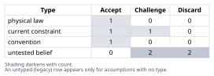
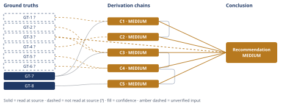

# Wind Turbine HSS Bearing Root-Cause Verification

*First-principles analysis · 10 October 2026*

*Read with: [How to read this analysis](HOW-TO-READ.md) · [Working file](analysis-20261010T065133Z.md) · [All files](INDEX.md)*

## Executive Summary

**Recommendation:** Do not authorize a like-for-like bearing replacement on a lubricant-change
basis alone (chain C5). Run confirmatory electrical and metallurgical diagnostics first, then
specify the replacement bearing and mitigation package based on what they show, prioritizing
electrical bearing-current mitigation as the leading hypothesis (chain C4).

**Band (from §6):** MEDIUM — every contributing chain (C1-C5) is itself rated MEDIUM, and the
Conclusion also rests directly on an unread hydrogen-embrittlement rival (GT-3?) (chains C1, C2,
C3, C4, C5).

**Would change it:** Direct shaft-voltage/current measurement at the HSS bearing and SEM/EDS of
the retrieved race for EDM-characteristic crater morphology (chain C4); absent those, the
operator's viscosity hypothesis is still refuted by the subsurface-origin morphology (chains C1,
C2), but the choice between electrical current and lubricant tribochemistry as primary accelerant
remains open (chain C4).

## 1. Problem Essence

**Core question:** Is lubricant-viscosity-driven boundary lubrication the actual root cause of
this HSS generator-end bearing's failure at ~1/9th of design life, or does the physical evidence
point to a different, more probable mechanism — and what does the answer change about the
replacement bearing specification and mitigation plan?

**Success criteria for a correct answer:**
- Confirms, partially confirms, or refutes the lubricant-viscosity hypothesis using the physical
  mechanics of how each candidate mechanism actually damages a race (not analogy).
- Names the most probable actual root cause with an explicit evidentiary chain back to the
  disassembly findings.
- Is grounded in current failure-analysis literature on WEC/butterflies and electrical bearing
  currents, not speculation alone.
- States what changes in the replacement/mitigation spec as a result, and what would be left
  unaddressed if only the lubricant hypothesis were acted on.
- States confidence level and what would overturn the conclusion.

**Technique-selection note:** "Root cause" is used throughout the prompt as ordinary
failure-analysis vocabulary, not as a request to run a standalone Five-Whys drill in isolation.
This is a multi-faceted request (mechanism comparison, hypothesis test, literature grounding,
practical spec implications), so the full holistic procedure (Phases 1-5) was run rather than a
single focused technique; Five-Whys-style irreducibility checks are embedded in Phase 3.

## 2. Assumptions Table



| # | Assumption | Type | Treatment | Verdict |
|---|---|---|---|---|
| A1 | "Cold-snap viscosity drop → boundary lubrication wear-through" is the mechanism | untested belief (operator's hypothesis) | Test against known damage morphology of boundary-lubrication failure vs. the observed morphology | **Refuted** as the standalone mechanism (see C2) |
| A2 | Lundberg-Palmgren subsurface fatigue theory applies to this bearing class | physical law / established theory | Accept as ground-truth candidate | Accepted → GT-1 |
| A3 | Turbine uses a PWM variable-speed converter (DFIG or full-scale) generating common-mode voltage on the shaft | current constraint (true for the overwhelming majority of 1.5 MW geared platforms) but **not explicitly stated** in the given data | Flag for operator confirmation of generator/converter topology | Unverified — needs confirmation |
| A4 | No functioning electrical bearing-current mitigation (grounding brush, shaft grounding ring, insulated/hybrid bearing) is present, or it has degraded | untested belief | Verify against as-built/maintenance records | Unverified — but consistent with the documented industry pattern of exactly this failure mode in unmitigated HSS stages |
| A5 | Vibration kurtosis step-change reliably indicates a discrete, localized defect (crack/spall nucleation) rather than distributed wear | convention of condition-monitoring practice | Challenge: kurtosis (4th statistical moment) is specifically sensitive to impulsive, localized events, not broadband gradual wear | Accepted — consistent with a crack/spall signature, inconsistent with gradual abrasive wear onset |
| A6 | Oil was sampled/analyzed and showed low viscosity or additive depletion at time of failure | untested belief | Flag: **no lubricant condition data was supplied** — the hypothesis rests only on "a cold snap occurred," not on a measured lubricant state | Unverified — evidentiary gap in the operator's own hypothesis |
| A7 | An 18 mm axial spall band with 0.4 mm-deep subsurface crescent cracking could be produced by a single short-duration (hours-to-days) cold-snap event | untested belief | Apply cumulative-fatigue-cycle reasoning (RCF requires millions of load cycles to nucleate and grow a crack network this large) | **Refuted** — mechanically requires a damage input acting repeatedly over a large fraction of the 14,000 hours, not a brief transient |
| A8 | If the electrical-current mechanism is confirmed, a like-for-like replacement bearing without mitigation will reproduce the same truncated life | current constraint, high confidence given A3/A4 if true | Carried forward as a second-order consequence (C5) | Accepted conditionally |

## 3. Ground Truths

Provenance note: GT-1 is established engineering theory held at high confidence, but its
depth band was not recomputed from this bearing's exact dimensions (roller diameter/race
curvature were not supplied in the case data) and no specific primary source for it was opened
this session, so it carries the `?` suffix alongside GT-2 through GT-6, which are grounded in
literature located via WebSearch this session;
the search tool's summaries of the underlying papers/industry sources were read, not the primary
documents themselves — these are **reported-by-delegate**, not **read-at-source**, and each
carries the `?` provenance suffix. GT-7/GT-8 are the case data as given, treated as given facts
(not independently re-verified).

- **GT-1?** (physical law / established theory, order-of-magnitude, not geometry-verified): Under
  Lundberg-Palmgren rolling-contact-fatigue theory, subsurface-initiated spalling originates at
  the depth of maximum reversing orthogonal shear stress beneath the Hertzian contact, typically
  on the order of z0 ~ 0.4-0.75x the contact semi-width below the surface — for MW-class
  HSS-stage cylindrical roller bearings this places the theoretical origin in roughly the
  0.2-0.5 mm band. Not read at a specific primary source this session — not read — turn budget;
  carried as domain-standard theory.
- **GT-2?**: Recent metallurgical sectioning studies of failed wind-turbine gearbox bearings
  (Dai & Long, *Wear*, 2025, per search summary) find butterfly-wing cracks initiating at
  damaged non-metallic inclusions to be the originating subsurface damage mechanism that can
  seed subsequent WEC formation. Source: "Serial sectioning investigation of butterfly and white
  etching crack (WEC) formation in wind turbine gearbox bearings" (core.ac.uk/works/74259374).
  Phase 3 failure record: search summary only, primary paper not opened this session — reason:
  not read — turn budget.
- **GT-3?**: Current literature treats WEC formation as having several competing/complementary
  candidate mechanisms — frictional/micro-slip energy input and adiabatic shear, hydrogen
  embrittlement from tribochemical decomposition of lubricant/water at nascent crack surfaces or
  high-slip zones, electrostatic discharge/electrical current damage, impact loading, and
  corrosion fatigue — with none definitively proven as the sole universal cause. Sources:
  Imperial College Spiral repository study on WEC origins; Springer Tribology Letters
  10.1007/s11249-017-0947-0. Phase 3 failure record: search summaries only, primary papers not
  opened this session — reason: not read — turn budget.
- **GT-4?**: Boundary-lubrication film breakdown characteristically produces surface-initiated
  damage — adhesive wear, abrasive wear, scuffing, and micropitting (roughness-scale, shallow
  surface/near-surface pits) — mechanistically distinct from deep subsurface-origin classical
  RCF spalling. Source: search summary of tribology literature on boundary lubrication wear
  modes. Phase 3 failure record: primary sources not opened this session — reason: not read —
  turn budget.
- **GT-5?**: In variable-speed geared wind turbines with PWM power-electronic converters,
  high-frequency common-mode voltage capacitively couples onto the generator/rotor shaft,
  inducing shaft voltages/currents (documented up to ~60A / ~1,200V or greater) that, absent
  adequate grounding, discharge through the nearest rotating bearings via electrical discharge
  machining (EDM), producing pitting, fluting, and WEC-type subsurface damage in metallurgical
  section. Sources: US Patent 11539317B2; AEGIS shaft-grounding technical blog. Phase 3 failure
  record: patent/industry summaries only, not independently cross-checked against a peer-reviewed
  primary source this session — reason: not read — turn budget.
- **GT-6?**: HSS gearbox bearings in geared wind turbines are repeatedly documented failing well
  before L10 life (cases as short as 6-24 months) due to unaccounted-for electrical currents from
  converter common-mode voltage; best-practice mitigation in the literature combines a grounding
  brush (DC/low-frequency path), a shaft grounding ring (high-frequency path), and in some designs
  a hybrid/insulated bearing — two insulated bearings alone are explicitly noted as insufficient,
  since blocked current still seeks a path through the gearbox. Sources: Renewable Energy World
  (Oregon wind farm case); nacleanenergy.com shaft grounding ring article. Phase 3 failure record:
  trade-press summaries, not a peer-reviewed primary source — reason: not read — turn budget.
- **GT-7** (case data, given): Axial-aligned ~18 mm spall; crescent subsurface microcracks
  originating ~0.4 mm below the surface; WECs and butterflies confirmed metallurgically; life
  ~14,000 hrs vs. L10 ~130,000 hrs (~9-10x below design); failure flagged by a step-change (not
  gradual rise) in vibration kurtosis.
- **GT-8** (case data, given): Generator-end HSS bearing is a cylindrical roller bearing — radial
  load only, no thrust capacity — and is, topologically, the rotating bearing electrically closest
  to the generator/converter in a geared drivetrain.

`?`-marked: GT-1, GT-2, GT-3, GT-4, GT-5, GT-6 (6 of 8). None of the `?`-marked ground truths
were read at their primary source this session (all "not read — turn budget"); this is disclosed
here and reflected in the confidence bands in section 4.

## 4. Derivation Chains



### Conclusion C1: The failure is subsurface-origin rolling-contact fatigue, not surface wear

```text
GT-1? (L-P subsurface origin band ~0.2-0.5mm) + GT-7 (observed origin 0.4mm, crescent subsurface cracks)
→ the observed crack origin depth and crescent subsurface morphology fall inside the classical Lundberg-Palmgren subsurface-initiation band for this bearing class
→ this is a subsurface-origin rolling-contact-fatigue-type failure, not a surface-wear-dominated failure
```

**Confidence:** MEDIUM — GT-1? is an order-of-magnitude theoretical check with no specific primary source opened this session, not a geometry-verified calculation (no bearing dimensions were supplied); the verification that would remove it as a cause of the downgrade is a precise Lundberg-Palmgren calculation from this bearing's actual roller/race geometry, read from a primary rolling-bearing-analysis reference, which would tighten this chain to HIGH or reveal a mismatch.

### Conclusion C2: The operator's viscosity-driven boundary-lubrication mechanism does not explain the observed morphology

```text
GT-4? (boundary lubrication causes surface-initiated damage) + C1 (MEDIUM)
→ a viscosity-collapse boundary-lubrication mechanism predicts shallow roughness-scale surface distress such as scuffing, micropitting, or adhesive and abrasive scoring, not a 0.4mm-deep subsurface crescent crack network
→ the disassembly report records none of those surface-distress signatures, only subsurface WEC and butterflies
→ the operator's cold-snap viscosity-drop mechanism, taken alone, does not explain the observed damage morphology
```

**Confidence:** MEDIUM — GT-4 is delegate-sourced from a search summary rather than a primary tribology text reopened this session, though it restates uncontroversial, well-established tribology; the verification that would remove it as a cause of the downgrade is a direct reread of a primary rolling-bearing failure-mode reference (e.g. Harris, *Rolling Bearing Analysis*, or ISO 15243) confirming the surface-vs-subsurface distinction as stated; this chain is also capped at C1's MEDIUM rating per the head-citation ceiling rule.

### Conclusion C3: A repeatedly-acting accelerant beyond baseline fatigue is required

```text
GT-2? (butterflies form at subsurface inclusions) + GT-3? (WEC has multiple candidate accelerant mechanisms) + GT-7 (butterflies and WEC co-present)
→ the co-occurrence of butterflies with WEC indicates a two-stage process: classical RCF-seeded subsurface shear damage accelerated into WEC by an additional energetic input beyond ordinary load cycling
→ growing WEC networks into an 18mm axial-aligned spall band requires that additional input to act repeatedly across a large fraction of the service life, not as a one-off transient
→ a continuously or repeatedly acting accelerant beyond baseline rolling-contact fatigue is required to explain both the WEC presence and the roughly ninefold life reduction
```

**Confidence:** MEDIUM — GT-2 and GT-3 are both delegate-sourced search summaries rather than primary-source reads; the verification that would remove them as a cause of the downgrade is opening and reading the underlying *Wear* (2025) and *Tribology Letters* papers directly; the logical step from "WEC and butterflies co-present" to "a repeated, not transient, accelerant is required" is sound irrespective of which specific accelerant turns out to be correct.

### Conclusion C4: Electrical bearing current is the most probable primary accelerant

```text
GT-5? (common-mode voltage drives EDM through bearings) + GT-6? (generator-end HSS is the preferential discharge point) + C3 (MEDIUM)
→ electrical bearing current acts on every voltage and current cycle, i.e. continuously and repeatedly across the 14,000 operating hours, satisfying the repeated-action requirement from C3
→ it specifically targets this component's location, the generator-end HSS, and is independently documented to produce WEC-type subsurface damage with axial-aligned pitting and fluting bands
→ electrical bearing current and EDM-type damage at the generator-end HSS bearing is the most probable primary accelerant, more probable than a transient lubricant-viscosity event, given both location and failure signature [Assumes: A3, A4]
```

**Confidence:** MEDIUM — GT-5 and GT-6 are delegate-sourced from patent and trade-press summaries, not a peer-reviewed primary source read this session; the verification that would remove them as a cause of the downgrade is direct shaft-voltage/current measurement at this bearing plus SEM inspection of the retrieved race for EDM-characteristic melt-and-resolidify craters. This chain rests on premises A3 (the converter topology generates significant common-mode shaft voltage) and A4 (an electrical-current mitigation gap exists) via the `[Assumes: A3, A4]` annotation on its last hop; neither premise's failure is priced here — if A3 is false (this turbine's topology produces negligible common-mode shaft voltage), this chain's conclusion fails and the rival named below becomes the leading explanation instead. This chain is also capped at C3's MEDIUM rating per the head-citation ceiling rule. Live rival not ruled out: hydrogen embrittlement driven by ordinary lubricant tribochemistry (GT-3), independent of or complementary to electrical current — nothing in the given disassembly data discriminates between them yet (see section 5, "Not abandoned — kept as a live rival").

### Conclusion C5: Replacement authorization must include electrical mitigation, not a lubricant change alone

```text
C4 (MEDIUM) + GT-8 (unmitigated current path discharges through the nearest bearing)
→[2nd] if the mitigation gap that allowed this is not corrected, the same current path remains available to any replacement bearing of the same specification
→[2nd] a like-for-like bearing swap with only a lubricant-grade change removes a mechanism that was not the primary driver while leaving the actual driver fully active
→[3rd] the predictable outcome, if only the lubricant hypothesis is acted on, is recurrence of the same WEC/butterfly signature at a similar truncated life, now compounded by a false sense that the problem was already fixed [Assumes: A8]
→ the replacement bearing authorization must include electrical-current mitigation and confirmatory diagnostics as a precondition, not merely a lubricant specification change
```

**Confidence:** MEDIUM — this chain's second-order logic follows almost mechanically once C4 holds (premise A8, `[Assumes: A8]`, is priced: if an unmitigated current path exists it will act on any same-spec replacement regardless of lubricant grade, which is the chain's own point), but the chain is capped at MEDIUM because it is rated no higher than the lowest-rated chain its head cites (C4, MEDIUM), per the head-citation ceiling rule; the downgrade cause belonging to C4 (A3/A4 unpriced, per C4's own confidence line) is what would need to close to raise this chain.

**Actor lens:** the maintenance/reliability team, told only "lubricant failure," will plausibly switch to a winter-grade/lower-pour-point oil and close the finding — a cheap, visible action that feels corrective. The OEM/gearbox supplier, if only told "lubricant," has no reason to re-examine the drivetrain's electrical grounding design, and a competing turbine in the same fleet with the same unmitigated current path continues accruing the same damage unnoticed.

**Time lens:** immediately, the turbine returns to service looking "fixed"; within roughly one failure cycle (order of 1-2 years, matching the 14,000-hour pattern), the same CMS kurtosis signature would plausibly reappear if the actual driver is electrical; across a fleet of similar turbines, this becomes a recurring, under-diagnosed HSS bearing replacement cost rather than a one-off event. No extension step here contradicts a Ground Truth.

## 5. Abandoned Reasoning

- **Tried:** Pure abrasive/adhesive wear from boundary lubrication as the sole, complete
  explanation. **Abandoned because:** the damage signature (0.4 mm-deep subsurface crescent
  cracks, WEC, butterflies) is a subsurface fatigue/accelerated-fatigue signature, not the surface
  scoring/scuffing/micropitting signature boundary-lubrication wear characteristically produces
  (GT-4, chain C2). **What it ruled out:** the operator's hypothesis as a *standalone, sufficient*
  mechanism (rules out A1 as sufficient on its own).
- **Tried:** Debris-denting/impact loading as the originator of the butterflies/WEC.
  **Abandoned because:** no debris denting, particle contamination, or impact indentation was
  reported in the disassembly findings — there is no positive evidence for it, only its absence
  from the stated data. Not ruled out with certainty (it is an evidentiary gap, not a disproof),
  but it does not currently compete with the electrical-current explanation given what location
  and literature pattern favor (does not rule out any numbered chain; recorded for completeness).
- **Not abandoned — kept as a live rival:** Hydrogen embrittlement driven by ordinary lubricant
  tribochemistry (additive/water decomposition at micro-slip zones), independent of or
  complementary to electrical current. This remains genuinely competing in the literature (GT-3)
  and is not settled by the given data (ruled out by neither GT-N nor Cn). This is why the
  verdict in section 6 is "refuted" for the operator's *specific* viscosity-wear claim, but only
  "primary cause is probably something else, with lubricant chemistry as a possible
  contributing/complementary factor" rather than a clean, total exoneration of lubricant.

## 6. Conclusion

**Operator hypothesis verdict:** REFUTED as stated — lubricant viscosity is not the primary
driver, though lubricant condition cannot be fully exonerated as a possible contributing factor
(chains C2, C3, C4).

**Recommended approach:** Do not authorize a like-for-like bearing replacement on a
lubricant-change basis alone (chain C5). First run the confirmatory diagnostics below; then
specify the replacement bearing and mitigation package based on what they show, prioritizing
electrical bearing-current mitigation as the leading hypothesis (chain C4).

**Key insight:** The disassembly morphology (0.4 mm subsurface crescent cracks, WEC, butterflies,
no reported surface-wear distress) matches a subsurface-origin, accelerated rolling-contact-fatigue
signature far better than it matches a boundary-lubrication wear signature (chains C1, C2) — and
the component's location (generator-end HSS, electrically nearest to the converter) plus the
roughly ninefold life reduction and the requirement for a repeated, not transient, accelerant
point toward electrical bearing current as the most probable primary driver (chains C3, C4), with
lubricant tribochemistry as an unresolved, plausible secondary/complementary contributor rather
than the primary cause.

**Trade-offs acknowledged:** This conclusion is built substantially on literature located via
search-summary review rather than primary-source reads (GT-1 through GT-6 all carry `?`), and on
an unconfirmed assumption about this specific turbine's converter topology and mitigation state
(chain C4). No direct electrical measurement or oil analysis was present in the given data — both
diagnostics would materially sharpen or overturn this conclusion (chain C4).

?-marked: GT-3 · lowest cited: MEDIUM · Inputs ceiling: MEDIUM

**Confidence:** MEDIUM — every contributing chain (C1 through C5) is itself rated MEDIUM, so the
Conclusion's rating equals its weakest contributing chains rather than any one of them alone; in
addition, the Conclusion rests directly on GT-3? (the hydrogen-embrittlement rival mechanism),
whose downgrade is removed only by opening and reading the underlying WEC-mechanism literature
directly rather than relying on this session's search summaries. C1's and C2's downgrade cause
(an order-of-magnitude rather than geometry-verified depth check, and a delegate-sourced tribology
ground truth) is removed by the verification named on each chain's own confidence line; C4's
downgrade cause (unpriced premises A3/A4, and GT-5?/GT-6? delegate sourcing) is removed by direct
shaft-current measurement and SEM/EDS of the race, as named on C4's own confidence line; C5
inherits C4's cause and is removed the same way. No chain here consumes a `GT-N?` input while
being rated HIGH, and each chain is rated no higher than the lowest-rated chain its own head cites.

### Practical implications for the replacement/authorization decision

**What the operator's hypothesis alone would lead to (and why that's insufficient):** switching
to a lower-pour-point/winter-grade lubricant and reinstalling a same-spec bearing. This treats a
symptom-adjacent variable (cold-weather viscosity) that the morphology does not support as the
operative mechanism (chain C2), leaves the probable actual accelerant (electrical bearing
current) fully active (chain C5), and — per the actor/time-lens second-order analysis in chain
C5 — predicts a recurrence of the same failure signature on a similar timescale, now with a
false "already fixed" status delaying correct root-cause attribution.

**What should actually happen before finalizing the spec:**
1. Confirm converter/generator topology (DFIG partial-scale vs. full-scale converter) and the
   as-built electrical bearing-current mitigation design for this turbine model (chain C4).
2. Inspect/test the existing grounding brush and any shaft grounding ring or insulated/hybrid
   bearing for continuity and wear — degraded grounding hardware is the single most common
   enabling condition for this failure pattern in the literature (chain C4).
3. Direct shaft voltage/current measurement (capacitive probe or permanent shaft-voltage
   monitor) to confirm presence and magnitude of common-mode-driven discharge at the HSS, before
   finalizing mitigation scope — this is the verification C4's own confidence line names as what
   would remove its downgrade cause (chain C4).
4. SEM/EDS of the retrieved race specifically for EDM-characteristic crater/melt-and-resolidify
   morphology versus pure mechanical fatigue striations — the other verification C4's confidence
   line names (chain C4).
5. Oil analysis (viscosity at operating temperature, water content, acid number/additive
   depletion, ferrography) to characterize actual lubricant condition and assess the
   tribochemical hydrogen-embrittlement rival independently of the electrical question (chain C3).
6. If electrical current is confirmed: specify the documented best-practice combination —
   grounding brush (DC/low-frequency path) and a shaft grounding ring (high-frequency path),
   since literature explicitly notes insulated bearings alone are not a complete solution for
   this current path — rather than a bearing-material change alone (chain C5).
7. Regardless of the electrical finding: consider re-evaluating the gear oil's EP/anti-wear
   additive package for hydrogen-generation tendency, as a complementary action addressing the
   live rival, not a substitute for item 6 if electrical current is confirmed active (chain C3).
8. Monitoring: add high-frequency shaft voltage/current logging to the CMS, and retain/tighten
   the kurtosis-based alarm threshold that successfully flagged this failure early, so the
   mitigation chosen does not weaken the one leading indicator that already worked (chain C5).
