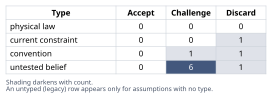
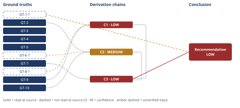

# Should You Split an Over-Budget Agent File

*First-principles analysis · 9 October 2026*

*Read with: [How to read this analysis](HOW-TO-READ.md) · [Working file](analysis-20261009T214503Z.md) · [All files](INDEX.md)*

## Executive Summary

**Recommendation:** Do not reflexively split the file. First verify what the ~500-line budget actually bounds and whether this deployment genuinely loads reference files only on demand; then trim duplicated/verbose content and densify prose immediately, since both pay off regardless of that verification; recalibrate the CI budget around an explicitly-scoped "always-loaded core"; and lazy-load only the genuinely conditional companion-tool procedures once on-demand loading is confirmed for this deployment (chain C3).

**Band (from §6):** LOW.

**Would change it:** Locating the commit/PR/design note that set the original budget; confirming, for this deployment, whether a reference file is read only when triggered rather than eagerly; and measuring the actual file's real token count and duplication directly instead of via an analogous precedent (chain C3).

## 1. Problem Essence

**Core problem:** Given a Claude Code agent file that now exceeds its own CI-enforced size budget by roughly 75% (878 lines against a recorded ~500-line / ~5,000-token ceiling) by inlining a core methodology, six companion-tool procedures, an output template, and a validation rubric, what intervention correctly addresses the real constraint the budget exists to protect — rather than whichever intervention merely makes the automated gate pass again.

**Success criteria:**
- Names the real constraint the budget is a proxy for, tested against at least one rival hypothesis rather than assumed from the obvious reading.
- States precisely when splitting the file into reference files does, and does not, reduce that real constraint — explicitly conditioned on the single fact the analysis cannot independently confirm (whether the file's deployment mechanism genuinely loads referenced content only on demand, or always loads everything regardless of file boundaries).
- Enumerates the plausible alternative interventions (trim redundancy, raise the budget, restructure density, lazy-load, accept-and-recalibrate the gate, and any viable combination of these) and scores them against the actual constraint identified above, not against "does the gate turn green."
- Delivers one concrete recommendation together with the specific verification step(s) that would resolve the critical open fact before committing engineering effort to the most expensive component of that recommendation.
- Does not require the answer to be exactly "split the file" or exactly "do not split the file" — a composite drawn from several of the candidate interventions is explicitly permitted if the evidence supports it, per the trade-off procedure's composite-option requirement.

---

## 2. Assumptions Table

| Assumption | Type | Treatment | Verdict | Verification |
|------------|------|-----------|---------|--------------|
| A1: The ~500-line/~5,000-token budget's primary intent is to bound per-invocation token/context cost. | convention | Explicitly challenge against rival hypotheses (human reviewability, PR-diff size, a generic anti-scope-creep tripwire). | Challenge — plausible, favored by the dual-unit framing (see GT-8/GT-9), but the human-reviewability rival is not refuted by any evidence available this session. | Unverified — no CI config or commit history for the actual gate was available; recommend locating the commit/PR/design note that introduced it. |
| A2: The six companion-tool procedures, the output template, and the validation rubric are all equally necessary on every invocation. | untested belief | Verify against the methodology's own stated access rules. | Discard — contradicted directly by GT-7: companion procedures are gated by explicit conditional triggers, while the template and rubric are opened unconditionally once per run. | Verified — read-at-source, the governing methodology text itself (GT-7). |
| A3: Splitting the file into separate reference files, by itself, reduces real per-invocation token cost. | untested belief | Verify conditional on loading mechanics, not assume. | Challenge — true only if the dispatched content can skip opening files it does not need, and nothing upstream eagerly concatenates every linked file regardless of trigger; neither condition is confirmed for the user's file. | Unverified (GT-1?); partially informed by GT-2/GT-6/GT-10 from an analogous, directly-inspected system (see chain C2). |
| A4: A Claude Code subagent dispatched via the Task tool cannot reliably issue a Read call against a sibling file in its own plugin's installed directory at invocation time. | current constraint (candidate) | Challenge against general product behavior (GT-6). | Discard — as a blanket claim, GT-6 holds that dispatched subagents generally retain the invoking session's tool access, including Read. A narrower, unrefuted version survives: whether the sibling files are guaranteed *present on disk* at the expected path in every installation of the plugin is a packaging question, independent of read-capability, and was not resolved this session. | Unverified (narrower form only) — flagged as the operative open question for Phase 4 (chain C2). |
| A5: The analogous precedent's own choice to fully inline its companion-tool content (GT-2) reflects a deliberate, principled packaging decision rather than accumulated duplication/drift. | untested belief | Verify against available documentation (design notes, commit messages). | Challenge — could not be confirmed either way; no ADR or commit message explaining the choice was found. Both explanations remain live. | Unverified — explicitly flagged rather than resolved by picking the more flattering reading. |
| A6: A meaningful share of the user's 878 lines is removable redundancy or verbosity rather than irreducible core content. | untested belief | Estimate against the analogous precedent's measured proportions (estimate procedure). | Challenge — partially supported: in the precedent, duplicated companion-procedure text alone is ~519 of 1,378 lines (~38%) of that file; this is an anchor from an analogous system's proportions, not a measurement of the user's actual file. | Unverified for the user's file (GT-1?; no file available to measure directly). |
| A7: A reviewed, explicit increase to the budget is inherently illegitimate, because "under budget" should always be treated as correct. | convention | Explicitly challenge (per the brief's own instruction not to assume this). | Discard — as a general claim, GT-9 shows that in at least one real, analogous system, the always-loaded template-plus-rubric content alone already costs more than double a 500-line ceiling with zero companion-tool content counted; a budget can simply have been miscalibrated from the outset, independent of any later scope creep. | Verified — read-at-source combination of GT-5 and GT-9; a reviewed recalibration is a legitimate partial fix provided it is deliberately scoped (see pre-mortem Cluster C). |
| A8: The methodology's own trigger-phrase/condition detection for when to open a given companion-tool procedure is reliably correct in practice. | untested belief | Verify via an automated trigger-coverage test before shipping any lazy-load component. | Challenge — unverified; this is the condition under which lazy-loading could silently degrade analysis quality with no CI signal. | Unverified — surfaced during the Phase 4 Assumption Audit; see `[Assumes: A8]` on chain C4. |
| A9: An automated textual-duplication check (comparing companion-procedure step text between a resident core and its reference-file counterpart) is feasible to build and maintain. | untested belief | Verify by prototyping a simple normalized-text diff/hash check. | Challenge — plausible, not attempted. | Unverified — surfaced during the Phase 4 Assumption Audit; see `[Assumes: A9]` on chain C4. |
| A10: Findings from the directly-inspected analogous plugin (GT-2, GT-3, GT-4, GT-5, GT-10) generalize to the user's own, unconfirmed plugin and file. | untested belief | Accept as general-pattern corroboration only; do not treat as proof about the user's specific file. | Challenge — accepted for general architectural reasoning, explicitly rejected as a substitute for inspecting the user's actual file, CI config, and deployment mechanism. | Unverified — the user stated this file is not available this session; recommended first action before building anything (see Conclusion). |

---

## 3. Ground Truths

- **GT-1?** The subject file, as described: a single Claude Code agent markdown file inlines a core methodology body, six companion-tool procedures, an output template, and a validation rubric; it now measures 878 lines against a recorded ~500-line/~5,000-token CI-enforced budget (≈75% overage). — unverified: this is the task-giver's own stipulated description of their file; the file, its CI config, and its commit history were explicitly stated as unavailable this session and were not independently opened.
- **GT-2** A structurally analogous, directly-inspectable Claude Code "first-principles" plugin exists on this machine's filesystem (not confirmed to be the user's own plugin). Its Task-dispatched agent file (`agents/first-principles.md`) is 1,378 lines and inlines, in two separate places, content for the same family of companion techniques (eight named there — five-whys in two modes, fishbone, inversion, pre-mortem, trade-off, second-order, estimate, theoretical-limit — a different count from the user's stated six, noted explicitly rather than conflated): a short index of one-paragraph pointer descriptions (~76 lines, lines 760–836) naming separate reference files, **and**, in the same document, the full step-by-step procedure text for those same eight techniques (~519 lines, lines 859–1378). — source: direct `wc -l`, `grep -n`, and `Read` of `agents/first-principles.md` and `references/*.md` in this session; read-at-source.
- **GT-3** The same plugin separately maintains eleven modular `skills/*/SKILL.md` files (70–317 lines each) that do not inline the companion-tool procedures, output template, or validation rubric; a top-level launcher skill (`skills/first-principles-analysis/SKILL.md`, 70 lines) explicitly dispatches the full analysis to the Task-tool agent rather than performing it inline. — source: direct `wc -l` and `Read` of `skills/first-principles-analysis/SKILL.md` and the `skills/` directory listing; read-at-source.
- **GT-4** Both packagings (the fully-inlined agent file and the split skill files) carry `<!-- GENERATED — DO NOT EDIT -->`-style headers naming one build step (`scripts/sync-content.py --write`) and common source fragments under a `shared/` directory — i.e. they are two generated outputs of one maintained source, not two independently hand-maintained forks. — source: direct `Read` of `references/pre-mortem.md` line 1 and `skills/first-principles-analysis/SKILL.md` line 9; read-at-source.
- **GT-5** In this same plugin, `references/output-template.md` is 551 lines and `references/validation-rubric.md` is 611 lines (1,162 lines combined). Both files document themselves as the on-demand, full-detail counterpart to a condensed skeleton/loop-instruction that stays resident in the main body on both surfaces ("`SKILL.md` on the skill surface, `agents/first-principles.md` on the agent surface"): output-template.md states a "condensed skeleton showing just the required section names and chain format lives resident in the agent body... Come here for the complete instructions"; validation-rubric.md calls itself "the Layer-3 scoring instrument read on demand by the validator-fix-repeat loop already resident in `SKILL.md`." — source: direct `wc -l` and `Read` of both files (lines 5–8 of output-template.md; lines 2–9 of validation-rubric.md); read-at-source.
- **GT-6?** Claude Code subagents dispatched via the Task tool generally retain the same tool access as the invoking session, including the Read tool against the filesystem — i.e. a dispatched subagent is not categorically prevented from issuing a Read call against a sibling file in its own plugin's installed directory. — unverified: general product knowledge; no current Claude Code documentation was opened as a source this session to confirm this for the present product version.
- **GT-7** Within the methodology instructions governing this very analysis, each of the eight companion-tool procedures is gated by an explicit conditional trigger ("when the assumption space feels too broad," "when two or more viable options survive," etc.), while the output template and the validation rubric are each opened exactly once per run, unconditionally — the two categories of inlined content have different, explicitly stated access patterns by design. — source: direct reading of this analysis's own governing instructions; read-at-source.
- **GT-8?** A line of markdown text does not correspond to a fixed number of tokens; token density varies with content type (dense prose vs. tables vs. terse bullets vs. code), so a budget stated as both a line ceiling and a token ceiling together measures two different things that drift apart as content density changes. — unverified: this is a general, in-principle-measurable property of tokenization; it was not demonstrated by actually running a tokenizer over comparable text in this session, so it is flagged rather than asserted as confirmed.
- **GT-9** Arithmetic on GT-5: in the analogous precedent, the output template plus validation rubric alone (1,162 lines) already exceed a 500-line ceiling by more than 2×, with zero companion-tool content counted at all — i.e., in at least one real system of this kind, a ~500-line ceiling is difficult to meet from always-loaded template-plus-rubric content alone, before any companion-tool procedure is added. — derived directly from GT-5 by arithmetic; no independent `?` needed beyond GT-5's own standing.
- **GT-10** The same two reference files each explicitly describe the pattern their own project uses for "always-needed" content: not "inline the long version" and not "split with nothing resident," but a third pattern — keep a short skeleton or loop-instruction resident in the main body, and defer only the long, fully-annotated detail to a separate file opened on demand. — source: direct `Read` of `references/output-template.md` lines 5–8 and `references/validation-rubric.md` lines 2–9; read-at-source.

**Provenance summary:** `?`-marked: GT-1, GT-6, GT-8 (3 of 10).
Read-at-source: GT-2 — `agents/first-principles.md` lines 760–1378 (companion-tool index and full procedures) and `references/*.md` file listing.
Read-at-source: GT-3 — `skills/first-principles-analysis/SKILL.md` lines 1–70 and `skills/` directory listing.
Read-at-source: GT-4 — `references/pre-mortem.md` line 1; `skills/first-principles-analysis/SKILL.md` line 9.
Read-at-source: GT-5 — `references/output-template.md` lines 5–8 (551 lines total); `references/validation-rubric.md` lines 2–9 (611 lines total).
Read-at-source: GT-7 — this analysis's own governing methodology instructions (Phase 2/Phase 4 trigger language; "Before presenting conclusions" open-once language).
Read-at-source: GT-9 — arithmetic on GT-5's measured figures.
Read-at-source: GT-10 — `references/output-template.md` lines 5–8; `references/validation-rubric.md` lines 2–9.

---

## 4. Derivation Chains

### Conclusion C1: The ~500-line/~5,000-token budget is most plausibly a proxy for per-invocation token/context cost, with human-reviewability as an unrefuted secondary candidate

GT-8? (lines and tokens are not a fixed ratio) + GT-9 (precedent's template+rubric alone cost 1,162 lines, over 2× a 500-line ceiling, with no companion-tool content counted)
→ a budget stated as both a line ceiling and a token ceiling together is most simply read as using the cheap-to-compute line count as a stand-in for the token count the author actually wants bounded
→ in at least one real system built for the same kind of methodology, the always-loaded template-plus-rubric content alone already costs more than double a 500-line ceiling, which is evidence worth checking the original budget against rather than assuming it was ever benchmarked against the content it is meant to bound
→ the best-supported reading of the ~500-line/~5,000-token budget is that it bounds per-invocation context/token cost specifically, though a human-reviewability motive remains a live, unrefuted secondary or alternative candidate

**Confidence:** LOW — two axes are short at once. Inputs: GT-8? (general tokenizer-density-variance claim) is unverified; verification = run an actual tokenizer over representative prose/table samples to confirm density variance, which would remove it as a cause of the downgrade. Rivals: the human-reviewability hypothesis (A1) is not refuted by any evidence available this session; verification = locate the commit/PR/design note that introduced the original budget and read its stated rationale.

### Conclusion C2: Splitting the file's content into on-demand reference files reduces real per-invocation cost only if on-demand loading is actually enforced for this specific deployment — not merely by moving text across a file boundary

GT-6? (dispatched subagents generally retain Read access) + GT-2 (precedent duplicates companion-tool content despite having split reference files available) + GT-10 (precedent's actual chosen pattern for always-needed content: resident skeleton plus on-demand full detail)
→ the capability needed for on-demand loading to work, per GT-6?, is generally available to a Task-dispatched agent, so a lack of Read capability is not by itself a decisive reason to keep everything inlined
→ GT-2 shows that even where that capability exists, this codebase family ended up with its companion-tool content fully duplicated inline anyway rather than purely split, so capability alone does not predict outcome
→ GT-10 shows a third, already-working pattern in this same codebase family for always-needed content — a short resident skeleton with only the long annotated detail deferred — rather than a binary choice between fully inline and fully split
→ whether splitting the user's six companion-tool procedures reduces real per-invocation cost depends on which of these three patterns is actually enforced and kept enforced after the change, which is a fact about process and deployment mechanism, not about where the text physically lives today

**Confidence:** MEDIUM — Inputs axis is short: GT-6? (general claim that Task-dispatched subagents retain Read access) is unverified against current Claude Code documentation for this product version; verification = check current Claude Code subagent/Task-tool documentation, or dispatch a test subagent whose instructions conditionally Read a sibling file and confirm the call succeeds, which would remove it as a cause of the downgrade. Inference and Rivals axes are not short here: GT-2 directly rules out the naive rival that capability alone predicts outcome.

### Conclusion C3: The lower-regret intervention is a composite — lazy-load only the genuinely conditional companion-tool procedures behind an enforced resident-skeleton pattern, trim the observed duplication, restructure dense prose into tables, and recalibrate the budget around an explicitly-scoped always-loaded core

C1 (LOW, budget likely proxies token cost with an unrefuted reviewability rival) + C2 (MEDIUM, splitting's payoff depends on enforcement, not file boundaries) + GT-7 (companion procedures conditionally gated, template/rubric unconditional)
→ because the inlined 878 lines are not one uniform category — GT-7 shows the template and rubric are needed on every run while the companion-tool procedures are only sometimes needed — any scoring of candidate interventions must weight real per-invocation cost conditional on which part of the file a given run actually touches, not the line count the gate measures as a whole
→ scoring six single-pattern options (status quo, pure on-demand split, cosmetic split, trim redundancy, raise the budget, restructure density) plus a composite against six weighted criteria anchored before scoring (real-cost reduction, fidelity preservation, maintainability, implementation effort, gate-meaningfulness, round-trip latency) ranks the composite at 82-84 points in both branches of the unresolved enforcement question, beaten only by a pure on-demand split's 84, and only in the branch where enforcement is confirmed
→ the composite is the lower-regret recommendation: it wins outright (72 vs. 64) when on-demand enforcement is not confirmed, because its trim-and-density component pays off unconditionally, and trails a pure split by only a 2-point near-tie when enforcement is confirmed
→[2nd] maintainers must now track an always-loaded-vs-conditionally-loaded boundary instead of one file, and GT-2's own precedent shows this codebase family has already let exactly that boundary drift into duplicated content once, so the same drift risk recurs here unless specifically guarded *[Assumes: A9]*
→[2nd] the dispatched agent itself gains a new failure mode under genuine lazy-loading — silently skipping a companion procedure its own trigger-detection should have opened — a degradation a line-count CI gate cannot see at all *[Assumes: A8]*
→[3rd] if that silent degradation goes undetected, downstream consumers of the agent's analyses receive subtly less rigorous output on affected runs while the CI gate stays green, teaching the team that a green gate implies correctness when it no longer does
→[3rd] a reviewed, explicitly-scoped budget recalibration carried out alongside the split, rather than instead of it, remains the one component of the fix whose value does not depend on how the lazy-loading enforcement question resolves

**Confidence:** LOW — capped by C1 (LOW: GT-8? unverified, and the human-reviewability rival purpose unrefuted) per the chain-citing-a-chain ceiling rule; also informed by C2's MEDIUM (GT-6? unverified). The margin between the composite and the next-best option is itself small (a 2-point near-tie in the favorable branch), so this is not a decisive win even on its own terms. Verification = resolve C1's two shortfalls (tokenizer density-variance test; locate the budget's original rationale) and C2's GT-6? (confirm current Task-tool Read-access behavior for this deployment), any of which would allow this chain to re-rate toward MEDIUM or HIGH.

---

## 5. Abandoned Reasoning

### Dead End: Blanket claim that Task-dispatched subagents cannot Read sibling plugin files, used to argue full inlining is architecturally forced

**What was tried:** Treated the full inlining observed in the analogous precedent (GT-2) as proof that a Task-dispatched subagent lacks Read access to its own plugin's reference files, and nearly built the whole recommendation around "splitting is impossible for this kind of file."

**Why abandoned:** GT-6 (general product knowledge that dispatched subagents retain the invoking session's tool access, including Read) contradicts the blanket version of the claim, and GT-10 shows the same codebase family successfully using on-demand Read for long-form reference content from the very same agent/skill surface — a capability-blocked design could not do this.

**What it ruled out:** Saves a future reader from assuming "it is a dispatched agent file, so it must be fully self-contained" as a law rather than a to-be-verified packaging/enforcement question (chain C2).

### Dead End: Raising the CI budget alone, with no other change, as a sufficient fix

**What was tried:** Scored raising the ceiling to match or exceed 878 lines, with no accompanying trim, restructuring, or lazy-loading, as a standalone candidate.

**Why abandoned:** Scored second-to-worst of all six single-pattern options in both branches of the trade-off (59/59; see the trade-off matrix in the process-output appendix) because it banks none of the available real-cost or gate-meaningfulness improvement if token-cost-proxying is in fact the dominant real constraint (chain C1), and it recalibrates with no defined scope, which the pre-mortem below (Cluster C) shows reproduces the identical argument at the next milestone.

**What it ruled out:** Saves a future reader from treating "the gate was simply wrong, raise it and move on" as a complete answer — a scoped recalibration is a legitimate partial component of the composite (chain C3), but is not, by itself, the fix.

### Dead End: Cosmetic split — moving text into separate files without enforcing when or whether it is actually read

**What was tried:** Scored splitting the six companion-tool procedures into reference files purely to satisfy the line-count gate, without enforcing on-demand loading behavior.

**Why abandoned:** Scored worst or near-worst of all options in both branches (55/55) because it does not reduce real per-invocation cost at all while making the gate's own signal meaningless going forward — precisely the "gate turns green, real cost unchanged or worse" failure mode named in the original brief, and GT-2's precedent shows this outcome is a real, not merely hypothetical, risk even in a codebase with sophisticated generation tooling.

**What it ruled out:** Saves a future reader from treating a file-boundary change as self-evidently meaningful without checking what actually gets loaded at invocation time (chain C2).

---

## 6. Conclusion

**Recommended approach:** Do not reflexively split the file. First, close the two open questions chains C1 and C2 could not resolve this session — what the original budget actually bounds, and whether this specific deployment genuinely loads referenced content only on demand. Then execute a composite: trim the duplicated/verbose content and restructure dense prose into tables immediately, since both pay off regardless of how the open questions resolve; recalibrate the CI budget around an explicitly-scoped "always-loaded core"; and lazy-load only the companion-tool procedures that are genuinely conditional, behind an enforced resident-skeleton-plus-on-demand-detail pattern, once on-demand loading is confirmed to hold for this deployment (chain C3).

**Key insight:** The six companion-tool procedures and the output template/validation rubric are not interchangeable candidates for "split out to shrink the file." The template and rubric are used unconditionally on every invocation, so splitting them only adds a guaranteed extra round trip for zero avoided cost, while the companion procedures are genuinely conditional and are the only part of the 878 lines where on-demand loading can pay off at all (chain C3). A real, directly-inspected analogous system has already converged on exactly this asymmetric treatment for its own template and rubric, while separately drifting into duplicating its companion-tool content despite having the split files available — showing that the naive "split everything" fix both targets the wrong granularity and is not self-enforcing even when attempted (chain C2).

**Trade-offs acknowledged:** The composite costs more engineering effort than any single-pattern alternative scored, and it introduces a new, CI-invisible failure mode — the dispatched agent silently skipping a companion procedure it needed because its own trigger detection misfired — that does not exist in a fully-inlined file (chain C3). This is accepted as a named risk, mitigated by requiring an automated trigger-coverage test and a duplication lint as part of the same migration, not deferred to later (see the pre-mortem record in the process-output appendix, Clusters A and B).

**Confidence:** LOW — capped by chain C3, and by GT-1? directly: the entire analysis rests on the task-giver's own stipulated, unconfirmed description of the file (878 lines, ~500/~5,000 budget, four categories of inlined content), which was never independently opened this session. This would move to MEDIUM or HIGH by: (a) finding the commit/PR/design note that set the original budget, to settle whether it targets per-invocation token cost or human reviewability (closes C1's shortfall); (b) confirming, for the user's actual deployment mechanism, whether a reference file is only read when its own trigger condition fires, rather than eagerly (closes C2's shortfall); and (c) measuring the user's actual 878-line file directly — its real token count, and how much of it duplicates content available elsewhere — rather than reasoning from an analogous precedent's proportions (closes GT-1?'s standing gap).
