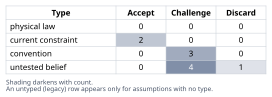
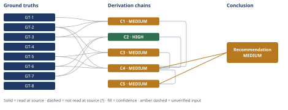

# Does Splitting the Agent File Fix the Budget Gate

*First-principles analysis · 10 October 2026*

*Read with: [How to read this analysis](HOW-TO-READ.md) · [Working file](analysis-20261010T074410Z.md) · [All files](INDEX.md)*

## Executive Summary

**Recommendation:** Treat "split the file" as conditional, not automatic. Externalize the mechanical delivery/report pipeline to a committed script (chain C4); cut the duplicated resident-plus-already-fetchable copy of three companion techniques (chain C4); and consciously recalibrate the numeric budget to current scope with a recurring review, rather than a one-time fix (chains C1, C5). Moving the output template or validation rubric further out will not help on its own, since that content is read back into context on every full-composer run regardless of where it lives (chain C2).

**Band (from §6):** MEDIUM — matches the weakest chains it rests on (C4, C5).

**Would change it:** Resolving A-8 (whether attention-degradation operates at this token scale) and A-9 (whether all eight techniques truly need a fully resident procedure) directly, rather than carrying them as scope estimates, and running the same measurements (GT-2 through GT-8) against the user's actual file rather than against this structural analog (chain C4; §6 Confidence).

## 1. Problem Essence

**Core problem:** What specific risk does the agent file's ~500-line/~5,000-token budget bound, and does moving content out of the single file into separately-loaded reference files reduce that specific risk, or only make the line-count check pass while leaving it untouched?

**Success criteria:**
- Names a specific mechanism the budget is evidenced to track (not a generic "cost/complexity" label), and distinguishes it from mechanisms the evidence does not support.
- For each mechanism named, states whether moving content to a Read-on-demand reference file changes the token/turn cost a typical invocation actually incurs, with the reasoning shown rather than assumed.
- Classifies the file's growth past its original budget into bloat / legitimate complexity / budget-miscalibration, with a stated basis for each classification, rather than asserting one label outright.
- Produces one concrete, actionable recommendation naming which specific content it applies to.

---

## 2. Assumptions Table

**Inversion applied (Phase 2 companion technique).** The claim under test is the one the "obvious reflexive move" takes for granted: *"splitting the file into separate reference files fixes the budget violation."* Inverted: *"splitting the file into separate reference files does not fix the budget violation."* Failure-guaranteeing conditions enumerated: (1) the split-out content is read back into context on every run anyway, so total per-run tokens are unchanged or higher; (2) the content moved out includes the trigger/decision logic the agent needs to decide, before reading anything else, whether a file is even relevant — removing it breaks the agent outright; (3) the gate measures only the main file's size, so "splitting" becomes gaming the metric rather than reducing the footprint it was meant to track; (4) the CI gate the user describes does not exist in the inspected codebase at all, so "fixing" it is moot. Necessary preconditions for the reflexive move to actually work: **P1** — the content being moved is not required to be resident for the agent's own decision-making (load-bearing); **P2** — the gate's intent is to cap this one file's size specifically, not the total footprint of everything it depends on (load-bearing). Condition (1) is shown true for a specific, named subset of content in chain C2 below; condition (2) is the literal full-split option ruled out in §5; condition (4) is confirmed in GT-4. These preconditions are carried into the table below as A-4 and A-9.

| Assumption | Type | Treatment | Verdict | Verification |
|---|---|---|---|---|
| A-1: This host loads an agent's entire body text into context unconditionally at invocation, with no native partial/lazy-loading of the body itself (only explicit in-run Read/Bash calls defer content). | current constraint | Record expiry: holds until the host ships conditional system-prompt loading. | Accept — expires if/when the host changes this; until then it is a platform fact, not a physical law. | read-at-source: direct observation this run (this analysis's own operating instructions arrived exactly this way). |
| A-2: The user's described CI gate (a literal ~500-line/~5,000-token automated regression check) exists as stated. | untested belief | Verify or flag. | Challenge — searched the one concrete, accessible instance of this architecture and found no such script/config (GT-4). | unverified — flagged; may exist in infrastructure outside the inspected tree. |
| A-3: Line count and token count scale together closely enough that a line-count gate is a reasonable proxy for a token-count gate. | convention | Challenge before use. | Challenge — token density varies sharply with content type (prose vs. tables vs. shell); measured directly below (Estimate technique) and shown to diverge by roughly 6×. | measured: GT-2, GT-3 character counts. |
| A-4: Splitting a monolithic instruction file into separate reference files automatically reduces the context cost of running the agent. | convention | Explicitly challenge — this is the reflexive move itself. | Challenge — true only for content not read back in during a typical run; false otherwise (chain C2). | see chain C2, Estimate technique. |
| A-5: A Read tool call returns file content with no overhead relative to the same content being resident in the system prompt. | untested belief | Verify. | Discard — the assumption as literally stated is false: this run's own Read calls returned line-numbered, tool-result-wrapped output, which is overhead resident text does not carry. | read-at-source: direct observation of this run's own Read tool outputs. |
| A-6: Invoking an external script via Bash does not require the script's own source text to enter the model's context — only stdout/exit status does. | current constraint | Record expiry: holds as long as this host's Bash results do not echo script source. | Accept — consistent with every Bash call made in this run, which returned only command output. | read-at-source: direct observation of this run's own Bash tool outputs. |
| A-7: This skill's own architecture is representative of the plugin described in the user's hypothetical scenario (one agent file inlining methodology + 6-8 companion techniques + output template + validation rubric, budget ~500 lines/~5,000 tokens, grown to ~878 lines). | untested belief | Flag explicitly — the user's actual file was not supplied. | Challenge — the structural match (four content categories, a companion-tool list) is close, but the measured numbers here (1,378 lines, ~27,000-32,000 resident tokens) do not match the user's figures; treated as the closest available real analog, not a confirmed identical instance. | unverified — flagged; the single largest external-validity caveat in this analysis, carried onto the Conclusion's confidence line. |
| A-8: Attention/instruction-following degradation ("lost in the middle") is a material risk at the 5,000-9,000-token range this budget covers. | untested belief | Verify or flag. | Challenge — plausible in principle; no eval was run in this analysis, and documented degradation effects are usually discussed at much larger context scales. | unverified — flagged, no eval run. |
| A-9: All eight companion techniques genuinely need their full procedure resident, rather than resident only as a trigger-plus-pointer with the full procedure fetched on demand. | convention | Challenge. | Challenge — GT-6 shows the project already treats three techniques with a lighter resident-plus-fetchable pattern; no technical reason in the inspected text rules out extending that pattern to the other five. | see GT-2, GT-6. |
| A-10: No process outside an automated check (e.g., manual code review) reliably catches drift between a committed delivery script and the prose instructions describing when to run it. | untested belief | Verify or flag. | Challenge — unverified either way; surfaced during the Phase 4 Assumption Audit on chain C5. | unverified — flagged, no evidence either way. |

---

## 3. Ground Truths

**Irreducibility check (5-Whys, reduce-to-primitives mode) applied to GT-1.** Claim: "the resident agent body loads in full, unconditionally, every invocation." Constituents: (a) the host's decision to pass the full agent-definition text as this agent's operating instructions — directly observed in this transcript, a direct measurement, verified; (b) the absence of a partial-loading API the agent could have used instead — not directly tested (no exhaustive API search was possible from inside a running instance), but consistent with the skill's own design, which routes around the limitation by hand-rolling explicit Read/Bash calls for the content it does defer (GT-3) rather than using some native partial-loading feature — Assumed, not independently verified. The parent claim (GT-1) is therefore verified on constituent (a) directly and corroborated, not proven, on (b); it is carried below without a `?` because the operative claim — that the full text loads before any task-specific reasoning happens — rests on (a) alone, which is a direct measurement.

- **GT-1** The complete text of the agent's definition file is supplied as this agent's resident operating context before any task-specific reasoning begins, on every invocation. — source: direct, first-person observation within this run (the instructions governing this analysis arrived exactly this way); read-at-source: this transcript's own operating context.
- **GT-2** The composer agent file measured is 1,378 lines / 20,107 words / 129,021 characters. — source: `wc -lwc` run directly on `agents/first-principles.md`; read-at-source: command output, this run.
- **GT-3** `references/output-template.md` (551 lines / 47,454 characters) and `references/validation-rubric.md` (611 lines / 51,609 characters) are not part of the resident agent body; the body's own instructions direct the agent to fetch them by explicit Read calls at defined points ("Open the output template once, before assembling," "Open the Self-Audit Gate's rubric once, before scoring"). — source: direct Read of both files plus direct quotation of the triggering instructions; read-at-source: this run's own Read tool calls.
- **GT-4** A direct search of the entire accessible plugin source tree (grep for "budget"/"500 line"/"5,000 token"; find for `*.yml`/`*.yaml`; find for a `scripts/` directory or `sync-content.py`) found no automated script, CI workflow, or test file enforcing any numeric line- or token-count ceiling on any file in this plugin. — source: `grep -rniE` and `find` run directly on the full tree; read-at-source: command output, this run. (Establishes absence-in-this-snapshot only; see A-2.)
- **GT-5** The plugin ships 15 separate, independently invocable `skills/<name>/SKILL.md` files — one per methodology phase (identify-essence 129 lines, challenge-assumptions 150, ground-truths 132, reason-upward 200, validate 208) and one per companion technique (five-whys 238, fishbone 227, inversion 255, pre-mortem 285, trade-off 317, second-order 249, estimate 180, theoretical-limit 232), plus a thin dispatcher (first-principles-analysis, 70 lines) and a persona skill (201 lines) — each far smaller than the 1,378-line composer agent shipped in the same plugin. — source: direct `find` + `wc -l`; read-at-source: command output, this run.
- **GT-6** For exactly three of the eight companion techniques (trade-off, pre-mortem, inversion), the composer body's Phase 4/5 instructions direct the agent to open a standalone reference file by Read at the point of use (trade-off.md 225 lines, pre-mortem.md 193 lines, inversion.md 174 lines), in addition to carrying its own shorter resident, procedure-only copy of the same technique. For the other five techniques, the body carries only the resident procedure copy, with no "open with Read" instruction, even though a corresponding standalone file exists for each (five-whys.md, fishbone.md, second-order.md, estimate.md, theoretical-limit.md, 88-168 lines each). — source: direct text comparison of the body's own Phase 4/5 instructions against both file groups; read-at-source: `sed`/`grep` output, this run.
- **GT-7** The composer body's "Companion Techniques" tail section (its final 520 lines, roughly 38% of the 1,378-line file) contains the full step-by-step numbered procedure for all eight companion techniques, not merely a trigger condition and a file pointer. — source: direct line-range extraction (`sed -n '859,1378p'`) and heading enumeration (`awk`); read-at-source: command output, this run.
- **GT-8** `references/output-template.md` contains an extensive set of worked "conforming"/"non-conforming" chain-grammar edge-case examples that do not reappear, at that level of detail, in the composer body's own "Output format" section, which states only the canonical chain-format block and a short confidence-band summary. — source: direct comparison of the two texts; read-at-source: this run's own operating text versus the Read of `output-template.md` above.

**Provenance summary:** `?`-marked: none (0 of 8). Read-at-source locations: GT-1 — this transcript's own supplied operating context; GT-2 — `wc -lwc` output on `agents/first-principles.md`; GT-3 — direct Read of `output-template.md` and `validation-rubric.md` plus the triggering text quoted from the agent body; GT-4 — `grep`/`find` output across the full accessible tree; GT-5 — `find`+`wc -l` output across `skills/*/SKILL.md`; GT-6 — `sed`/`grep` comparison of Phase 4/5 text against the two file groups; GT-7 — `sed -n '859,1378p'` plus `awk` heading extraction; GT-8 — side-by-side comparison of the agent body's own text against the Read of `output-template.md`.

## 4. Derivation Chains

### Supporting technique work

**Estimate (Fermi / dimensional analysis) applied.** Target quantity: total tokens actually loaded into context during one typical full-composer run, for (a) the current hybrid design (condensed resident body + two reference files fetched mid-run) versus (b) a hypothetical fully-inlined design (same total content, no Read calls for the template/rubric). Unit-factors, using the standard ≈4 characters/token heuristic (an estimate, not a measurement — bracket noted):
- Resident body: 129,021 chars ÷ 4 ≈ 32,255 tokens (GT-2).
- `output-template.md` when Read mid-run: 47,454 chars ÷ 4 ≈ 11,864 tokens, plus an estimated 5-10% Read-wrapper/line-numbering overhead (A-5) ≈ 12,450-13,050 tokens.
- `validation-rubric.md` when Read mid-run: 51,609 chars ÷ 4 ≈ 12,902 tokens, plus the same overhead band ≈ 13,550-14,200 tokens.
- Current hybrid total for a run that reads both once (as the body's own instructions prescribe): central ≈ 32,255 + 12,750 + 13,875 ≈ **58,880 tokens**.
- Fully-inlined alternative (same content, no Read round-trip, minus a small amount of now-unneeded "go read this" pointer prose): central ≈ 32,000 + 11,864 + 12,902 ≈ **56,766 tokens**.
- Bracket on the delta (hybrid − inlined), varying the chars/token ratio 3.5-4.5 and the overhead 5-10%: **+400 to +2,500 tokens**, central **≈+1,200 tokens**, in every case positive.

Decision-resolution check: both the lower and upper bracket ends agree the hybrid, Read-based design costs *more*, not less, than full inlining for this specific content — content the full-composer path reads on every run regardless. The estimate is decisive for that narrow question; it does not speak to content that is read only conditionally (handled separately in chain C2).

**Theoretical-limit applied.** Direction: lower is better (minimizing resident footprint). Governing hard constraint: a stateless-per-invocation LLM agent cannot act on a decision rule it has not yet been given in-context, so every trigger condition that decides "should I now fetch more detail" must already be resident before that decision point (A-1). Ideal floor: a resident body containing only phase names + one-line definitions, one trigger line + one Read-pointer per companion technique and per externalizable reference doc, the bare chain-format grammar, and a single pointer to one external delivery script — roughly 80-200 lines, central ≈120 lines, ≈2,000-4,000 tokens at this file's own measured density (≈93.6 chars/line). Best demonstrated (observed, not computed): the plugin's own smallest focused skill, `skills/first-principles-analysis/SKILL.md`, at 70 lines (GT-5). Conventional figure: the composer at 1,378 lines / ≈32,000 resident tokens (GT-2). Gap 1 (conventional → best demonstrated): proven reachable in this same codebase, but only by giving up one-shot full composition — the focused skills solve one phase or technique each, not all thirteen in one run. Gap 2 (best demonstrated → ideal floor): even the 70-320-line focused skills sit well above the ≈120-line computed floor, because they still carry framing prose and examples beyond bare trigger-plus-pointer — headroom nobody in this codebase has fully claimed.

**Trade-off analysis applied (Phase 4).** Options, including the status quo and a composite, with a must-have knockout applied first: *any option must preserve the agent's ability to decide, before reading anything else, which phase or technique applies.* A literal "externalize everything, including the trigger/decision logic itself" option fails this must-have outright (§5, Dead End 1) and is excluded from scoring below.

Criteria, weighted and locked before scoring: **Cr1** lowers actual per-invocation token/latency cost for a full run (×5); **Cr2** improves human maintainability/review burden (×3); **Cr3** low implementation risk / preserves the one-shot composer capability (×3); **Cr4** restores compliance with the stated numeric gate (×3); **Cr5** converts the gate into a durable, ongoing scope-review signal rather than a one-time fix (×4).

| Option | Cr1 | Cr2 | Cr3 | Cr4 | Cr5 | Weighted total |
|---|---|---|---|---|---|---|
| O0 — status quo | 1 | 1 | 5 | 1 | 1 | 5+3+15+3+4=**30** |
| O2 — raise the budget only | 1 | 2 | 5 | 5 | 2 | 5+6+15+15+8=**49** |
| O3 — cut the 3-technique duplication only (GT-6) | 2 | 3 | 4 | 2 | 1 | 10+9+12+6+4=**41** |
| O4 — retire/shrink the composer, lean on `skills/` (GT-5) | 5 | 4 | 1 | 5 | 3 | 25+12+3+15+12=**67** |
| O5 — composite: script-externalize the delivery pipeline + cut the GT-6 duplication + consciously recalibrate the budget | 3 | 4 | 4 | 4 | 5 | 15+12+12+12+20=**71** |

Flip test: O5 leads O4 by 4 points. Raising Cr1's weight (O4 scores 5 vs. O5's 3 there, the largest per-point gap) to flip the ranking requires solving 42+5w = 56+3w → w=7 — two points past the top of the declared 1-5 scale. The same holds for Cr4 (the only other axis where O4 leads O5). No single-criterion weight change within the declared 1-5 range flips this result; it is a robust win for O5, not a near-tie.

### Conclusion C1

GT-1 (resident body loads in full, every run) + GT-2 (measured 1,378 lines / ~32,000 resident tokens) + GT-3 (template/rubric fetched by Read, not resident)
→ a numeric ceiling on the resident body caps a fixed per-invocation cost incurred regardless of which phases or techniques a given run exercises, not a cost proportional to what the run actually uses
→ the measured resident size sits far below context-window limits and below the token scale at which published attention-degradation findings are usually measured, so crediting the budget with protecting the model's own instruction-following is speculative rather than demonstrated *[Assumes: A-8 — if a controlled eval later showed measurable degradation at this scale, the budget would gain a second real mechanism rather than lose this one; absent such an eval the claim stays unconfirmed, not false]*

**Confidence:** MEDIUM — the Inputs axis is clean (no `?`-marked ground truth), but the Inference axis is short on one named, bounded hop: the second hop rests on A-8, which this analysis could not verify either way. What would close it: a controlled eval comparing this exact agent's instruction-adherence at ~500 vs. ~1,378 resident lines. Rivals: a rival credits the budget primarily with protecting attention/instruction-following rather than cost/latency/review burden; it is named and bounded rather than settled, and is recorded as Dead End 3 in §5 rather than adopted.

### Conclusion C2

GT-3 (template/rubric fetched by Read every full-composer run) + GT-6 (3 of 8 techniques already resident-plus-fetchable) + GT-7 (full procedures still resident for all 8)
→ content the body's own instructions direct it to Read on every full-composer run is not removed from that run's real cost by externalizing it — it re-enters context later in the same run, through a Read result carrying line-number and tool-result overhead *[Assumes: A-5 — observed directly in this run's own Read calls; even if a future host added zero such overhead, the externalized content would still re-enter context in full, so "does not remove it from cost" survives even if "and loses a little" weakens]*
→ content fetched only when a technique's own trigger fires on a subset of runs is genuinely removed from every run where that trigger does not fire, because the file is then never opened at all

**Confidence:** HIGH — both hops' premises are priced and the endpoint survives either way (see bracket above); the one candidate rival — "splitting helps regardless of load timing, because it helps human reviewers" — is named and shown to answer a different question than this chain's cost claim, not to contest it (§5, Dead End 4), so it does not leave this conclusion's own question unsettled.

### Conclusion C3

GT-2 (1,378 resident lines measured) + GT-5 (15 separate 70-317-line focused skills already ship) + GT-7 (~520 resident lines, ~38% of the file, are full companion-technique procedures)
→ the plugin's own focused skills show a single phase or technique running correctly in 70-320 lines, so the composer's full size is not an unavoidable minimum for "running a first-principles analysis" in general — it is the specific cost of doing all five phases and all eight techniques inside one uninterrupted run instead of re-dispatching to the smaller skills
→ most of that specific cost is additive content the composer's assigned scope genuinely requires resident, because stripping a technique's resident trigger would leave the composer unable to decide mid-run whether that technique applies *[Assumes: A-9 — under live Challenge in §2: GT-6 shows the project already gives three techniques a lighter trigger-plus-fetchable-file treatment without apparent harm, so "genuinely requires" the heavier treatment is not yet demonstrated for the other five]*

**Confidence:** MEDIUM — Inputs clean, but the second hop rests on A-9, itself under active Challenge and not yet resolved either way. What would close it: converting one more technique (e.g. estimate) to the lighter trigger-plus-pointer treatment and confirming, across a representative sample of runs, that the composer still invokes it correctly. Rivals: "the growth is mostly careless bloat, cut aggressively" stays partially live via the same unresolved A-9 and is not separately dead-ended, since it is this chain's own named shortfall rather than a distinct settled alternative.

### Conclusion C4

GT-2 (size facts) + GT-5 (existing decomposition) + GT-6 (duplication facts) + C1 (MEDIUM) + C2 (HIGH) + C3 (MEDIUM)
→ weighted totals across five locked criteria rank the composite option (O5: script-externalize the delivery pipeline, cut the GT-6 duplication, consciously recalibrate the budget) highest at 71, ahead of leaning fully on the existing `skills/` split (O4, 67), raising the budget alone (O2, 49), cutting the duplication alone (O3, 41), and doing nothing (O0, 30)
→ no single criterion's weight can move far enough within the declared 1-5 scale to flip the top two options — both would need a weight of 7 on cost-reduction alone — so the composite option's lead over the next-best alternative is robust rather than a near-tie

**Confidence:** MEDIUM — capped by the Inputs ceiling (cites C1 and C3, both MEDIUM); the weighting itself was locked before scoring and the arithmetic recomputes cleanly (see Adversarial pass record). What would raise this to HIGH: resolving A-8 and A-9 (C1's and C3's named shortfalls) directly, rather than carrying them forward as scope estimates. Rivals: O4 (lean fully on the existing `skills/` decomposition) is the strongest non-selected alternative — not ruled out, but behind by a margin the flip test shows is robust; it is named here, not dead-ended, because it remains a reasonable choice for a different use case (users who do not need one-shot full composition).

### Conclusion C5 (second-order extension of C4)

C4 (MEDIUM)
→[2nd] adopting O5 changes who does what: maintainers gain a smaller composer file and a versioned delivery script, but now own a new synchronization risk between that script and the prose describing when to run it, since GT-4 found no existing automated check that would catch drift between the two *[Assumes: A-10]*
→[2nd] it also changes the incentive facing whoever adds a ninth companion technique next: the lighter trigger-plus-fetchable-file pattern (GT-3, partially GT-6) becomes the template to copy instead of pasting a full procedure into the tail, which should lower the growth rate per future addition even though it does not shrink the current file by itself
→[3rd] over several more milestones, if the budget is reset once but never attached to a recurring review step, the same unchecked-growth pattern that produced the original overrun recurs, because the gate's value per C1 is conscious scope review, not the specific number

**Confidence:** MEDIUM — inherits C4's band; the extension introduces one new named assumption (A-10, unresolved either way) but does not contradict any ground truth, so no Phase 2 re-route is triggered. What would raise this: adding the synchronization check named in the Adversarial pass record's disposition for "Missing synchronization guard," which would resolve A-10 rather than merely flag it.

## 5. Abandoned Reasoning

### Dead End: Literal full externalization (the naive version of O1)

**What was tried:** Considered moving *all* content out of the resident body into Read-on-demand files, including each technique's trigger condition and the five-phase control loop itself, to minimize resident line count as far as possible.

**Why abandoned:** This fails the trade-off procedure's must-have knockout: a stateless-per-invocation agent cannot decide to Read a file describing a trigger condition it no longer has resident (A-1). The option is not merely weaker than its rivals, it is not viable at all — it removes the agent's ability to decide anything before it has already read everything.

**What it ruled out:** Every surviving option (O0, O2, O3, O4, O5) keeps trigger/decision logic resident; only exposition, worked examples, and mechanical delivery steps are legitimate externalization candidates.

### Dead End: Treating line count as a reliable stand-in for token count

**What was tried:** Initially assumed the ~500-line and ~5,000-token figures in the user's framing move together, so that fixing the line count would also fix the token count.

**Why abandoned:** Direct measurement (GT-2, GT-3) put the resident body alone at roughly 32,000 tokens — about six times the hypothetical 5,000-token figure named alongside the 500-line figure — once code blocks, shell snippets, and tables are mixed with prose (A-3). Lines and tokens do not move together reliably in this content mix.

**What it ruled out:** Reporting progress in lines saved alone, without also reporting the token-estimate change, would be reporting a proxy this analysis itself found unreliable.

### Dead End: Attention-degradation as the primary rationale for the budget

**What was tried:** Considered making in-context attention/instruction-following degradation the headline mechanism the budget protects (candidate hypothesis C from the original question list).

**Why abandoned:** No eval or measurement was available inside this analysis at the specific token scale involved (roughly 5,000-32,000 tokens), and documented degradation effects are typically discussed at much larger context scales (A-8). The claim is not contradicted, merely unconfirmed, so it was demoted to a named, bounded caveat on chain C1 rather than adopted as the headline mechanism.

**What it ruled out:** A recommendation built primarily around "shrink the file so the model attends to it better," offered without an eval to support it.

### Dead End: Maintainability-only justification as a rival to the cost finding

**What was tried:** Considered whether "splitting helps regardless of load timing, because it helps human reviewers" settles the question chain C2 asks.

**Why abandoned:** This is a true but separate claim — it answers "is a split good for reviewers," not "does a split lower this run's real token/latency cost" — so it does not rule out C2's finding that unconditionally-read content gains nothing on the cost axis specifically.

**What it ruled out:** Using "it's more maintainable" as the sole justification for an otherwise cost-neutral-or-negative split; the recommendation instead carries maintainability as an independent, acknowledged benefit of the specific cuts proposed (§6), not as the answer to the cost question.

---

## 6. Conclusion

**Recommended approach:** Treat the "split the file" instinct as conditional, not automatic, and act on three specific, distinguishable moves rather than one generic one: (1) externalize the mechanical delivery/report-generation pipeline to a committed script invoked by a single Bash call, since that content never needs to re-enter the model's own context at all (chain C4); (2) cut the duplication GT-6 identified — the resident full-procedure copy kept alongside an already-fetchable twin for three of the eight companion techniques — once a dry run confirms the lighter trigger-plus-pointer form still fires correctly (chain C4, Adversarial pass disposition); (3) consciously recalibrate the numeric budget to the agent's actual current scope, paired with a recurring review trigger rather than a one-time number change, so the gate keeps doing the scope-review job chain C1 found it actually does (chains C1, C5). Do not expect moving the output template or validation rubric further out of the resident body to help on its own — chain C2 shows that content is read back in on every full-composer run regardless of where it lives.

**Key insight:** Whether splitting the file helps is not a single yes/no fact about "splitting" — it depends entirely on whether the specific content being moved is read back into context on every run (where it gains nothing and loses a little, chain C2) or only when a technique's own trigger fires on a subset of runs (where it gains in direct proportion to how often that trigger does not fire). Applying the reflexive move without checking which category a given block of content falls into is how a team gets a passing line-count check and an unchanged, or slightly worse, real per-invocation cost (chain C2).

**Trade-offs acknowledged:** The recommendation accepts two new risks the Adversarial pass surfaced rather than eliminating them: a synchronization risk between the externalized delivery script and the prose describing when to run it, for which the disposition names an automated comparison check as the mitigation (chain C5); and a portability risk if script execution is unavailable in some environment, for which the disposition names keeping the inlined shell steps as a documented fallback (chain C5). It also accepts that O4 — leaning fully on the existing `skills/` decomposition instead — remains a reasonable, non-dominated choice for users who do not need one-shot full composition; the trade-off analysis does not rule it out, only ranks it second for the stated criteria (chain C4).

**Confidence:** MEDIUM — matches the weakest chains it rests on (C4, C5, both MEDIUM). Every ground truth behind this conclusion is read-at-source with zero `?`-marked inputs, so the Inputs axis itself is clean; the MEDIUM band comes entirely from the Inference axis — A-8 and A-9, both still under live Challenge in §2 — and from A-7, the extrapolation assumption that this skill's own measured architecture stands in for the user's unseen plugin, which is not capturable as a single ground truth's suffix because it qualifies the whole analysis's applicability rather than any one fact's truth value. What would raise this to HIGH: running the same measurements (GT-2 through GT-8) directly against the user's actual file rather than against this structural analog.
