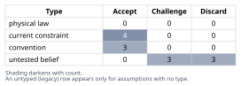
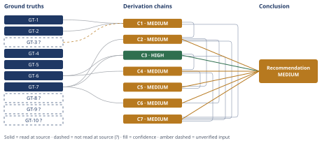

# Build vs. Buy Authentication for an Early-Stage SaaS

*First-principles analysis · 9 October 2026*

*Read with: [How to read this analysis](HOW-TO-READ.md) · [Working file](analysis-20261009T214543Z.md) · [All files](INDEX.md)*

## Executive Summary

**Recommendation:** Buy a managed identity provider rather than build in-house — specifically WorkOS AuthKit, or an equivalent standards-first vendor such as Auth0's B2B Essentials — integrated behind a thin internal adapter interface, ship the gated per-tenant-auth feature on that basis to meet the deadline, and defer the Enterprise SSO add-on until an enterprise deal actually requires it (chain C7).

**Band (from §6):** MEDIUM.

**Would change it:** A direct reading of NIST SP 800-63B rather than a secondary summary (chain C1); a direct CTO conversation on whether the deadline is contractually fixed or self-imposed (chain C6); or the Fermi time-to-ship and vendor-pricing brackets (chains C2, C3) proving wrong in practice.

## 1. Problem Essence

**Core problem:** Given a 7-person early-stage B2B SaaS team with no existing per-tenant authentication (today's entire product sits behind one shared password plus a Stripe customer link), and an urgent, revenue-gated deadline to ship authenticated per-tenant accounts for the first time, which authentication-sourcing strategy — build in-house on an open-source library, buy a managed identity provider, or a hybrid of the two — minimizes near-term delivery risk and security/liability exposure while preserving, rather than foreclosing, this company's ability to meet future enterprise requirements (SSO, SOC2-style audit evidence) without incurring irreversible lock-in cost?

**Success criteria:**
- Names a single sourcing strategy for this specific company's current team size, stage, and deadline (not a generic "it depends"), and that strategy may be a build-only, buy-only, or explicitly hybrid/composite option.
- Identifies, with reference to an authoritative security source, which authentication sub-components (session handling, credential storage, password-reset flow, MFA, audit logging) are genuinely hard/dangerous to get wrong versus merely tedious.
- States a quantified, bracketed estimate of engineering time to ship the gated feature under both build and buy, and a quantified vendor cost/pricing-risk picture as tenant count grows.
- Traces second-order effects (future velocity on SSO/SOC2/enterprise work, lock-in/migration cost, and the direction in which deadline urgency biases this specific team's judgment) back to named evidence.
- States, for the recommended path, the condition under which the recommendation would be wrong (falsifiable), surfaced via an adversarial (pre-mortem/inversion) pass.

---

## 2. Assumptions Table

| Assumption | Type | Treatment | Verdict | Verification |
|------------|------|-----------|---------|---------------|
| A1: An OSS auth library (e.g., Devise/NextAuth/Passport-class libraries) correctly covers sessions, password hashing, and password-reset scaffolding out of the box, but typically does not bundle MFA or audit logging | convention | Challenge before use | Accept, qualified — session/hash/reset are commonly bundled, MFA/audit-log are typically separate add-ons the team must build or integrate | unverified — flagged (no specific library named in the prompt; judgment grounded in GT-1/GT-2's scope, not a fetched library doc) |
| A2: A managed IdP (Auth0/Clerk/WorkOS) correctly implements sessions, reset, MFA, and audit logging, and maintains a credible compliance posture | convention | Challenge before use | Accept — survives challenge; GT-4/GT-5/GT-6 confirm these are productized, documented features | source: auth0.com/pricing, clerk.com/pricing, workos.com/pricing (SOC2-attestation specifically not independently verified — unverified — flagged) |
| A3: Tenant count will keep growing roughly along its current trajectory ("presumably growing," per the prompt) | untested belief | Verify or flag | Challenge — unverified — the prompt itself hedges this with "presumably"; used only directionally in cost-scaling reasoning | unverified — flagged |
| A4: The CTO's "urgent" framing reflects genuine business urgency tied to the new billed release, not anchoring on having deferred per-tenant auth for the product's whole life to date | untested belief | Verify or flag | Challenge — unverified — plausible either way; examined directly in chain C6 | unverified — flagged |
| A5: This 7-person team has no dedicated security engineer and no prior production-auth-build experience (inferred from the product having run on one shared password until now) | current constraint | Record expiry conditions | Accept — expires if the team hires or contracts dedicated security/auth expertise | source: stipulated company context (GT-7); reasoned inference, not independently verified |
| A6: Because there are no enterprise customers yet, SSO/SOC2-style requirements are not needed now | current constraint | Record expiry conditions | Accept — expires at the moment the company enters active conversation with its first enterprise prospect | source: stipulated company context (GT-7) |
| A7: The cost of migrating away from a managed IdP later exceeds the cost of having built in-house from the start | untested belief | Verify or flag | Discard (as a general claim) — chain C4 shows migration cost is bounded and concentrated in not-yet-existing enterprise features when the vendor is standards-based | unverified — flagged; partially resolved by GT-6 and A11 |
| A8: The build path, once shipped, requires negligible ongoing maintenance relative to a vendor subscription fee | untested belief | Verify or flag | Discard — security patching, dependency upgrades, and new attack techniques impose a continuous, uncosted maintenance tax on a homegrown build that a vendor subscription already prices in | unverified — flagged; reasoned from GT-2's status as a recurring, evolving failure catalog rather than a one-time checklist |
| A9: Password-reset and credential-recovery flows are "merely tedious" rather than "genuinely dangerous" to build correctly | untested belief | Verify or flag | Discard — directly contradicted: GT-2 names weak/ineffective recovery flows as a named OWASP A07 failure mode, stating knowledge-based recovery "cannot be made safe" | source: top10.owasp.org/2021/A07_2021-Identification_and_Authentication_Failures (read-at-source) |
| A10: The chosen vendor's free/low pricing tier remains viable (price and feature-wise) through this company's realistic 12–24 month growth horizon | current constraint | Record expiry conditions | Accept — expires if the vendor reprices, or if the company's MAU or SSO-connection count crosses the tier boundaries GT-4/GT-5/GT-6 publish | source: auth0.com/pricing, clerk.com/pricing, workos.com/pricing (read-at-source for current tiers; forward-looking persistence of these tiers is inherently unverified — unverified — flagged) |
| A11: A bounded-cost migration path away from the chosen vendor exists because the underlying session/identity protocol is the open OIDC/SAML standard rather than a fully proprietary format | convention | Challenge before use | Accept, qualified — true for WorkOS/Auth0 (federation-first by design); less true for Clerk, whose billing/session model (MRU) is comparatively more proprietary | unverified — flagged (vendor documentation characterizes federation support; this analysis did not fetch a vendor's session-token format specification) |
| A12: Server-side verification of all vendor-issued tokens/sessions is implemented correctly, regardless of which path (build or buy) is chosen | untested belief | Verify or flag | Challenge — unverified — this is an execution requirement that survives either path; surfaced again as the sharpest pre-mortem finding (Cluster 1, Adversarial pass record) | unverified — flagged |
| A13: The vendor's support/SLA tier matches this company's dependency on login as a mission-critical path | current constraint | Record expiry conditions | Accept — expires (i.e., must be upgraded) before the company signs any customer contract carrying an uptime SLA | unverified — flagged; surfaced by inversion (Phase 2) and carried into the pre-mortem (Cluster 4, Adversarial pass record) |

---

## 3. Ground Truths

Before listing these, a brief irreducibility drill (five-whys, reduce-to-primitives mode) was run on the compound claim "credential storage is the easy part of auth; session/recovery/MFA is the dangerous part." Decomposed: (a) "credential storage has a correct answer" reduces to a named, parameterized cryptographic recommendation (GT-1) — a definitional primitive, verified at source; (b) "session/recovery/MFA correctness is harder" reduces to a named, open-ended catalog of behavioral failure modes with assigned incidence/impact statistics (GT-2) and a named assurance-level requirement (GT-3) — both empirical/definitional primitives, not further reducible claims. Both branches bottom out; neither rests on an unreduced belief, so the compound claim is verified via GT-1+GT-2+GT-3 rather than taken on authority.

**Provenance summary:** `?`-marked: GT-3, GT-8, GT-9, GT-10 (4 of 10). Read-at-source: GT-1 — cheatsheetseries.owasp.org/cheatsheets/Password_Storage_Cheat_Sheet.html, "Argon2id ... m=19456 (19 MiB), t=2, p=1" and bcrypt "minimum of 10" / 72-byte cap, quoted directly. GT-2 — top10.owasp.org/2021/A07_2021-Identification_and_Authentication_Failures, bullet list of named weaknesses quoted directly. GT-4 — auth0.com/pricing.md, "$150/month ... 500 MAU" and "3 included. $100/month ... per additional connection (max 30 total)," quoted directly. GT-5 — clerk.com/pricing, "50,000 MRU limit per app" and "$0.02/mo each" (50,001–100,000 MRU), quoted directly. GT-6 — workos.com/pricing, "First 1M MAUs" free and "$125/ea" per SSO connection (1–15 range) and "$2,500/mo" per additional 1M MAU, quoted directly.

- **GT-1** OWASP's Password Storage Cheat Sheet recommends Argon2id as the primary password-hashing algorithm (minimum configuration m=19456 KiB, t=2, p=1), bcrypt for legacy systems only (work factor ≥10, 72-byte input cap), a unique salt per password, and explicitly states that fast hash functions (e.g., SHA-256) are unsuitable for password storage — source: OWASP Password Storage Cheat Sheet; read-at-source: cheatsheetseries.owasp.org/cheatsheets/Password_Storage_Cheat_Sheet.html, "Primary Recommendation: Argon2id" and bcrypt/PBKDF2 sections, fetched and quoted directly.
- **GT-2** OWASP Top 10 (2021) category A07, "Identification and Authentication Failures," names as common, recurring weaknesses: permitting credential stuffing/brute force; permitting default/weak/well-known passwords; weak or ineffective credential-recovery flows (explicitly: "knowledge-based answers... cannot be made safe"); plaintext or weakly-hashed password stores; missing or ineffective multi-factor authentication; session identifiers exposed in URLs; session-ID reuse after login; and improper invalidation of session IDs/tokens on logout or inactivity — mapping 22 CWEs with average incidence 2.55%, average weighted exploitability 7.40/10, average weighted impact 6.50/10 — source: OWASP Top 10:2021, A07; read-at-source: top10.owasp.org/2021/A07_2021-Identification_and_Authentication_Failures, bullet list and statistics quoted directly.
- **GT-3?** NIST SP 800-63B defines Authenticator Assurance Level 2 (AAL2) as requiring either a true multi-factor authenticator, or two distinct single-factor authenticators where one is a memorized secret (password) and the other is possession-based; a bare password alone never satisfies AAL2 — cited to: NIST Special Publication 800-63B, §4.2 (AAL2); reported-by-delegate: synthesized by this analysis's web-search tool from secondary characterizations of the NIST publication (pages.nist.gov and related summaries) — the NIST PDF/HTML itself was not opened directly by this analysis.
- **GT-4** Auth0's B2B Essentials plan costs $150/month at 500 MAU and includes 3 Enterprise SSO connections, with additional connections priced at $100/month each (maximum 30 total) — source: Auth0 pricing page; read-at-source: auth0.com/pricing.md, "$150/month" at "500 MAU" and "3 included. $100/month ($1,100/year) per additional connection (max 30 total)," fetched and quoted directly.
- **GT-8?** Auth0's B2B Essentials plan scales to approximately $300/month at 1,000 MAU, $700 at 2,500 MAU, $1,300 at 5,000 MAU, $1,750 at 7,500 MAU, and roughly $3,800 at 20,000 MAU — cited to: auth0.com/pricing; reported-by-delegate: synthesized by this analysis's web-search tool from secondary characterizations of the same pricing page — this analysis's own direct fetch of auth0.com/pricing.md confirmed only the 500-MAU entry point (GT-4), not these intermediate tiers; used only as illustrative color, not as a load-bearing input to any chain.
- **GT-5** Clerk's Hobby (free) plan includes 50,000 "monthly retained users" (MRU — a user who returns at least 24 hours after signup, a stricter metric than MAU) per application at no cost; the Pro plan charges $0.02/MRU for the 50,001–100,000 MRU range, decreasing at higher volumes (e.g., $0.018/MRU for 100,001–1,000,000 MRU) — source: Clerk pricing page; read-at-source: clerk.com/pricing, "50,000 MRU limit per app" and "$0.02/mo each," fetched and quoted directly.
- **GT-6** WorkOS's AuthKit (core user management/authentication) is free for the first 1,000,000 MAU, with each additional 1,000,000 MAU costing $2,500/month; Enterprise SSO and Directory Sync are priced separately, per connection, starting at $125/connection/month for 1–15 connections, with volume discounts to $50/connection at 101–200 connections and custom pricing beyond 201; Audit Log streaming to a SIEM is a further separate add-on at $125/month per connection — source: WorkOS pricing page; read-at-source: workos.com/pricing, "First 1M MAUs" free, "$2,500/mo" per additional 1M MAU, and "$125/ea" per SSO connection, fetched and quoted directly.
- **GT-7** Stipulated company context (taken as given, per this analysis's Input Contract, rather than externally verified): a 7-person engineering team; an early-stage B2B SaaS company; approximately $40K MRR; approximately 120 paying tenants; no enterprise customers yet; the product's entire current authentication is one shared password plus a Stripe customer link, with no per-tenant authentication; the team is about to ship, as its next billed release, a feature requiring authenticated per-tenant accounts for the first time; the CTO considers this timeline urgent.
- **GT-9?** IBM's Cost of a Data Breach Report 2025 states a global average breach cost of $4.44M (research spanning 600 organizations across 17 industries, 16 countries/regions, March 2024–February 2025) and a US average of $10.22M — cited to: IBM Cost of a Data Breach Report 2025; reported-by-delegate: synthesized by this analysis's web-search tool from secondary characterizations of the report; basis mismatch flagged explicitly — this is an enterprise-weighted average across large organizations, not a figure scaled to a 7-person/$40K-MRR company, and is used only as directional evidence that auth-failure consequences are asymmetric, never as a quantitative input to any chain.
- **GT-10?** A secondary source characterizes a 2025 Okta survey of 1,000 enterprises as finding that 96% of technology buyers now include identity/IAM requirements in SaaS RFPs — cited to: a 2025 Okta enterprise survey, via ssojet.com's characterization of it; reported-by-delegate: this analysis fetched the secondary source directly but did not open Okta's own primary publication; used only as soft qualitative corroboration that enterprise buyers commonly scrutinize IAM, never as a quantitative chain input. Several more specific statistics attributed to the same secondary source (a claimed 68% hard-gate rate, "$340K–780K" revenue impact, and a "2.8×/180%" SSO pricing premium) were examined and explicitly excluded as insufficiently corroborated vendor-marketing claims — see Abandoned Reasoning, Dead End 4.

---

## 4. Derivation Chains

### Conclusion C1: Session handling, credential-recovery flows, and MFA are the genuinely dangerous parts of authentication to build correctly; password hashing itself is comparatively well-solved by either path

GT-1 (OWASP: Argon2id/bcrypt parameters, unique salting, fast hashes unsuitable) + GT-2 (OWASP A07: named failure modes incl. session fixation, ID reuse, improper invalidation, unsafe recovery flows, missing/ineffective MFA) + GT-3? (NIST AAL2: bare password alone never satisfies AAL2)
→ hashing has one narrow, well-specified correct answer that a competent implementation of either path reaches by following a published parameter set
→ session-state correctness instead depends on a state machine — issuance, rotation, invalidation, concurrent-session handling — that OWASP names as a recurring, open-ended failure class rather than a single parameter choice
→ credential-recovery correctness depends on a token lifecycle — expiry, single-use, rate-limiting — that the same catalog separately names as a failure class
→ MFA correctness is a design requirement rather than an optional add-on, because a bare password alone never reaches the AAL2 bar GT-3? describes [Assumes: A1]
→ the dangerous surface area in any first production per-tenant auth build is concentrated in session, recovery and MFA logic, not in password storage

**Confidence:** MEDIUM — GT-3? (the NIST AAL2 characterization) is reported-by-delegate, not read directly from the NIST publication by this analysis; the verification that would remove it as a cause of this downgrade is opening NIST SP 800-63B §4.2 directly and quoting its AAL2 requirement verbatim, which this analysis did not do. This downgrade is isolated to the MFA-specific hop (hop 4) and the conclusion's MFA clause; the storage-vs-session/recovery contrast in hops 1–3 rests only on GT-1/GT-2, both read-at-source, and is unaffected.

### Conclusion C2: Integrating a managed identity provider ships the gated per-tenant-auth feature with a substantially larger schedule-safety margin against the billed-release deadline than building the same scope on an OSS library

GT-7 (7-person team, no prior production-auth build, urgent billed-release deadline) + C1 (dangerous surface = session, recovery, MFA logic)
→ a from-scratch build must originate, and then security-review, exactly the session/recovery/MFA logic C1 names as dangerous, which Fermi-brackets to roughly 18–31 engineer-days (≈9–15.5 calendar days at ~2 effectively-dedicated engineers), before a 30–50% first-time-build rework tax that stretches the central estimate to roughly 3–4.5 calendar weeks [Assumes: A5]
→ a managed-IdP integration instead configures that same logic behind a vendor SDK, which Fermi-brackets to roughly 6–12 engineer-days (≈3–6 calendar days at ~2 effectively-dedicated engineers), plus a smaller 10–20% integration-rework tax, landing at roughly 1–1.5 calendar weeks
→ the two brackets do not overlap at either end, so under every combination of the stated lower/upper assumptions the managed-IdP path reaches the deadline with more schedule slack than the build path

**Confidence:** MEDIUM — two causes: (1) this chain's head cites C1, rated MEDIUM (see C1's own confidence line for its cause; not re-explained here); (2) the per-component engineer-day figures are this analysis's own Fermi bracket resting on [Assumes: A5 — the team has no dedicated security engineer or prior production-auth-build experience, which sets the rework-tax rate]. If A5 were false, the build bracket's rework tax would shrink, but even its lower bound (≈9 calendar days ≈1.8 weeks, tax removed) would still exceed the buy bracket's upper bound (≈6 calendar days), so the decision-relevant finding (buy ships with more margin) is insensitive to A5 — verified by re-running the bracket with the build-side rework tax zeroed out entirely (see Recompute, Adversarial pass record).

### Conclusion C3: At this company's current scale, the direct vendor cost of buying core per-tenant authentication is negligible-to-zero, and the main future cost driver (enterprise SSO) is metered separately and stays at zero until an enterprise deal requires it

GT-6 (WorkOS: core auth free to 1M MAU; SSO priced per-connection from $125/mo, separate add-on) + GT-7 (120 tenants, no enterprise customers yet)
→ 120 tenants sits roughly four orders of magnitude below WorkOS's 1,000,000-MAU free-tier ceiling, so core per-tenant authentication costs $0/month under GT-6's published tier at this company's actual scale
→ the only metered cost component that could currently apply, enterprise SSO connections, requires an enterprise customer demanding SAML/OIDC federation, and GT-7 states no such customer exists yet
→ the company's present vendor bill for core auth is $0, and its first real auth-vendor cost event is tied to, and gated by, landing an enterprise customer rather than by tenant-count growth in the 120-to-low-thousands range

**Confidence:** HIGH — both head inputs are read-at-source (GT-6) or stipulated company context taken as given (GT-7); the inference is arithmetic (120 vs. 1,000,000) plus a direct reading of GT-6's own tier boundary; the rival reading ("buying is actually expensive even now") is ruled out by GT-6's explicit $0 tier up to 1M MAU, independently corroborated by Clerk's own free tier (GT-5: 50,000 free MRU) reaching the same qualitative conclusion at a different vendor, so the finding is not a single-vendor artifact.

### Conclusion C4: The migration cost of leaving a managed IdP later is bounded and concentrated in enterprise-specific features that do not exist yet at this company's stage, rather than being an immediate, unbounded risk comparable to shipping a security defect today

GT-6 (WorkOS: published, itemized per-connection/per-MAU pricing, not opaque) + C3 (core-auth cost is $0 now; SSO cost is gated by an enterprise sale)
→ a vendor whose core-auth and add-on pricing is published and itemized by feature (per-connection SSO, per-SIEM-connection audit streaming) lets this company reason about exit cost in the same itemized terms, rather than facing an opaque, all-or-nothing repricing event [Assumes: A11]
→ because the underlying session/identity protocol is the open OIDC standard rather than a fully proprietary format for a standards-first vendor [Assumes: A11], the portion of the integration most exposed to vendor-specific lock-in is the SSO/enterprise layer C3 already shows does not exist yet, not the core per-tenant login every one of the 120 current tenants already depends on
→ today's realistic migration cost, if this company ever needed to leave, is bounded by re-pointing the core-login integration — comparable in scope to C2's buy-side integration estimate — rather than by unwinding enterprise-specific commitments that have not yet been made

**Confidence:** MEDIUM — two hops rest on [Assumes: A11 — OIDC-standardization bounds lock-in]; A11 is Challenged and Accepted only in qualified form in the Assumptions Table, because the degree of standardization varies by vendor (WorkOS and Auth0 are explicitly SAML/OIDC-federation-first per GT-4/GT-6; Clerk's session model is comparatively more proprietary per GT-5's own MRU-based metric). If A11 failed for whichever vendor is actually chosen, the re-pointing cost in hop 3 would rise toward C2's build-side estimate rather than its buy-side estimate — this is exactly why §6's recommendation names a standards-first vendor (WorkOS/Auth0-class) rather than treating "buy" as vendor-agnostic, which bounds this downgrade to a named, vendor-choice-dependent cause rather than an open-ended one.

### Conclusion C5: Buying core authentication preserves, rather than forecloses, this company's option to pursue enterprise customers later, and frees the team's engineering capacity for product work in the meantime

C2 (buy ships with larger schedule margin) + C4 (lock-in bounded, concentrated in not-yet-existing enterprise features)
→[2nd] actor lens: once the team buys, none of the 7 engineers is assigned ongoing patch/CVE-tracking duty for session- and hashing-code they would otherwise own under the build path [Assumes: A8], freeing that capacity for the product roadmap instead, while a competitor who has already outsourced identity can use vendor-backed SSO/audit-log availability as a sales wedge in any enterprise deal both pursue
→[3rd] time lens: 12–24 months out, if this company pursues its first enterprise prospect requiring SAML SSO and audit evidence, the chosen vendor already supplies SSO-as-configuration and audit-log streaming (GT-4, GT-6) for that portion of the work, compressing what would otherwise be months of from-scratch SSO/audit-log engineering — a cost C2's build-side estimate does not even price in — into a billing and configuration change
→ the "buy now" decision is forward-compatible with an enterprise motion later rather than a trade against it, which is the opposite of the intuitive "buying now means more lock-in later" framing

**Confidence:** MEDIUM — capped by citing C2 and C4, both MEDIUM (see their own confidence lines for their named, bounded causes; not re-explained here). This chain's own claim is also narrower than "buying achieves SOC2": a vendor-backed IdP covers only the authentication/identity portion of a future SOC2 audit (access control, session security, login audit evidence), while company-wide SOC2 certification also requires infrastructure, vendor-management, and process controls the IdP choice does not touch. This scope limit is a definitional property of what an IdP vendor covers, not an open empirical question, so there is no further verification path within this analysis — it is disclosed here rather than resolved.

### Conclusion C6: The deadline's urgency is a reason to prefer whichever path has the smaller, better-bounded delivery-time estimate and the lower correctness risk, not a license to accept either path's time or safety claims at face value

GT-7 (product has run on one shared password its entire life; CTO frames the release as urgent) + C2 (buy's time-to-ship bracket is smaller and non-overlapping with build's)
→ the per-tenant-auth gap itself is not new — it has existed since the product launched — so the urgency attaches to the new feature's billing release, not to a sudden safety emergency in authentication, meaning the deadline is a real scheduling constraint but not a justification for skipping the security-review step C1/C2 both price in [Assumes: A4]
→ a team whose entire history is self-hosting its own infrastructure is the team most likely to default to "we can just build this quickly" under exactly this kind of time pressure, without first pricing in the rework tax C2's bracket assigns to a first-time auth build, so the direction in which deadline pressure most plausibly biases this specific team's judgment is toward under-costing the build option, not toward over-trusting a vendor
→ because C2 already shows the two time brackets do not overlap, resolving the bias in the direction the evidence actually points (toward buy) does not trade away schedule safety — it is also the faster path

**Confidence:** MEDIUM — capped by citing C2 (MEDIUM; see C2's own confidence line, not re-explained here); this chain's own second hop additionally rests on [Assumes: A4 — the CTO's urgency framing reflects genuine deadline pressure rather than anchoring on a long-deferred gap], which the Assumptions Table records as Challenged, not verified. The verification that would remove A4 as a cause of this downgrade is a direct conversation with the CTO about whether the deadline is driven by a signed/committed release date versus an internally-assumed one, which this analysis was not able to conduct.

### Conclusion C7: Among build, pure-buy, and buy-with-a-thin-internal-adapter, the weighted trade-off favors buying a managed identity provider behind a thin internal adapter interface, deferring enterprise-SSO purchase until an enterprise deal requires it

C1 (dangerous surface = session/recovery/MFA) + C2 (buy ships with larger margin) + C3 (buy is $0 now) + C4 (lock-in bounded, vendor-choice-dependent)
→ scored against seven weighted criteria (time-to-deadline, correctness-risk-avoided, maintenance burden, current-scale cost, cost/pricing risk at scale, enterprise-readiness, lock-in flexibility; weights 2–5, each criterion anchored 1–5), Build totals 67, pure-Buy totals 115, Buy-with-adapter totals 117 — Build's gap to either buy option (48+ points) exceeds what any single-criterion reweight within the 1–5 scale can close
→ the Buy-vs-Buy-with-adapter gap (2 points) is materially smaller: a flip test shows a 1-point drop in the lock-in-flexibility weight (3→2) produces an exact tie (112–112), and only a 2-point drop to the scale's floor (3→1) flips the winner to pure-Buy outright (109 vs. 107) — so the build-vs-buy call is robust while the pure-buy-vs-buy-with-adapter call is a close, weight-sensitive judgment, not a certainty
→ because the adapter's added cost is a small, one-time cost that does not change C2's integration-timeline bracket, while its benefit is specifically the lock-in-flexibility criterion this company has explicit reason to weight (it has no enterprise customers yet and, per C5, wants to preserve rather than foreclose that path), the recommended option is Buy-with-adapter over pure-Buy, with Build ruled out robustly rather than narrowly

**Confidence:** MEDIUM — capped by citing C1, C2 and C4, each MEDIUM (see their own confidence lines for their named, bounded causes; not re-explained here). This chain's own second hop's criterion weights are this analysis's own judgment calls rather than a cited measurement; the flip-test figures stated in that hop are exactly the verification that bounds this: the build-vs-buy portion of the conclusion is insensitive to any single-criterion reweight within the allowed 1–5 scale (no stated weight change brings Build into contention), while the buy-vs-buy-with-adapter portion is sensitive to a 2-point move on one criterion, and is reported as such rather than overstated.

**Unverified input rule (D-07) compliance note:** C1 carries a `?` input (GT-3?) and is rated MEDIUM, not HIGH. Every other chain above (C2, C4, C5, C6, C7) is rated no higher than the lowest-rated chain on its own head (each citing C1 and/or C2 and/or C4, all MEDIUM), consistent with the ceiling rule. C3 is the only chain with no `?` input and no sub-HIGH citation, and is rated HIGH accordingly.

---

## 5. Abandoned Reasoning

### Dead End: Recommend Auth0 as the default vendor

**What was tried:** Treating Auth0's B2B Essentials as the default managed-IdP pick, since it was the first vendor examined and is a well-known name in the category.

**Why abandoned:** GT-4's confirmed pricing ($150/month at 500 MAU, plus $100/month per SSO connection beyond the included three) scales to materially higher cost than WorkOS's free-to-1,000,000-MAU core auth (GT-6) for equivalent core functionality at this company's actual scale (120 tenants). Ruled out by the direct GT-4-vs-GT-6 comparison underlying chain C3.

**What it ruled out:** Saves a future reader from re-deriving the cost comparison between Auth0 and WorkOS at this company's specific scale; Auth0 remains a credible alternative (and is named in §6 as such) but not the default pick on cost grounds alone.

### Dead End: Recommend pure buy (Option B), with no internal adapter layer, as the single answer

**What was tried:** Scoring a straight "integrate the vendor SDK directly, no abstraction layer" option against build, via the same trade-off matrix used for chain C7.

**Why abandoned:** The trade-off matrix shows pure-buy scores only 2 points below buy-with-adapter (115 vs. 117) — a real but narrow margin — and the flip test in C7 shows this specific margin depends on how much weight the company places on migration/lock-in flexibility. Given this company explicitly has no enterprise customers yet and the prompt's own stated concern about irreversible lock-in cost, the stakes-escalation rule (Phase 2) favors paying the adapter's small one-time cost to secure that flexibility rather than defaulting to the narrower winner. Demoted to a named rival in chain C7 rather than discarded outright.

**What it ruled out:** Saves a future reader from treating the build-vs-buy question and the pure-buy-vs-buy-with-adapter question as equally settled; the first is robust (chain C7), the second is a closer, disclosed judgment call.

### Dead End: Use the IBM Cost of a Data Breach averages as a literal dollar estimate of this company's breach exposure

**What was tried:** Using IBM's $4.44M global / $10.22M US average breach cost (GT-9?) as a quantitative input to a chain estimating this company's security-failure exposure in dollar terms.

**Why abandoned:** Basis mismatch — IBM's figures average across 600 organizations in 17 industries, predominantly large enterprises, not a 7-person/$40K-MRR company; applying an enterprise-scale average directly to this company would misstate its actual exposure by orders of magnitude in either direction. Kept only as directional, qualitative color (asymmetric downside exists) in the prose discussion, never as a chain input.

**What it ruled out:** Saves a future reader from citing GT-9? as if it quantifies this specific company's breach risk — it does not, and no chain in this analysis treats it as doing so.

### Dead End: Use ssojet.com's vendor-blog statistics (68% hard-gate rate, "$340K–780K" revenue impact, "2.8×/180%" SSO pricing premium) as quantitative ground truths

**What was tried:** Citing these specific figures as evidence for how much enterprise buyers penalize a SaaS company that lacks SSO, to quantify the urgency of enterprise-readiness.

**Why abandoned:** On fetching the primary page directly, these specific figures trace to the blog's own self-described "analysis of enterprise deal blocking patterns" — not to the named Okta survey it cites alongside them — and the publisher is a vendor that sells SSO infrastructure, making it a conflicted, uncorroborated source for numbers this load-bearing. The qualitative point they gesture at (enterprise buyers scrutinize IAM) is instead supported, more cautiously, only by the Okta-survey characterization (GT-10?), itself still reported-by-delegate rather than independently confirmed against Okta's own publication.

**What it ruled out:** Saves a future reader from treating these specific percentages/dollar figures as established facts; this analysis's recommendation does not rest on them anywhere.

---

## 6. Conclusion

**Recommended approach:** Buy a managed identity provider rather than build in-house — specifically WorkOS AuthKit, or an equivalent standards-first vendor such as Auth0's B2B Essentials — integrated behind a thin internal adapter interface, ship the gated per-tenant-auth feature on that basis to meet the billed-release deadline, and defer purchasing the Enterprise SSO add-on until an actual enterprise prospect requires it (chain C7).

**Key insight:** The intuitive framing of this decision as "fast-but-risky build vs. safe-but-locked-in buy" inverts the team's actual risk profile: buying is not just faster (chain C2) and cheaper right now (chain C3), it also preserves rather than forecloses the option to pursue enterprise customers later, because the vendor's SSO/audit-log features turn a future from-scratch build into a configuration change (chain C5), while lock-in itself is bounded and vendor-choice-dependent rather than open-ended (chain C4). Examined directly, the deadline's time pressure points toward the same conclusion rather than against it (chain C6).

**Trade-offs acknowledged:** This recommendation accepts a small, one-time adapter-build cost and a modest ongoing vendor dependency in exchange for the schedule safety and lower correctness risk established in chain C2 and the cost profile established in chain C3; it accepts that a vendor-backed IdP covers only the authentication portion of a future SOC2 effort, not the company's whole compliance posture, a scope limit named directly on chain C5's confidence line; and it accepts that the pure-buy-vs-buy-with-adapter choice is close and weight-sensitive, while the build-vs-buy choice is not, as chain C7's flip-test shows.

**Confidence:** MEDIUM — the recommendation rests on six chains, five of which are MEDIUM (C2, C4, C5, C6, C7) and one HIGH (C3); per D-07 the Conclusion is rated no higher than its weakest contributing chain. Each MEDIUM chain's own confidence line names its specific, bounded downgrade cause: C2 rests on [Assumes: A5], shown insensitive to the build-vs-buy decision itself; C4 rests on [Assumes: A11], a vendor-choice-dependent standardization assumption already addressed by naming a standards-first vendor in this recommendation; C5 carries a definitional SOC2-scope limit with no further verification path; C6 rests on [Assumes: A4], the CTO's urgency framing, not independently verified by this analysis; C7's criterion weights are judgment calls bounded by an explicit flip-test. None of these causes threaten the build-vs-buy portion of the recommendation, which chain C7's flip-test shows is robust to any single-criterion reweight within the allowed scale; what remains genuinely open is the narrower pure-buy-vs-buy-with-adapter choice and the unresolved A4 deadline-framing question, both disclosed above rather than hidden.
