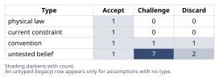
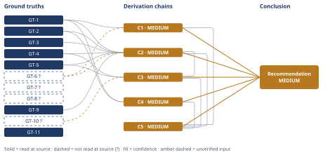

# Build vs. Buy Authentication for Multi-Tenant Accounts

*First-principles analysis · 10 October 2026*

*Read with: [How to read this analysis](HOW-TO-READ.md) · [Working file](analysis-20261010T073842Z.md) · [All files](INDEX.md)*

## Executive Summary

**Recommendation:** Adopt a managed identity provider now, scoped to what today's 120 tenants and zero enterprise customers actually require, deferring MFA depth, audit-log depth, and SSO/SCIM connections until a real deal or compliance need triggers them, while keeping the irreducible tenant-authorization logic in-house either way (chain C5).

**Band (from §6):** MEDIUM (chain C5).

**Would change it:** Confirming the "no enterprise customers yet" and enterprise-SSO-demand premises with the CTO and sales, replacing the Estimate's engineering-time brackets with a measured spike, and having leadership review and re-lock the trade-off's criteria weights rather than this analysis setting them (chain C5).

## 1. Problem Essence

**Core problem:** Given a committed, time-boxed billed-release requirement for real per-tenant, multi-user authenticated accounts, which approach to acquiring the authentication capability — building the credential/session primitives in-house on an open-source library, adopting a managed identity provider, or some phased/split combination of the two — minimizes the combined risk of (a) missing the release date, (b) shipping an exploitable authentication vulnerability, and (c) accumulating a maintenance or re-architecture burden a 7-person team cannot sustain, while leaving room to add enterprise-grade SSO/SAML/SCIM later without a rebuild?

**Success criteria:**
1. The Conclusion names a specific approach — build, buy, or a named phased/split combination — and is not constrained to restate the prompt's two named options verbatim; a composite answer is an acceptable outcome if the ground truths support it.
2. The Conclusion states what minimum capability scope is required to ship safely now, and distinguishes it from scope that is bundled in by habit or caution and can be deferred.
3. The Conclusion gives a comparative cost figure — engineering time and/or vendor spend — for the leading options, not a qualitative pros/cons list alone.
4. The Conclusion states what happens, under the recommended approach, when the first enterprise SSO/SAML/SCIM request arrives.
5. The Conclusion states a confidence band and names what evidence or verification would raise or lower it.

---

## 2. Assumptions Table

| Assumption | Type | Treatment | Verdict | Verification |
|------------|------|-----------|---------|--------------|
| A-1: Full MFA + audit-log scope must be included at initial launch for the feature to be safe. | convention | Explicitly challenge before use. | Challenge — not required for safety at this scale; MFA and audit logging are defense-in-depth and enterprise-sales enhancements, not preconditions for avoiding the OWASP A07 failure modes. | Cross-checked against GT-1/GT-2's enumerated risk classes; none requires MFA's presence to avoid the named weaknesses. |
| A-2: Build and buy require the same auth feature scope, so they can be compared on equal footing. | untested belief (the framing assumption flagged in the prompt) | Verify, or flag unverified. | Discard — false; buy bundles MFA, session management, password-reset, and basic audit logging into the base product, while build starts from lower-level primitives the team must assemble, test, and own — the two paths do not start from equal scope per dollar or per engineer-hour. | GT-3, GT-4, GT-5 (vendor pricing/feature pages). |
| A-3: A 7-person engineering team with no dedicated security engineer can safely build and indefinitely maintain security-critical auth code. | current constraint | Record expiry conditions. | Accept — expires if/when the company hires a dedicated security or platform engineer, or reaches a scale that justifies a part-time security owner; holds today. | GT-6? (team-size fact, stipulated). |
| A-4: Managed identity providers are affordable at this company's current scale (120 tenants, no enterprise customers). | untested belief | Verify, or flag unverified. | Accept — base MAU/MRU allotments (GT-3, GT-4) comfortably exceed the likely total end-user count at 120 tenants; the expensive per-connection SSO/SCIM tier (GT-4, GT-5) only activates once actual enterprise connections exist, and none exist today. | GT-3, GT-4, GT-5. |
| A-5: CTO-stated urgency justifies skipping a build-vs-buy comparison and defaulting to build. | convention | Explicitly challenge before use. | Discard — urgency is a real current constraint but logically argues for whichever path reaches a safe launch fastest; chain C2 shows that is buy, not build, so using urgency to skip evaluation inverts its own logic. | C2 (Estimate). |
| A-6: A credible SSO/SAML/SCIM request from an enterprise prospect is a near-certain, not remote, future event for this company. | untested belief | Verify, or flag unverified. | Challenge — unverified — flagged; directionally plausible (vendor pricing pages are themselves built around exactly this buying pattern) but no company-specific sales-pipeline evidence was examined. | unverified — flagged; GT-10?. |
| A-7: Diverting 2-3 of 7 engineers to build auth meaningfully delays the billed feature itself, because the feature hard-depends on auth existing first. | physical law (logical/arithmetic necessity given a hard dependency and fixed headcount) | Accept as a ground-truth candidate. | Accept — a hard dependency plus fixed headcount makes this a matter of arithmetic, not opinion. | GT-11 (resource-constraint arithmetic). |
| A-8: Vendor lock-in is a larger, more one-directional risk than the risk debt of exiting a poorly-maintained in-house system later. | untested belief | Verify, or flag unverified. | Challenge — unverified — flagged; lock-in runs in both directions (standard OIDC/SAML protocols bound vendor lock-in somewhat; an under-maintained in-house system accumulates its own exit debt), so this is a second-order finding rather than a settled one. | unverified — flagged; no migration-cost-magnitude source was examined. |
| A-9: Open-source auth libraries are only as secure as the team's configuration and patch discipline, not inherently secure or insecure by virtue of being open source. | convention | Explicitly challenge before use. | Accept — directly consistent with GT-1/GT-2, which frame these as implementation and maintenance failure modes, not library-existence failure modes. | GT-1, GT-2. |
| A-10: Audit-log and basic compliance tooling come "for free" in both the build and buy paths. | untested belief | Verify, or flag unverified. | Discard — false for build (must be built from scratch); true at the paid tier for buy, where it ships as a named base feature. | GT-5. |
| A-11: Integrating a managed IdP's SDK will be done correctly by the team, with no misconfiguration (signature validation, redirect URIs, session-cookie flags). | untested belief (surfaced via the Phase 2 inversion pass) | Verify, or flag unverified. | Challenge — unverified — flagged; this is the residual competence risk that buying relocates rather than removes. | unverified — flagged; addressed as Pre-Mortem Cluster 1 in section 5's adversarial pass record. |
| A-12: Vendor pricing and uptime terms will remain acceptable as the company's tenant count grows. | untested belief (surfaced via the Phase 2 inversion pass) | Verify, or flag unverified. | Challenge — unverified — flagged; GT-3's own documented pricing-structure change is direct precedent that vendor pricing is not static. | unverified — flagged; mitigated in Pre-Mortem Cluster 2 with a named re-evaluation trigger. |
| A-13: The Estimate procedure's engineering-time brackets (build and buy) reflect this specific 7-person team's actual velocity, not a generic team's. | untested belief (surfaced during the end-of-Phase-4 Assumption Audit, chain C2) | Verify, or flag unverified. | Challenge — unverified — flagged; the brackets are analyst-generated, not measured. | unverified — flagged; a time-boxed 2-3 day spike comparing both integration paths would replace the bracket with a measured figure. |
| A-14: The trade-off's locked criteria weights reflect this company's actual risk tolerance and strategic priorities. | untested belief (surfaced during the end-of-Phase-4 Assumption Audit, chain C5) | Verify, or flag unverified. | Challenge — unverified — flagged; the weights were set by this analysis, not elicited from the CTO or leadership. | unverified — flagged; would be confirmed by having leadership review and re-lock the weights before final commitment. |
| A-15: The chosen managed-IdP vendor's security practices and incident history are representative of vendor-class identity providers generally. | untested belief (surfaced during the end-of-Phase-4 Assumption Audit, chain C4) | Verify, or flag unverified. | Challenge — unverified — flagged; no specific vendor's SOC2 report, security page, or incident history was examined. | unverified — flagged; would be confirmed during vendor selection before contracting. |

---

## 3. Ground Truths

**Irreducibility drill (five-whys, reduce-to-primitives mode), applied to GT-9 and feeding chain C4:** The candidate claim "self-built authentication introduces meaningful security risk at this team's maturity level" was decomposed into its constituents: (a) credential-storage correctness, (b) session-management correctness, (c) password-reset/token-flow correctness, (d) ongoing patch maintenance of the library and its dependency tree. (a)-(c) each bottom out at a direct, checkable engineering fact — did the team use a vetted hashing primitive, regenerate the session ID post-login, invalidate sessions on logout, avoid leaking the session ID in a URL — and these are exactly the named weaknesses in GT-1/GT-2, i.e. a bounded, enumerable checklist a competent review can close. (d) does not bottom out the same way: it is a recurring commitment with no terminal check, which is the structural difference the drill surfaces and which chain C4 relies on.

- **GT-1** OWASP's A07:2021 category ("Identification and Authentication Failures") names these weaknesses: permitting credential stuffing and brute-force attacks; permitting default/weak/well-known passwords; weak or ineffective credential-recovery ("forgot password") processes; plaintext or weakly-hashed password storage; missing or ineffective multi-factor authentication; exposing the session identifier in the URL; reusing the session identifier after successful login (session fixation, CWE-384); sessions not properly invalidated on logout or inactivity. — source: OWASP Top 10 2021, A07:2021; read-at-source: https://top10.owasp.org/2021/A07_2021-Identification_and_Authentication_Failures, body list of weaknesses and CWE-384 mapping.
- **GT-2** OWASP's prevention guidance for A07:2021 includes: implement multi-factor authentication to prevent automated credential-stuffing/brute-force/stolen-credential attacks; test passwords against a top-10,000-worst-passwords list; use identical outcome messaging for registration and credential-recovery flows to prevent account enumeration; deploy a server-side, secure, built-in session manager that generates a new, high-entropy session ID after login. — source: OWASP Top 10 2021, A07:2021; read-at-source: same page as GT-1, "How to Prevent" section, quoted directly.
- **GT-3** Clerk's Pro plan is $25/mo including 50,000 monthly-retained-users (MRU), with a $0.02/user overage in the next band; the Business plan is $300/mo with the same MRU allotment; a $100/mo add-on unlocks unlimited organization members; one enterprise SSO connection is included on Pro. — source: clerk.com/articles/clerk-pricing-explained; read-at-source: body text quoting "$25/mo", "50,000 monthly retained users", "$0.02 / user", and "$300/mo".
- **GT-4** WorkOS's pricing includes the first 1,000,000 monthly active users free for core user management (AuthKit: email/password, social login, MFA); enterprise SSO and Directory Sync (SCIM) connections are priced separately on an identical volume-tier table: $125/connection for 1-15, $100 for 16-30, $80 for 31-50, $65 for 51-100, custom pricing at 101+. — source: workos.com/pricing; read-at-source: body text quoting "First 1 million monthly active users free" and the "$125/ea" through "101+ Custom" tier table.
- **GT-5** Auth0's B2B Essentials plan starts at $150/mo for 500 MAU, includes 3 enterprise (SSO) connections, and bills additional connections at $100/mo each up to a maximum of 30; the plan explicitly ships audit-log streaming ("Stream Auth0 Audit Logs") as a named base feature; MAU-based scaling runs to $300/mo at 1,000 MAU and $700/mo at 2,500 MAU. — source: auth0.com/pricing; read-at-source: body text quoting "$150/month for 500 MAUs", "3 SSO connections", "$100/month ... per additional connection (max 30 total)", and "Stream Auth0 Audit Logs".
- **GT-6?** The company is a 7-person engineering team running an early-stage B2B SaaS at roughly $40K MRR with roughly 120 paying tenants and no enterprise customers today. — unverified: this is a company fact stipulated in the prompt with no external source named; it describes the user's own company and is carried as given, but this analysis has not independently verified it.
- **GT-7?** The product's current access model is a single shared password plus a Stripe customer link, with no concept of individual authenticated users or tenant-scoped accounts today. — unverified: stipulated in the prompt, no external source named.
- **GT-8?** The upcoming feature requires authenticated, per-tenant, multi-user accounts, is the company's explicit next billed release, and the CTO considers the timeline urgent. — unverified: stipulated in the prompt, no external source named.
- **GT-9** Authentication (verifying who a principal is) and authorization (governing what an authenticated principal may do, scoped to a tenant or resource) are distinct concerns in security engineering; no identity-provider product, bought or built, performs an application's own tenant/resource-scoped permission checks for it. — source: definitional; this is the standard authentication/authorization distinction in IAM and security-engineering practice, established via the reduce-to-primitives drill above rather than requiring an empirical citation.
- **GT-10?** B2B SaaS companies moving upmarket routinely encounter enterprise prospects who require SSO (and increasingly SCIM) as a procurement or security-review condition. — unverified: this analysis observed that managed-IdP vendors price and market entire product tiers around exactly this pattern (GT-4, GT-5), which corroborates the pattern but does not establish its frequency or timing for this specific company; no company-specific sales-pipeline evidence was examined.
- **GT-11** For a team of fixed size N that allocates k members to a prerequisite task A on which a dependent task B has a hard dependency, B's earliest completion time is lower-bounded by A's completion time, and the capacity available for B in the meantime is reduced to (N-k)/N of the team. — source: logical/arithmetic necessity, requiring no external citation.

**Provenance summary:** `?`-marked: GT-6, GT-7, GT-8, GT-10 (4 of 11). Read-at-source: GT-1 and GT-2 — top10.owasp.org/2021/A07_2021-Identification_and_Authentication_Failures, body weakness list and "How to Prevent" section; GT-3 — clerk.com/articles/clerk-pricing-explained, Pro/Business plan figures; GT-4 — workos.com/pricing, free-tier and per-connection tier table; GT-5 — auth0.com/pricing, B2B Essentials plan figures. GT-9 and GT-11 carry no `?` as definitional/logical ground truths requiring no external source per the reduce-to-primitives drill's "definition" and "direct logical necessity" buckets.

---

## 4. Derivation Chains

### Conclusion C1: Full MFA + audit-log scope is premature for a safe initial launch and is deferrable without increasing OWASP A07 risk exposure

GT-1 (OWASP A07 named weaknesses) + GT-6? (120 tenants, no enterprise customers)
→ the weaknesses that must be mitigated at any launch are credential-stuffing resistance, secure password storage, secure session handling, and a safe credential-recovery flow
→ MFA and audit logging are prevention enhancements and enterprise-buyer expectations, not baseline conditions for avoiding those named weaknesses
→ at 120 tenants with no enterprise customers there is no present contractual or compliance trigger forcing MFA or audit-log scope into the launch-blocking critical path
→ full MFA + audit-log scope is premature for safe initial launch and can be deferred to a fast-follow without increasing A07 risk exposure

**Confidence:** MEDIUM — GT-6? is the stipulated "no enterprise customers yet" company fact; if a live deal already requires SSO or a vendor security review already demands audit logs, that premise fails and this chain's scope recommendation narrows. Verification that would remove the downgrade: confirm with sales/CTO whether any current deal already carries a compliance or SSO-style ask. A live but unsettled rival is noted here: some B2B buyers run vendor-security reviews that ask for audit-log capability even below "enterprise" size; this analysis found no evidence that applies to this company's current pipeline, so the rival is carried as unsettled rather than ruled out.

### Conclusion C2: The buy path's engineering cost to a safe launch is roughly a fifth to a third of the build path's, even after pricing in the engineering work buy does not remove

GT-1 + GT-2 (OWASP weaknesses and prevention guidance) + GT-9 (authN/authZ separation) + GT-3 + GT-4 + GT-5 (vendor pricing/feature bundling) + GT-6? (team size)
→ building a minimally safe credential/session/reset flow from an OSS library, reviewed, costs this team roughly 6 engineer-weeks, rising to roughly 9-10 engineer-weeks if MFA and audit logging are included at launch as option (a)'s stated scope describes [Assumes: A-13]
→ integrating a managed IdP's SDK for the same functional surface, inclusive of MFA and basic audit logging bundled into the vendor's base product, costs roughly 0.5 to 2 engineer-weeks, because the vendor has already built and hardened those primitives [Assumes: A-13]
→ even under buy, roughly 2-5 engineer-days of tenant-authorization wiring remains irreducible, because no vendor product can own an application's own tenant-scoped permission logic
→ the buy path's total engineering cost to a safe launch is roughly a fifth to a third of the build path's, even after pricing in the irreducible authorization work buy still requires

**Confidence:** MEDIUM — GT-6? (team size) is carried through to the Estimate brackets, and A-13 (the brackets reflect this team's actual, unmeasured velocity) is an explicit unverified premise on both the build-time and buy-time hops; the two bracket ranges do not overlap (6-9.5 engineer-weeks vs. 0.5-2 engineer-weeks), which is why the directional conclusion is stable even though the exact figures are estimates rather than measurements. Verification that would remove the downgrade: a time-boxed 2-3 day spike where one engineer attempts a minimal OSS-library wiring and a vendor-SDK wiring, replacing the bracket with a measured figure.

### Conclusion C3: The buy path absorbs the first enterprise SSO/SAML/SCIM request at near-zero incremental engineering cost; the build path defers today's urgency problem to a second, higher-stakes repeat of it

C2 (MEDIUM) + GT-4 + GT-5 (per-connection SSO/SCIM pricing) + GT-10? (enterprise SSO demand pattern)
→ both managed-IdP vendors price enterprise SSO/SCIM as an incremental, already-integrated per-connection add-on to a product the team has already wired in
→ turning SSO on for the first enterprise customer is therefore a configuration and billing change, not a new engineering project, once the vendor relationship already exists
→ the build path's stated scope (OSS library plus sessions, reset, MFA, audit log) contains no SAML/SCIM implementation at all, so the first enterprise SSO request would force a new, separately-scoped engineering project under the same kind of time pressure the CTO already describes today
→ the buy path absorbs the first enterprise SSO/SAML/SCIM request at near-zero incremental engineering cost, while the build path defers today's urgency problem to a second, likely higher-stakes, repeat of it

**Confidence:** MEDIUM — capped by C2's own MEDIUM rating and by GT-10?'s unverified premise that enterprise SSO demand is near-certain rather than a remote hypothetical for this specific company. Verification that would remove the downgrade: a direct conversation with sales about whether any prospect in the pipeline has already raised SSO/SAML/SCIM as a requirement, rather than relying on the general industry pattern GT-10? describes.

### Conclusion C4: For this team's current maturity, the build path's dominant risk is unbounded ongoing maintenance, not one-time implementation risk, and that risk is structurally larger than the buy path's bounded vendor risk

GT-1 + GT-2 (OWASP weaknesses and prevention guidance)
→ the specific failure modes a self-built system must get right, and keep right indefinitely, are exactly the enumerated OWASP A07 classes: credential-stuffing resistance, password storage, session fixation/invalidation, and credential-recovery safety [Assumes: A-3]
→ a managed IdP's base offering is built and continuously patched by a vendor whose business depends on getting these primitives right across a very large customer base, a materially larger and more continuously-tested surface than a 7-person team's first attempt [Assumes: A-15]
→ the blast radius of a missed patch or misconfiguration in the self-built system is total, because migrating the existing 120 tenants off the shared password means every tenant's access now depends on this new code path
→ a vendor-side incident, by contrast, is typically bounded by the vendor's own incident response and affects many customers simultaneously, which historically forces faster public disclosure and remediation
→ for a 7-person team with no dedicated security engineer, the build path's dominant risk is unbounded ongoing maintenance rather than one-time implementation risk, and that risk is structurally larger than the buy path's bounded, vendor-concentration risk

**Confidence:** MEDIUM — the Inputs axis alone would license HIGH, but the Inference axis is short: the second hop rests on A-15 (this analysis did not examine a specific named vendor's security track record, only the general IdP-market pattern) and the first hop rests on A-3 (no dedicated security owner is committed), neither of which this analysis priced the failure of. A live, unsettled rival is carried here rather than ruled out: high-profile identity-provider breaches have occurred, so "buy is obviously lower risk" is not a certainty — it is a comparison of a bounded, vendor-scale risk against an unbounded, team-scale one, not a claim that vendor risk is zero. Verification that would remove the downgrade: review the specific candidate vendor's SOC2 report, public incident history, and status-page track record before contracting.

### Conclusion C5: Adopt a managed identity provider now, scoped to what today's 120 tenants and zero enterprise customers actually require, deferring MFA depth, audit-log depth, and SSO/SCIM connections until a concrete deal or compliance ask requires them

C1 (MEDIUM) + C2 (MEDIUM) + C3 (MEDIUM) + C4 (MEDIUM)
→ scoring build-full-scope, buy-full-activation, and buy-scoped-to-MVP against seven weighted criteria — time-to-safe-ship, launch security risk, maintenance burden, current cost, future-SSO cost, engineering focus preserved, and lock-in exposure, with weights locked before scoring [Assumes: A-14] — ranks buy-scoped-to-MVP highest at 132 of 140 points, buy-full-activation second at 123, and build-full-scope last at 58, and the flip test shows this ranking survives every single-criterion reweighting
→ extending this through the actor and time lenses shows the advantage widening rather than narrowing over time: a few cycles out, exactly when the first enterprise SSO ask is most likely to arrive, is exactly the moment the scoped-buy path's advantage is largest [Assumes: A-6, A-12]
→ the build path, by contrast, would be repeating today's urgency crunch under higher revenue stakes at exactly that same moment
→ adopt a managed identity provider now, scoped to what today's 120 tenants and zero enterprise customers actually require, and leave MFA depth, audit-log depth, and SSO/SCIM connections switched off or unpurchased until a concrete deal or compliance ask requires them

**Confidence:** MEDIUM — every chain this recommendation rests on is independently MEDIUM, so the recommendation cannot exceed MEDIUM; it carries A-14 (the trade-off's weights were set by this analysis, not elicited from the CTO or leadership) and A-6/A-12 (enterprise SSO demand and vendor pricing stability over time, both unverified) as its own additional downgrade causes. It would rise toward HIGH only if: GT-6? and GT-10? were independently confirmed with the CTO/sales; the Estimate's brackets in C2 were replaced with a measured spike result; and the trade-off's weights in this hop were reviewed and re-locked by company leadership rather than set by this analysis.

---

## 5. Abandoned Reasoning

### Dead End: Build the full scope in-house (sessions + reset + MFA + audit log, fully owned) as the default, ownership-maximizing choice

**What was tried:** Treated "build everything in-house so the company owns its own auth stack outright, with no vendor dependency" as a live candidate for the headline recommendation, on the reasoning that full ownership avoids vendor lock-in and is cheaper at scale over the long run.

**Why abandoned:** The Estimate (chain C2) showed this path's engineering-time cost is roughly 3-5x the buy path's even on the lower end, under an explicitly urgent, committed release date; the trade-off (chain C5) scored it 58 of 140 against buy-scoped-to-MVP's 132, a 74-point gap that the flip test showed survives any single-criterion reweighting. The premise that this company is near the scale where self-hosting identity becomes cheaper than vendor fees was also checked against GT-3/GT-4 and found false: at 120 tenants, vendor base tiers are near-free.

**What it ruled out:** Saves a future reviewer from re-litigating "just build it, we'll own it" as a serious option at this company's current scale and urgency; it also exposed assumption A-2 (the flawed belief that build and buy start from equal scope) as the thing actually driving this preference rather than real cost data.

### Dead End: Buy with full activation (purchase enterprise SSO/SCIM connections today, before any enterprise customer exists)

**What was tried:** Considered recommending that the company activate and pay for enterprise SSO/SCIM connections immediately, on the reasoning that proactively having SSO "ready to go" removes any future friction entirely.

**Why abandoned:** GT-4 and GT-5 show enterprise connections are priced per-connection ($65-$125/connection/month at WorkOS, $100/month at Auth0) as a recurring cost paid whether or not any tenant uses them; with zero enterprise customers today, this is a quantifiable recurring waste, not a hedge. The trade-off (chain C5) scored this option second at 123 of 140, losing specifically and only on the "cost at current scale" criterion — every other criterion tied with the scoped-buy option, since the vendor relationship and configuration-level SSO readiness are identical either way.

**What it ruled out:** Saves a future reviewer from treating "pay for everything up front so it's never a problem" as free insurance; the cost of that insurance is fully quantified in chain C5 and is not worth paying before a concrete deal exists.

### Dead End: Treating "the enterprise SSO demand pattern will not apply to this company" as a reason to skip SSO-readiness planning on either path

**What was tried:** Considered whether the recommendation should ignore the second-order SSO/SAML/SCIM question entirely, on the reasoning that this company may never sell upmarket and so building toward that scenario is premature regardless of path.

**Why abandoned:** This was not actually a competing conclusion — the recommendation in C5 already defers SSO/SCIM activation on both the scoped-buy and build paths until a concrete deal exists, so this reasoning reinforces the recommendation's scoping discipline rather than contradicting it. It was abandoned as a distinct line of reasoning because it added nothing beyond what C1 and C5 already establish.

**What it ruled out:** Confirms that the recommendation does not implicitly assume enterprise demand is certain — it only assumes that *if* it materializes, one path absorbs it far more cheaply than the other (chain C3), which is true regardless of how likely that event is.

---

## 6. Conclusion

**Recommended approach:** Adopt a managed identity provider now (an Auth0/Clerk/WorkOS-class product), scoped deliberately to what today's 120 tenants and zero enterprise customers actually require — core sessions, password storage, password reset, and a basic organization/tenant model — and leave MFA depth, audit-log depth, and SSO/SCIM connections switched off or unpurchased until a concrete deal or compliance ask requires them, while keeping the irreducible tenant-authorization wiring in-house either way (chain C5). This is a phased-buy recommendation, not a pure "buy everything" or "build everything" choice (chain C5).

**Key insight:** The prompt's own framing — "build vs. buy" as if both paths require assembling the same auth feature scope — does not hold up: buying bundles MFA, session management, password-reset, and basic audit logging into the base product at this company's scale, while building starts from lower-level primitives the team must assemble and own individually, so the two paths are not comparable per unit of scope (chain C2). The second non-obvious finding is that "buy" does not mean "zero in-house auth engineering" — an irreducible few days of tenant-authorization wiring remain regardless of path, because no identity-provider product can own an application's own tenant-scoped permission logic (chain C2).

**Trade-offs acknowledged:** This recommendation accepts ongoing vendor dependency and the recurring cost and partial lock-in that comes with it, rather than full in-house ownership (chain C4). It defers full MFA and audit-log depth rather than shipping the most defensively "complete" version of the feature on day one (chain C1). It also defers purchasing enterprise SSO/SCIM connections until a real deal requires them, accepting a small amount of future negotiation friction in exchange for not paying for unused capacity today (chain C3, chain C5). The exact size of that friction is unverified, since A-6 and A-10 are both unverified — no chain — flagged assumption only.

**Confidence:** MEDIUM — every chain this conclusion rests on (C1-C5) is rated MEDIUM, so the conclusion cannot exceed MEDIUM; each chain's own confidence line already names its specific downgrade cause (GT-6?'s unverified "no enterprise customers yet" premise on C1 and C2; GT-10?'s unverified enterprise-demand premise on C3; A-15's unverified vendor-security-generalization premise on C4; A-14's unverified leadership-weighting premise on C5) and none of those causes is repeated here. This conclusion's own additional downgrade cause is that the trade-off's criteria weights were authored by this analysis rather than confirmed with the company's leadership (A-14) — removable by having the CTO and whoever owns the sales pipeline review and re-lock the weights, and confirm the GT-6?/GT-10? premises, before treating this as a final decision rather than a strong working recommendation.
