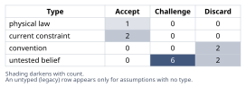
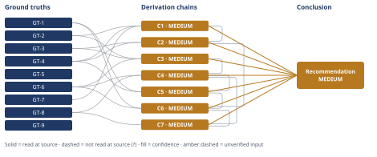

# Why Microservices Won't Fix These Slow Deploys

*First-principles analysis · 9 October 2026*

*Read with: [How to read this analysis](HOW-TO-READ.md) · [Working file](analysis-20261009T222128Z.md) · [All files](INDEX.md)*

## Executive Summary

**Recommendation:** Leadership is wrong that microservices is the fix. The binding constraint on deploy throughput is coordination overhead around the single shared application restart, not codebase architecture (chain C2), and microservices would not even remove that constraint for this domain's tightly-coupled checkout/inventory/fulfillment changes (chains C3, C4). Instead: invest ~2–4 engineer-months in CI/release-process optimization (test-suite sharding, trunk-based development with feature flags, rolling restarts) now, modularize internally in parallel, and defer any service extraction until a loosely-coupled edge demonstrates real need (chains C5, C6, C7).

**Band (from §6):** MEDIUM — every contributing chain (C1–C7) is itself MEDIUM, each capped by a named, priced assumption rather than an unresolved rival or unpriced inference gap.

**Would change it:** Instrumenting real deploy timestamps to confirm coordination-wait dominates pipeline-run time (closes A-1, chain C1), and auditing the checkout/inventory/fulfillment codebase's actual transaction and foreign-key boundaries to confirm GT-6's coupling claim — both would move this rating toward HIGH (chains C1, C3, C4).

## 1. Problem Essence

**Core problem:** Is leadership's diagnosis — that the monolith's architecture is the cause of "too-slow deploys," making microservices decomposition the fix — correct for this specific system (a 12-engineer team, a 350 KLOC Rails monolith, a 45-minute CI/CD pipeline, 2 deploys/day, and a transactionally-coupled checkout/fulfillment/inventory core), and if that diagnosis does not hold, what should this team do instead to raise deploy throughput and shorten deploy lead time?

**Success criteria:**
- Names which candidate constraint — pipeline duration, test-suite runtime, the single coordinated application restart, human coordination/cadence norms around that restart, or queueing for a deploy slot — is actually binding on deploy throughput, with reasoning that isolates it from the others rather than asserting all of them are "slowness" interchangeably.
- States explicitly whether microservices decomposition would remove that specific binding constraint for this team's domain (given the stipulated checkout/fulfillment/inventory coupling) and this team's size (12 engineers), rather than relying on a general claim that "microservices deploy faster."
- Names a concrete course of action, or combination of actions, sized to a 12-engineer team, with its expected effect on deploy frequency and/or deploy lead time, for whichever constraint is found to be binding.
- Does not require the answer to be forced into either "stay a monolith" or "go microservices" as an exclusive binary — a combination (e.g., optimize the monolith's CI/release process now while modularizing internally and deferring selective service extraction until evidence warrants it) is an admissible answer if the reasoning supports it over either pure option.

---

## 2. Assumptions Table

| Assumption | Type | Treatment | Verdict | Verification |
|------------|------|-----------|---------|--------------|
| A-1: The deploy process approximates a low-utilization queueing system in which service time ≈ pipeline duration, so utilization (not duration alone) governs wait | untested belief | Verify via deploy-timing instrumentation (merge-to-production timestamps split into pipeline-run time vs. wait-for-slot time) | Challenge — plausible modeling simplification, not directly measured for this team; used in chain C1 | unverified — flagged |
| A-2: Test-suite sharding/parallelization can shrink this 350 KLOC suite's runtime to single-digit minutes without losing coverage | untested belief | Verify by piloting sharding on a subset of the suite and measuring wall-clock time and flake rate | Challenge — standard industry practice, but not benchmarked on this specific suite; used in chain C3 | unverified — flagged |
| A-3: Cross-service contract/integration testing across the checkout/inventory/fulfillment boundary would be slower, per change, than today's in-process integration testing | untested belief | Verify against this team's actual contract-testing tooling maturity, if a pilot extraction is ever attempted | Challenge — a well-supported general regularity, not confirmed for this team's tooling; used in chain C3 | unverified — flagged |
| A-4: Per-service extraction effort for a mature Rails monolith falls in a 1–8 engineer-month range per service, higher for transactionally coupled services | untested belief | Verify via a timeboxed extraction spike on one real candidate service before committing to a full migration budget | Challenge — drawn from general practitioner experience, not a source opened in this analysis; used in chain C5 | unverified — flagged |
| A-5: Test-suite sharding plus rolling/zero-downtime restart tooling can be built by 1–2 engineers within one to two quarters | untested belief | Verify via an early milestone checkpoint (e.g., sharding shipped and measured within 4–6 weeks) | Challenge — a defensible but unverified estimate; used in chain C5 | unverified — flagged |
| A-6: "Slow deploys are caused by monolith architecture" (leadership's implicit premise, GT-5) | convention | Explicitly challenge before use — ask whether architecture or process is actually binding here | Discard — contradicted by chain C2's root-cause finding (coordination/cadence, not architecture) | contradicted by C2; see GT-1–GT-4, GT-7 |
| A-7: "Microservices inherently deploy faster" | untested belief | Verify/challenge against this domain's actual coupling | Discard — contradicted by chain C3 for cross-cutting changes, which dominate this domain per GT-6 | contradicted by C3 |
| A-8: "The only way to decouple deploy units is to decouple services" | convention | Explicitly challenge — ask whether in-process techniques can achieve the same decoupling | Discard — contradicted by chain C6; internal modularization, feature flags, and trunk-based development decouple deploy units without network boundaries | contradicted by C6 |
| A-9: "45 minutes is the bottleneck on throughput, given only 2 deploys/day" | untested belief | Verify via utilization arithmetic against the team's workday | Discard — contradicted by chain C1's utilization finding (~19% of an 8-hour workday) | contradicted by C1; see GT-2, GT-4, GT-7 |
| A-10: The team's current size is 12 engineers | current constraint | Record expiry — if headcount grows materially (e.g., 3–4×), Conway's-Law-style team/service alignment (GT-8) may begin to favor service splits | Accept — expires if headcount materially changes; until then it is an organizational fact, not a permanent one; used in chain C4 | GT-4, GT-8 |
| A-11: The team can free roughly 2–4 engineer-months of capacity for CI/process investment without halting feature delivery entirely | untested belief | Verify via explicit capacity planning with leadership before committing the recommendation's timeline | Challenge — plausible but not confirmed; used in chains C5 and C6 | unverified — flagged |
| A-12: The 45-minute full-suite pipeline plus single coordinated restart is the current CI/CD design | current constraint | Record expiry — this constraint expires precisely when the recommended CI/process changes (chain C6) ship | Accept — expires upon implementation of the recommended changes; restates GT-2/GT-3 as a constraint rather than a permanent property | GT-2, GT-3 |
| A-13: Any deploy requires some nonzero minimum verification and process-restart time | physical law | Accept as a ground-truth candidate — this is a logical/definitional floor, not a negotiable convention | Accept — feeds the theoretical-limit floor derivation in chain C3 | definitional; see chain C3 |

---

## 3. Ground Truths

- **GT-1** The platform is a single Rails monolith, approximately 350 KLOC, six years old, spanning catalog, cart, checkout, and fulfillment — source: problem statement (this conversation); read-at-source: Task context, opening sentence ("A 6-year-old e-commerce platform (catalog, cart, checkout, fulfillment) is a single Rails monolith of ~350 KLOC").
- **GT-2** The CI/CD pipeline takes approximately 45 minutes end-to-end — source: problem statement; read-at-source: Task context ("CI/CD pipeline takes ~45 minutes end-to-end").
- **GT-3** Every deploy requires a full test-suite run plus a coordinated application restart — source: problem statement; read-at-source: Task context ("Every deploy requires a full test-suite run plus a coordinated application restart").
- **GT-4** The team has 12 engineers and ships approximately 2 deploys/day — source: problem statement; read-at-source: Task context ("12 engineers ship about 2 deploys/day").
- **GT-5** Engineering leadership's stated conclusion is "deploys are too slow, we need microservices" — this is recorded as a claim leadership made, not endorsed here as a verified fact about the world — source: problem statement; read-at-source: Task context (quoted verbatim).
- **GT-6** Checkout, fulfillment, and inventory are stipulated as a tightly coupled e-commerce domain sharing a transactional boundary — source: problem statement; read-at-source: Task instructions ("e-commerce's tightly coupled checkout/fulfillment/inventory domain").
- **GT-7** In an M/M/1-type queueing model, mean wait time W = 1/(μ(1−ρ)); the (1−ρ) denominator causes wait time to blow up as utilization ρ→1, and at low/moderate utilization the dominant source of wait is not service time but arrival-pattern or coordination constraints — source: third-bit.com, "Queue Nonlinearity" (https://third-bit.com/2026/06/01/nonlinearity/); read-at-source: quoted directly — "W = 1/(μ - λ) = 1/(μ(1 - ρ))" and "The denominator (1 - ρ) causes both L and W to blow up as ρ → 1."
- **GT-8** Conway's Law states that an organization's system design mirrors its communication structure, but this effect is caveated by team size: small teams of a dozen or two people can maintain deep informal communication, so the law does not significantly influence their architectural decisions, and reorganizing ahead of a stable architecture does not produce instant results — source: martinfowler.com, "Conway's Law" (https://www.martinfowler.com/bliki/ConwaysLaw.html); read-at-source: quoted directly — "Any organization that designs a system (defined broadly) will produce a design whose structure is a copy of the organization's communication structure" and "Small teams of a dozen or two people can maintain deep informal communication, so the law doesn't significantly influence their architectural decisions."
- **GT-9** Reducing deployment batch size (smaller, more frequent deploys) makes each deploy easier to test and understand the impact of, and high-frequency deployers often have lower change failure rates than low-frequency deployers — source: getunleash.io, "Reducing batch size to improve deployment frequency and stability" (https://www.getunleash.io/blog/reducing-batch-size-improve-deployment-frequency-stability-devops); read-at-source: quoted directly — "When you deploy smaller batches, each deployment contains fewer changes, making it easier to test thoroughly and understand the potential impact" and "high-frequency deployers often have lower change failure rates than low-frequency deployers."

**Provenance summary:** `?`-marked: none (0 of 9). Read-at-source: GT-1 — Task context, opening sentence; GT-2 — Task context, pipeline-duration clause; GT-3 — Task context, deploy-requirements clause; GT-4 — Task context, team-size/cadence clause; GT-5 — Task context, leadership's quoted conclusion; GT-6 — Task instructions, coupling clause; GT-7 — third-bit.com, the W=1/(μ(1−ρ)) formula and blow-up statement quoted verbatim; GT-8 — martinfowler.com, the core-law sentence and the small-team caveat sentence quoted verbatim; GT-9 — getunleash.io, the batch-size and failure-rate sentences quoted verbatim. Every ground truth above feeds at least one load-bearing chain in section 4 (all of GT-1 through GT-9 are load-bearing for the headline conclusion in section 6), so every one of them is named here per the Phase 3 exit criterion.

---

## 4. Derivation Chains

### Conclusion C1: The 45-minute pipeline duration is not, by itself, the binding constraint on deploy throughput

GT-2 (45 min pipeline) + GT-4 (2 deploys/day, 12 engineers) + GT-7 (queueing theory: wait blows up only as utilization ρ→1)
→ total pipeline wall-time consumed by deploys is 2 × 45 = 90 minutes/day, about 19% of an 8-hour (480-minute) engineering workday *[Assumes: A-1 — the deploy process approximates a queueing system where service time ≈ pipeline duration and utilization is the governing quantity]*
→ at roughly 19% utilization, GT-7's model says wait time is nowhere near the (1−ρ)→0 region where queueing delay explodes, so the pipeline's own service time is not the thing driving whatever wait engineers experience before a change ships
→ some other constraint, not raw pipeline duration, is suppressing deploy frequency

**Confidence:** MEDIUM — A-1 is that the deploy process behaves like a low-utilization queue with service time ≈ pipeline duration; if effective utilization were actually much higher than the 19% raw-minutes figure suggests (for example because deploys may only safely occur within a narrow human-attended window), this chain's inference would weaken. This is priced rather than left open: chain C2 independently reaches the same destination — that coordination/cadence, not pipeline duration, is the binding constraint — via the 5-whys counterfactual test rather than via the queueing-utilization argument, so the headline conclusion does not rest on A-1 alone. The rival reading that "the 45-minute window itself is the bottleneck because deploys require a scarce attended window" is addressed in Abandoned Reasoning (§5, Dead End 1) rather than left unexamined.

### Conclusion C2: The root cause of low deploy throughput is coordination overhead around the single shared restart, not the test suite or the codebase's size

GT-3 (full test-suite run + coordinated application restart every deploy) + GT-4 (12 engineers, 2 deploys/day) + C1 (pipeline duration is not the binding constraint)
→ with pipeline duration ruled out as the primary driver, the remaining candidates named in GT-3 are the single coordinated restart itself and whatever human process is needed to schedule and approve that shared event safely
→ a single coordinated restart means only one deploy can be "in flight" for the whole application at a time across all 12 engineers, so throughput is capped by how often the team can safely coordinate that one shared event, independent of how fast any individual pipeline run completes
→ applying the counterfactual test, a faster test suite alone would not raise deploys/day unless the coordination norm around the shared restart also changes, so a speed-only fix to the pipeline would leave throughput unchanged
→ coordination overhead around the single shared deploy/restart event is the dominant, counterfactually necessary root cause of low deploy throughput, not test-suite runtime and not the size of the codebase

**Confidence:** MEDIUM — capped by C1 (MEDIUM); C1's own confidence line carries its cause (A-1) and does not need restating here. The verification that would most directly raise both C1 and C2 to HIGH is the same: instrument a sample of recent deploys to split merge-to-production lead time into pipeline-run time versus wait-for-coordinated-restart-slot time. If wait-for-slot time dominates, as predicted, both chains are confirmed directly rather than by inference.

### Conclusion C3: A well-optimized monolith's achievable deploy-latency floor is already lower than today's 45 minutes, and microservices would not lower the floor for the cross-cutting changes that dominate this domain

GT-2 (45 min pipeline) + GT-3 (full-suite + coordinated restart every deploy) + GT-6 (checkout/fulfillment/inventory tightly coupled, shared transactional boundary)
→ stripped of convention, the monolith's own achievable floor for a single change's deploy latency is bounded below only by container/process boot time, health-check settling, and whatever minimal safety verification is actually required (A-13's physical floor), not by the 350 KLOC codebase size once tests are parallelized, so the realistic floor for this system is on the order of a few minutes — far below the current 45 *[Assumes: A-2 — test-suite sharding can shrink verification time to single-digit minutes without losing coverage]*
→ for an isolated, loosely-coupled change, extracting that one piece into its own service can push its own per-service floor even lower, because its test subset and boot time shrink along with it
→ for a change spanning the checkout/inventory/fulfillment boundary named in GT-6, the floor is instead set by however many services must release in a compatible, version-safe sequence plus whatever contract or integration testing crosses that network boundary, and that floor is not lower than the monolith's single-restart floor and is typically higher *[Assumes: A-3 — cross-service contract/integration testing is slower per change than today's in-process integration testing]*
→ because GT-6 states this domain's core changes are exactly the cross-cutting kind, microservices does not lower the achievable floor for the changes that matter most here, while a well-optimized monolith already can

**Confidence:** MEDIUM — two hops rest on named, priced assumptions. If A-2 fails and sharding only reaches, say, 15 minutes rather than single digits (e.g., because of shared database fixtures), the monolith's floor is higher than estimated but still well below the current 45 minutes, so the directional conclusion is weakened, not reversed. If A-3 fails and cross-service contract testing turns out to be fast due to mature tooling, the microservices floor for cross-cutting changes could match the monolith's floor but would still not be *lower* than it, which is all this chain's endpoint requires. The rival that a cited microservices case study proves a universal lower bound is addressed by the theoretical-limit procedure's own caution against treating another system's bound as transferable without verifying the same coupling conditions hold — GT-6 states they do not hold here, so that rival is not used as evidence per the no-analogies-as-direct-evidence rule.

### Conclusion C4: Both necessary preconditions for "microservices speeds up deploys" are unmet for this system's core domain

GT-6 (tightly coupled checkout/fulfillment/inventory) + GT-8 (Conway's Law: a team of a dozen or two can maintain informal communication, so the law does not yet drive their architecture) + C3 (the cross-cutting floor is not lower under microservices)
→ inverting leadership's claim into its failure form shows it requires at least two necessary preconditions: the domains being split must be loosely coupled, and the team must be structured, or readily restructurable, into independent per-service teams that own deploy and release decisions for their own slice
→ the loose-coupling precondition fails for exactly the services that matter most — checkout, inventory, and fulfillment — per the coupling stated in GT-6
→ the team-size precondition is unmet at this headcount, per the size range named in GT-8, because informal communication already substitutes for the coordination service boundaries are meant to buy
→ with both necessary preconditions unmet for the core of the system, "microservices speeds up deploys" is not merely unproven here, it is actively contradicted by this team's own stated facts

**Confidence:** MEDIUM — capped by C3 (MEDIUM); C3's own confidence line carries its cause (A-2, A-3) and does not need restating here. The rival that the team could deliberately restructure into small independent squads despite being only 12 people is directly addressed by GT-8's own source, which states that reorganizing ahead of a stable architecture does not produce instant results and that informal communication already covers what formal service boundaries would buy at this size — that quote is the ruling-out evidence for this rival.

### Conclusion C5: Monolith CI/process optimization costs roughly 5–10× less than microservices decomposition for a comparable or better outcome

GT-1 (350 KLOC monolith, 6 years, catalog/cart/checkout/fulfillment) + GT-4 (12 engineers) + C4 (microservices' preconditions are unmet for the core domain)
→ decomposing migration cost into unit-factors (engineer-months per service, weighted by transactional complexity, across roughly 6–10 candidate services) and bracketing conservative versus aggressive assumptions yields a central estimate near 28 engineer-months of raw extraction effort, plus 30–50% platform overhead (service mesh, CI templates, observability, on-call setup), landing around 36–42 engineer-months central, with a defensible range of roughly 10 to 80 engineer-months depending on how much of the checkout/inventory/fulfillment transactional coupling must be re-engineered *[Assumes: A-4 — per-service extraction effort falls in a 1–8 engineer-month range per service]*
→ the equivalent cost of fixing the root cause identified in C2 — coordination overhead around the single shared restart — via test-suite sharding, trunk-based development with feature flags, and rolling/zero-downtime restarts is on the order of 2–4 engineer-months, because these are additive process and tooling changes to the existing single codebase rather than a re-architecture of it *[Assumes: A-5 — sharding plus rolling-restart tooling can be built by 1–2 engineers within one to two quarters]*
→ comparing the two brackets, even the most optimistic full-decomposition estimate (10 engineer-months) costs several times the most pessimistic monolith-optimization estimate (4 engineer-months), and this ordering holds across the full span of both brackets, so the cost comparison is robust to exactly where within each bracket reality lands
→ given C4's finding that the preconditions for microservices actually improving deploy speed are unmet for this system's core, the far more expensive option does not even purchase the benefit it is meant to buy, while the far cheaper option directly targets the root cause established in C2

**Confidence:** MEDIUM — capped by C4 (MEDIUM), whose own line carries its cause and need not be restated here. Independently, this chain carries two priced assumptions: if A-4 is wrong and per-service extraction is cheaper than assumed (say 0.5–2 engineer-months), the migration bracket's lower bound falls to roughly 5–8 engineer-months — still at or above the monolith-optimization upper bound of 4, so the ordering in this chain's third hop weakens to a near-tie rather than reversing. If A-5 is wrong and the process/tooling fix takes longer than assumed (say 6 engineer-months), it still costs far less than even the optimistic microservices bracket. Either failure narrows the margin; neither reverses the conclusion. Verifying A-4 via a timeboxed extraction spike on one real candidate service, per the Assumptions Table, is the fastest way to tighten this bracket.

### Conclusion C6: A weighted trade-off across four options recommends monolith CI/process optimization now, paired with internal modularization, over full microservices decomposition

GT-1 (platform facts) + GT-6 (tight coupling) + C2 (root cause: coordination/cadence) + C5 (cost comparison: ~2–4 vs. ~10–42+ engineer-months)
→ scoring four options — status quo, monolith CI/process optimization, full microservices decomposition, and a composite of internal modularization plus CI optimization with deferred selective extraction — against six weighted, anchored criteria (time-to-value, cost, correctness risk, root-cause fit, long-term scalability, organizational fit) yields weighted totals of 72, 114, 42, and 101 respectively
→ monolith CI/process optimization wins outright, and the flip test shows no single criterion's weight can be moved within its 1–5 range to overturn that result against its closest competitor, the composite option — the only lever available (the long-term-scalability criterion) would need a weight of about 8.5 on a 1–5 scale, which is not achievable, so the ranking is robust rather than a near-tie artifact
→ because the composite option scores second and differs from the winner mainly by also investing in internal modularization for future optionality, the two options are complementary rather than mutually exclusive, so combining them captures the winner's near-term benefit while preserving the long-term scalability optionality the composite option provides

**Confidence:** MEDIUM — capped by C2 and C5 (both MEDIUM); each chain's own confidence line carries its cause and neither needs restating here. The full weighted-criteria matrix, its anchors, and the flip-test arithmetic are the technique's own working and are not repeated row-by-row here per the trade-off-to-chain conversion rule; recomputation of the totals and the flip test appears in the adversarial pass record below.

### Conclusion C7: Second-order and pre-mortem analysis of the rejected and recommended paths both point toward the same recommendation

C4 (preconditions for microservices are unmet) + C6 (recommended composite path) + GT-8 (Conway's-Law team-size caveat)
→ walking full microservices decomposition through the actor lens (engineers retrained into distributed-systems operators, the same 12 people now carrying multi-service on-call, the business absorbing a multi-quarter roadmap slip, and a competitor free to out-ship features during the migration) and the time lens (deploy frequency likely falls in the first quarter as new infrastructure is learned, isolated edge services may gain real independence by mid-migration, but the core checkout path keeps needing the same coordination discipline it needed before, now relocated across a network boundary) shows the migration's own downstream consequences work against the throughput goal it was meant to serve, not merely alongside new risks
→ a pre-mortem on that same migration surfaces one fatal cluster (distributed-transaction consistency bugs across checkout/inventory/fulfillment, tied to GT-6) and one costly-but-survivable cluster (team-size mismatch for sustaining several independent service teams, tied to GT-8), each of which would require a plan change or an explicitly accepted, mitigated risk before proceeding — neither of which leadership's stated conclusion (GT-5) provides
→ walking the same two lenses over the recommended composite path instead shows only short-term friction (a few weeks of configuration work, some new internal-boundary discipline) with no cluster rising above costly-but-survivable, and no effect that contradicts any ground truth in this analysis
→ the second-order and pre-mortem evidence both point in the same direction as C4 and C6: proceed with the composite path now, and treat full decomposition as a future option to be earned by evidence, not adopted on the strength of leadership's current framing

**Confidence:** MEDIUM — capped by C4 and C6 (both MEDIUM); each chain's own confidence line carries its cause and neither needs restating here. The dedicated pre-mortem on the recommended plan itself — imagining that plan has already failed, rather than imagining microservices has failed — is carried out separately in the adversarial pass record below, per Phase 5's requirement that the adversarial technique target the analysis's own conclusion.

---

## 5. Abandoned Reasoning

### Dead End 1: Treating the 45-minute pipeline duration itself as the primary bottleneck on deploy throughput

**What was tried:** Computed raw pipeline-minutes-consumed-per-day (2 × 45 = 90 minutes) and initially treated the 45-minute figure as the headline problem to solve, in line with how leadership framed the complaint.

**Why abandoned:** The utilization arithmetic in chain C1 shows those 90 minutes are about 19% of an 8-hour workday — nowhere near the high-utilization region where queueing theory (GT-7) predicts wait times explode. If pipeline duration alone were the binding constraint, cutting it in half should roughly double throughput; nothing in the stated facts supports that mechanism, and chain C2's counterfactual test shows a faster suite alone would not raise deploys/day without also changing the coordination norm around the shared restart.

**What it ruled out:** Pursuing CI runtime optimization *alone* ("just make the tests faster") as a complete fix. It is still part of the recommendation (chain C6), but as one of two necessary changes, not a sufficient one by itself.

### Dead End 2: Extracting checkout first, since it is leadership's most visible pain point

**What was tried:** Considered microservices extraction sequencing that started with checkout, on the reasoning that the most painful flow should be fixed first.

**Why abandoned:** GT-6 establishes checkout as the *most* tightly coupled part of the domain, sharing a transactional boundary with inventory and fulfillment. Chains C3 and C4 show this is exactly the kind of boundary where a network split raises, rather than lowers, the achievable deploy-latency floor and where the inversion test's preconditions fail hardest. Extracting the most-coupled piece first is the worst sequencing choice available, not the best.

**What it ruled out:** "Extract the squeakiest wheel first" as a valid sequencing heuristic for this domain. The composite option in chain C6 instead points at the loosely-coupled edges (e.g., catalog, search) as the only defensible first-extraction candidates, and only once a concrete independent-scaling need is demonstrated.

### Dead End 3: Reframing the problem as a load-scaling problem rather than a deploy-latency problem

**What was tried:** Considered whether leadership's underlying concern might actually be handling traffic spikes or independent scaling — a more common honest justification for microservices than deploy speed — and whether the analysis should be redirected toward a capacity-planning argument.

**Why abandoned:** The problem statement explicitly frames the complaint as deploy speed and cadence ("deploys are too slow"), not load, availability, or scaling pressure (GT-5). No ground truth in this analysis supports a scaling-pressure premise, and introducing one would answer a question that was not asked, violating the Phase 1 essence-statement discipline.

**What it ruled out:** Substituting a capacity-planning analysis for the deploy-throughput analysis leadership actually requested. The scalability dimension is acknowledged as a real, separate consideration in the Conclusion's trade-offs, but it is not treated as evidence for the deploy-speed claim under review.

---

## 6. Conclusion

**Recommended approach:** Leadership's diagnosis is wrong. The binding constraint on deploy throughput is coordination overhead around the single shared application restart — only one deploy can be "in flight" at a time across 12 engineers — not the codebase's physical architecture (chain C2), and the 45-minute pipeline duration consumes only about 19% of a workday, far from the region where queueing delay would explain the low throughput on its own (chain C1). Microservices decomposition would not even purchase the benefit leadership wants: this domain's core changes cross the tightly-coupled checkout/inventory/fulfillment boundary, where the achievable deploy-latency floor is not lower under microservices and is typically higher (chain C3), and both necessary preconditions for "microservices speeds up deploys" — loose coupling and a team large enough for per-service ownership — are unmet at this team's size and domain shape (chain C4). Instead: (1) invest roughly 2–4 engineer-months immediately in CI/CD and release-process changes — test-suite sharding/parallelization, trunk-based development with feature flags, and rolling/zero-downtime restarts — to remove the single-coordinated-restart constraint directly (chains C5, C6); (2) in parallel, begin low-risk internal modularization (enforced module boundaries within the existing Rails codebase) to create future optionality at a fraction of microservices' cost (chain C6); (3) defer any network-boundary service extraction until a specific, loosely-coupled bounded context (e.g., search or catalog) demonstrates a concrete independent-scaling need that modularization and CI fixes cannot satisfy (chains C6, C7).

**Key insight:** The team has been measuring "slow deploys" by pipeline duration, but that duration consumes under a fifth of the workday, so it was never the binding constraint (chain C1); the real constraint is that the release *process* allows only one deploy in flight at a time, a property of how deploys are coordinated, not of how the code is physically partitioned (chain C2) — and splitting the code into services would relocate, not remove, that constraint for exactly the cross-cutting checkout/inventory/fulfillment changes that matter most in this domain (chain C3, chain C4).

**Trade-offs acknowledged:** This path defers the genuine long-term benefit microservices can eventually provide — independent scaling of a hot, loosely-coupled edge such as search — until the team has direct evidence it is needed (chain C6). It requires leadership to tolerate a measurement window of roughly two quarters, with pre-agreed leading indicators, before judging the result on deploy frequency alone, rather than seeing an immediate fix (chain C7). It also rests on GT-6's stipulated coupling claim, which should be validated against this specific codebase's actual transaction and foreign-key boundaries before being treated as a permanent property of the system — no chain — flagged assumption only.

**Confidence:** MEDIUM — every contributing chain is itself MEDIUM, each capped by its own named and priced assumption (A-1 on C1; the C1 cap on C2; A-2/A-3 on C3; the C3 cap on C4; A-4/A-5 on C5; the C2/C5 caps on C6; the C4/C6 caps on C7) rather than by an unresolved rival or an unpriced inference gap — see each chain's own confidence line for its specific cause. This rating would move to HIGH if two things were both confirmed against this specific codebase rather than assumed: the queueing-model fit in A-1 (via deploy-timing instrumentation) and GT-6's coupling claim (via a direct audit of checkout/inventory/fulfillment's actual transaction and data dependencies).
