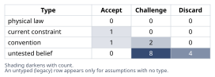
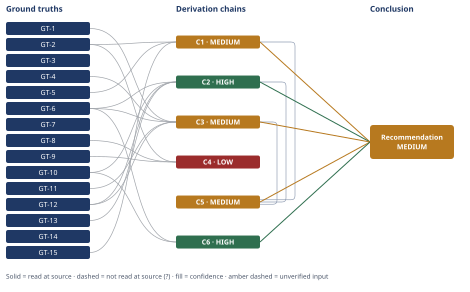

# Monolith Deploy Speed: Microservices vs Direct Fixes

*First-principles analysis · 10 October 2026*

*Read with: [How to read this analysis](HOW-TO-READ.md) · [Working file](analysis-20261010T082608Z.md) · [All files](INDEX.md)*

## Executive Summary

**Recommendation:** Leadership's conclusion is not correct as stated. Fix the pipeline and release process directly — instrument it, shard the test suite, adopt phased restarts, and decouple deploy from release with feature flags — and defer microservices until a named organizational/scaling trigger fires, not before (chain C5, chain C6).

**Band (from §6):** MEDIUM

**Would change it:** Instrumenting the CI pipeline and runner concurrency to settle chain C1's causal attribution, and scoping the checkout/inventory data-consistency design directly to tighten chain C3's cost-comparison margin, would move this to HIGH (chain C1, chain C3).

## 1. Problem Essence

**Core problem:** Given a monolithic e-commerce platform whose release pipeline takes 45 minutes and whose observed throughput is ~2 deploys/day, is a full microservices decomposition the correct remedy, or does the actual bottleneck — and therefore the correct remedy — lie elsewhere in test design, deploy mechanics, or release process, independent of how many deployable services the system is split into?

**Success criteria:**
1. The analysis names the specific mechanism(s) that produce the 45-minute duration and the 2/day figure, and shows whether splitting the codebase into N services would change those mechanisms.
2. The analysis states, with a cost/effort comparison, whether a full microservices migration or a direct pipeline/process fix reaches improved deploy throughput faster and at lower risk for this specific team (12 engineers) and domain (tightly coupled catalog/cart/checkout/fulfillment).
3. The analysis produces a prioritized action plan that is not constrained to picking exactly one of "microservices" or "do nothing" — a direct-fix path, a partial-extraction path, and a combination of the two are all live candidates to be evaluated on the same footing.
4. The analysis states concrete, named conditions under which a future microservices extraction (full or partial) would become the correct call, so the question can be re-opened on evidence rather than on recurring pressure alone.

## 2. Assumptions Table

| Assumption | Type | Treatment | Verdict | Verification |
|---|---|---|---|---|
| A1: The monolith's architecture (being one deployable unit) is the cause of the 45-minute pipeline duration. | untested belief | Verify via decomposition (five-whys reduce-to-primitives + arithmetic). | Discard — contradicted by GT-11 and by the five-whys drill in §3, which bottoms out at tooling/process choices, never at codebase or service count. | unverified — flagged; ruled out via chains C1/C4 |
| A2: Splitting into microservices will reduce deploy time / increase deploy throughput. | untested belief / convention | Challenge via inversion. | Discard — inversion (chain C2) shows it does not fix the identified bottleneck and adds distributed-system costs (GT-12, GT-13) for a 12-engineer team. | unverified — flagged; challenged and discarded in chain C2 |
| A3: The coordinated application restart requires a full stop-the-world cutover. | current constraint | Record expiry condition. | Accept — true today; expires once a rolling/phased restart mechanism is adopted (GT-9). | GT-9 (Puma `restart.md`, read-at-source) |
| A4: A full test-suite run is necessary on every deploy. | convention | Challenge before use. | Challenge — some test run is necessary for correctness confidence, but serial, unsharded execution of the full suite on every change is a convention, not a requirement. | GT-8 (GitHub Actions matrix docs, read-at-source) |
| A5: 2 deploys/day is a direct consequence of the 45-minute pipeline duration. | untested belief | Verify via arithmetic. | Discard — a 45-minute serial pipeline permits ≈32 sequential runs/day (GT-15); observed 2/day is ≈6% of that ceiling, so duration is not the binding constraint. | GT-15 (arithmetic identity); chain C1 |
| A6: 12 engineers is enough to sustainably own and operate N≈4–6 independent microservices without materially raising coordination/ownership risk. | untested belief | Challenge via arithmetic + Conway's Law. | Discard — 12/4–6 ≈ 2–3 engineers/service before platform overhead, and GT-10's team-communication framing implies boundaries that outrun real team structure will be fought by the organization. | GT-10 (Conway's Law, read-at-source); chain C2 |
| A7: Catalog, cart, checkout, and fulfillment are equally natural, low-risk seams to split along. | convention | Challenge before use. | Challenge — checkout/cart/fulfillment need strong consistency across inventory, pricing, and payment; catalog is read-heavy and loosely coupled; seams are not fungible in risk. | GT-6 (task-stated domain coupling) + GT-13; chains C2, C7 |
| A8: Fixing the pipeline/process directly, without a service split, is technically feasible for this monolith. | convention (standard industry practice) | Supported directly by cited sources. | Accept — test parallelization (GT-8), phased restarts (GT-9), and deploy/release decoupling via feature flags (GT-14) are standard, documented patterns, not exotic engineering. | GT-8, GT-9, GT-14 (all read-at-source) |
| A9: CI runner capacity / build concurrency is sufficient and is not itself a contributor to the observed 2/day throughput. | untested belief | Flag as unverified; recommend as first diagnostic step. | Challenge — unverified — flagged; nothing in the scenario establishes this, and it is the single most load-bearing open question behind chain C1's causal attribution. | unverified — flagged; action item 0 in §6 |
| A10: Deploy throughput is leadership's complete and only stated justification — no undisclosed scaling/organizational driver is also in play. | untested belief | Flag; out of scope but named explicitly. | Challenge — unverified — flagged; this analysis takes the stated justification (GT-2, GT-5, GT-7) at face value; chain C7's triggers should be checked against any undisclosed driver. | unverified — flagged; none supplied in the scenario |
| A11: The composition of the 45-minute pipeline (install/boot vs. asset compile vs. test execution vs. restart) is known. | untested belief | Flag as unverified; this gap is itself a finding. | Challenge — unverified — flagged; no phase-by-phase breakdown was given, so chain C4's bracket rests on an assumed, explicitly-flagged composition. | unverified — flagged; action item 0 in §6 |
| A12: A coordination-overhead efficiency multiplier of ≈0.45 (vs. naive linear headcount scaling) reasonably approximates real parallelization limits for migration design/build work on this team. | untested belief | Flag as a judgment-based heuristic, explicitly bracketed. *(surfaced in Phase 4 audit — chain C3)* | Challenge — unverified — flagged; chain C3's bracket is built so its lower and upper ends still drive the same decision, bounding (not eliminating) this risk. | unverified — flagged; see chain C3 |
| A13: The seven weighted trade-off criteria and their locked weights reasonably reflect what this leadership team actually values. | untested belief | Flag; recommend confirming weights with leadership directly. *(surfaced in Phase 4 audit — chain C5)* | Challenge — unverified — flagged; the flip-test in chain C5 shows the ranking is robust to any single ±1 weight change, bounding this risk. | unverified — flagged; see chain C5 |
| A14: Engineering capacity freed by not pursuing a full migration is redirected to customer-facing feature work rather than reabsorbed elsewhere. | untested belief | Flag. *(surfaced in Phase 4 audit — chain C6)* | Challenge — unverified — flagged; a management-execution question outside this analysis's data. | unverified — flagged; see chain C6 |
| A15: Specific headcount thresholds for when multiple autonomous product teams naturally emerge (materially above the current 12) are a reasonable illustrative heuristic. | untested belief | Flag; the attempted citation for a standard team-size heuristic returned no result. *(surfaced in Phase 4 audit — chain C7)* | Challenge — unverified — flagged; the qualitative trigger (organizational scale, not latency) is backed by GT-10 directly; the specific numbers are illustrative judgment only. | unverified — flagged; source fetch attempted, unavailable |
| A16: The per-context design and data/consistency engineering-month unit costs used in chain C3 are of the correct order of magnitude. | untested belief | Flag as a judgment-based heuristic; priced so that the resulting brackets stay decisive even under moderate error. *(surfaced in Phase 4 audit — chain C3)* | Challenge — unverified — flagged; chain C3's non-overlapping-bracket argument absorbs moderate error in these unit costs without changing the ranking. | unverified — flagged; see chain C3 |

## 3. Ground Truths

**Scenario premises (GT-1–GT-7) are stipulated by the problem statement itself** — they are the given facts of this engineering situation, not externally-sourced claims, so the `read-at-source` / `reported-by-delegate` / `unverified` provenance machinery (built for claims about the world that could be wrong) does not apply to them; they carry no `?` because they are not in dispute as premises of the case under analysis.

- **GT-1** The platform is a 6-year-old Ruby on Rails monolith, ~350 KLOC, covering catalog, cart, checkout, and fulfillment in a single deployable. — source: problem statement (stipulated).
- **GT-2** The CI/CD pipeline takes ~45 minutes end-to-end. — source: problem statement (stipulated).
- **GT-3** Every deploy requires a full test-suite run plus a coordinated application restart. — source: problem statement (stipulated).
- **GT-4** The team has 12 engineers. — source: problem statement (stipulated).
- **GT-5** Current throughput is ~2 deploys/day. — source: problem statement (stipulated).
- **GT-6** Catalog/cart/checkout/fulfillment business logic is tightly coupled. — source: task framing (stipulated).
- **GT-7** Leadership's stated, settled conclusion is: "deploys are too slow, we need microservices." — source: problem statement (stipulated).

**Externally-sourced ground truths (GT-8–GT-14), read at source during this analysis:**

- **GT-8** CI matrix/parallel-job strategies run multiple test-job variations concurrently rather than sequentially, and a configurable maximum-parallelism setting controls concurrency — the mechanism by which total CI wall-clock duration is reduced via parallel execution. — source: GitHub Actions documentation, "Using a matrix for your jobs"; read-at-source: page text on `jobs.<job_id>.strategy.matrix` and `jobs.<job_id>.strategy.max-parallel`, quoted: "A job will run for each possible combination of the variables."
- **GT-9** Puma's phased restart replaces worker processes one at a time; new connections are not lost and clients see no added latency, provided more than one worker is configured — contrasted with a full stop/start of all workers at once. — source: Puma `docs/restart.md`; read-at-source: quoted, "A phased restart works by first killing an old worker, then starting a new worker, waiting until the new worker has successfully started before proceeding to the next worker," and "New connections are not lost, and clients will not experience any increase in latency (as long as the number of configured workers is greater than one)."
- **GT-10** Conway's Law: organizations are constrained to produce designs that mirror their communication structure (Conway, 1967); loosely-coupled organizations produce more modular systems; misalignment between team structure and system boundaries causes the project to be "in trouble" (Coplien & Harrison). Separately, Martin Fowler's "Microservice Premium": "don't even consider microservices unless you have a system that's too complex to manage as a monolith"; the majority of software systems should be built as a well-modularized monolith; many perceived monolith limitations on continuous delivery are organizational-implementation failures, not inherent architecture limits. — sources: Wikipedia, "Conway's law"; martinfowler.com, "MicroservicePremium"; both read-at-source (quoted above) and treated as one combined ground truth because they jointly establish the single claim this analysis needs — that the trigger for splitting is organizational/complexity scale, not deploy latency.
- **GT-11** Distributed systems impose a "Microservice Premium": "microservices impose a cost on productivity that can only be made up for in more complex systems"; remote calls are slower and failure-prone than in-process calls ("Distributed systems are harder to program, since remote calls are slow and are always at risk of failure"); multi-resource updates generally forgo distributed transactions in favor of eventual consistency, which can be "extremely hard to diagnose." — source: martinfowler.com, "Microservice Trade-Offs"; read-at-source: quoted passages above.
- **GT-12** Operating many services multiplies — rather than removes — the CI/CD automation burden: "half-a-dozen applications now turn into hundreds of little microservices," and "there's no way to handle dozens of services without the automation and collaboration that continuous delivery fosters" — i.e., each resulting service needs the same deployment-automation investment the original system needed, not a smaller one. — source: martinfowler.com, "Microservice Trade-Offs"; read-at-source: quoted passage above.
- **GT-13** Feature flags/toggles let an application "keep everyone working on the mainline without revealing a half-implemented feature," decoupling code deployment from feature release — though the source itself cautions that flags are "the last thing you should do," after small-batch releases and the Keystone Interface pattern, i.e., a supplementary tool rather than a first-choice substitute for good release slicing. — source: martinfowler.com, "FeatureToggle"; read-at-source: quoted passages above.

**Derived ground truth (GT-15), verified by direct computation — not an empirical claim, so the `?` machinery does not apply:**

- **GT-15** A strictly serial release process with fixed duration D = 45 minutes permits at most ⌊(24×60)/45⌋ = 32 sequential completions per day; the observed throughput of 2/day is therefore ≈6% of the technical ceiling implied by pipeline duration alone. — source: arithmetic identity (24×60÷45 = 32, recomputed independently in §5 Recompute); verified by direct computation.

**Provenance summary.** `?`-marked: none (0 of 15) — every ground truth is either a stipulated scenario premise (GT-1–GT-7), read at source (GT-8–GT-14), or a verified mathematical identity (GT-15). Read-at-source locations for every unsuffixed, externally-sourced ground truth feeding a load-bearing chain: GT-8 — GitHub Actions "Using a matrix for your jobs," the `matrix`/`max-parallel` passages quoted above; GT-9 — Puma `docs/restart.md`, the phased-restart and no-added-latency passages quoted above; GT-10 — Wikipedia "Conway's law" (Conway 1967 formulation, Coplien & Harrison) and martinfowler.com "MicroservicePremium," passages quoted above; GT-11 — martinfowler.com "Microservice Trade-Offs," the distributed-systems and eventual-consistency passages quoted above; GT-12 — same source, the per-service automation-burden passage quoted above; GT-13 — martinfowler.com "FeatureToggle," the deploy/release-decoupling and "last thing you should do" passages quoted above.

**Five-Whys (causal mode) drill — irreducibility check on "the monolith's architecture causes the 45-minute pipeline / 2-deploys-per-day figures" (supports GT-15's use in chain C1 and rules out assumption A1):**

1. *Why only ≈2 deploys/day?* → Because deploys are executed only during scheduled release windows rather than continuously. *Counterfactual: without scheduled windows, would 2/day still occur?* No — throughput would track however many CI runs complete and pass. Necessary cause — drill further.
2. *Why scheduled windows rather than continuous deploys?* → Because the coordinated restart is treated as a risk event requiring a human to watch the rollout, so it is batched to reduce how often that event occurs. *Counterfactual:* plausible, but not fully confirmable from the given facts — marked `?` (this is assumption A9/A11's territory); drill the named branch anyway.
3. *Why is the restart treated as a risky, watched event?* → Because the current mechanism is a full stop/start of the application rather than a rolling/phased restart; GT-9 shows a phased restart avoids dropped connections and added latency. *Counterfactual: with a phased-restart mechanism in place, would the restart still need to be a watched, batched event?* No — phased restart removes the correctness/availability risk that motivates batching. Necessary cause — drill further.
4. *Why does the team use a full restart instead of a phased one?* → Because the deploy tooling has not been configured for phased restarts — a tooling gap, not a property of the monolith's size or the number of services it contains. *Counterfactual: if the monolith had already been split into microservices but each service still used a full-stop restart, would the batching behavior disappear?* No — the same batching motive would apply per service. This is the step that rules out A1: the cause is the restart-mechanism choice, not codebase/service architecture.
5. *Why has this tooling gap not already been closed?* → Plausibly, engineering time has been prioritized toward feature delivery over deploy-pipeline investment. *Counterfactual:* cannot be confirmed from the given facts — marked `?`, unresolved; settling it would require the team's planning history, which is outside this analysis's data and not needed for the forward recommendation.

**Verdict:** Root cause (within control) = restart-mechanism choice (full stop/start instead of phased/rolling), driving risk-averse batching of release windows — corrective: adopt a phased/rolling restart (GT-9); actionable immediately. Contributing/unresolved (`?`): prior prioritization history (step 5) and whether CI runner capacity independently constrains throughput (step 2) — both unresolved on the given facts, both named as open diagnostic questions rather than treated as settled.

## 4. Derivation Chains

### Conclusion C1: Deploy throughput is bottlenecked primarily by release-process policy, not by pipeline duration or by the monolith's codebase/service architecture

GT-2 (45-minute pipeline) + GT-5 (2 deploys/day observed) + GT-15 (serial-capacity ceiling arithmetic)
→ a strictly serial 45-minute pipeline mathematically permits roughly 32 sequential completions in a 24-hour day
→ observed throughput of 2 per day is only about 6% of that technical ceiling
→ a gap this large between technical capacity and observed throughput cannot be fully explained by pipeline duration alone *[Assumes: A9 — CI runner concurrency is not itself the bottleneck; if A9 is false the explanation shifts from release-batching policy toward CI infrastructure capacity, but the top-level finding that pipeline duration itself is not the binding constraint is unaffected either way]*
→ the most plausible remaining explanation, pending direct verification, is release-batching policy or manual coordination gates around the restart rather than the monolith's size or service count

**Confidence:** MEDIUM — the Rivals axis is short: a live, unruled-out rival (CI runner scarcity/queueing as the dominant constraint, named as assumption A9) has not been settled by any fact given in the scenario. What would close it: instrument the CI system for one to two weeks to log (a) actual runner concurrency and queue-wait time for every build attempt, and (b) timestamps of every deploy attempt across a full day, not only completed ones. Until that data exists, this chain's attribution to "policy" specifically — as opposed to infrastructure capacity — is the weakest link; the arithmetic finding that duration itself is not the binding constraint (hops 1–2) is independently HIGH-confidence (pure computation, recomputed in §5).

### Conclusion C2: Splitting into microservices now would not fix the throughput bottleneck identified in chain C1, and would add net-new delivery and correctness risk for this team

GT-6 (domain coupling) + GT-10 (microservice premium / complexity threshold) + GT-12 (distributed-system costs) + GT-13 (per-service CD burden)
→ a single extracted service's own test suite can run faster in isolation, but cross-service integration and contract tests that did not previously exist now sit on the critical path for any change spanning more than one service
→ given GT-6's stated tight coupling between cart, checkout, and fulfillment, a large share of real changes in this domain cross service boundaries, so this new cross-service testing tax applies broadly rather than to an edge case
→ the resulting N services would each still need the same test-design and restart-strategy fixes identified in chain C1, which were never addressed — only multiplied across N deploy pipelines to maintain
→ splitting also adds currently-absent distributed-system costs — network calls, eventual consistency, and contract/version management — which for a payments/inventory/fulfillment flow is a correctness risk categorically worse than a slow pipeline

**Confidence:** HIGH — every hop follows directly from a named, read-at-source ground truth or from GT-6's stated coupling premise; the strongest rival to this chain's claim — that a well-executed single-context extraction with mature saga design from day one could avoid these costs — is named and ruled out in §5 Abandoned Reasoning (AR-2): the engineering effort that rescues correctness is precisely what keeps chain C3's migration-cost bracket above the direct-fix bracket, so the rival does not change this chain's endpoint. No `?`-marked input, no unpriced assumption on any hop this endpoint depends on.

### Conclusion C3: A full microservices migration costs roughly 5–6× the effort of directly fixing the pipeline and release process, before counting the recurring per-service operational tax migration adds permanently

GT-1 (350 KLOC, 6-year-old monolith) + GT-4 (12 engineers) + GT-6 (domain coupling) + GT-11 (distributed-system costs) + GT-12 (per-service CD burden)
→ decomposing migration cost into boundary-design, data/consistency-engineering, and platform-setup unit-factors yields a one-time effort bracket of roughly 8 to 23 engineer-months (central ≈13), with data/consistency engineering for the transactionally coupled contexts as the dominant and most uncertain factor *[Assumes: A16 — the per-context unit-cost estimates are of the correct order of magnitude; this is the chain's named weakest link (see §5 Sensitivity) because if these estimates are optimistic by roughly 2× or more, the effort-month bracket's lower end could approach the direct-fix bracket's upper end, narrowing the margin]*
→ applying a parallelization-efficiency multiplier appropriate for 12 engineers converts that effort bracket into a calendar-time bracket of roughly 3 to 8.5 months (central ≈5) *[Assumes: A12 — a ≈0.45 coordination-overhead efficiency multiplier approximates real parallelization limits for this kind of interdependent work; if this multiplier is wrong the calendar-time figures shift, but the effort-month comparison in the next hop does not depend on it]*
→ decomposing the direct-fix path (test sharding, test-suite speed audit, phased-restart adoption, feature-flag tooling, CI runner-capacity audit) the same way yields a one-time effort bracket of roughly 1.3 to 5 engineer-months and a calendar-time bracket of roughly 1 to 3.5 months with 2–3 engineers assigned part-time
→ the effort-month brackets do not overlap (8–23 versus 1.3–5 engineer-months, an 8× gap at the near edge and a ≈5× gap at the central estimates); the calendar-time brackets narrow to a small edge-case overlap once the efficiency multiplier is applied, but the central calendar estimates remain decisively different (≈5 months versus ≈1.6 months), so the ranking does not depend on resolving that edge case

**Confidence:** MEDIUM — the Inference axis is short on one hop: A16 (the per-context unit-cost estimates) is not fully priced against failure — a large enough overestimate of migration cost would narrow the decisive effort-month gap, even though the central estimates differ by roughly 5×. What would close it: a scoped, time-boxed engineering estimate (a one-week spike) specifically for the checkout/inventory data-consistency design, the single highest-uncertainty line item, before this cost comparison is treated as final. A12's dependency is priced and does not threaten the conclusion, since the decisive comparison runs on engineer-months, not calendar time.

### Conclusion C4: An 8-to-15-minute pipeline, down from 45 minutes, is a realistic achievable floor for this monolith without any change to its service architecture

GT-2 (45-minute pipeline) + GT-8 (CI parallel-job mechanism) + GT-9 (phased restart)
→ treating the 45 minutes as a largely fixed setup/compile cost of roughly 5 to 9 minutes plus a parallelizable test-execution cost of roughly 30 to 38 minutes is a reasonable first decomposition, though the real split is unmeasured *[Assumes: A11 — the assumed pipeline-phase composition is of the correct order of magnitude; this is not fully priced against failure, because the specific minute figures in the next hop shift directly with it]*
→ sharding that test-execution cost across 8 to 16 parallel CI workers drives the test phase toward roughly 2 to 4 minutes, so the pipeline's ideal floor lands in an 8-to-15-minute range once fixed setup cost is added back
→ converting the coordinated restart to a phased/rolling restart removes the restart step from the user-facing blocking critical path entirely, since GT-9 shows it proceeds without dropped connections or added latency
→ no "best demonstrated" figure for a similarly sized Rails monolith's optimized pipeline could be verified from a source this analysis opened, so that tier of the bracket is left explicitly unfilled rather than asserted

**Confidence:** LOW — two axes are short at once. Inference: A11 (the assumed pipeline-phase breakdown) is not priced against failure — the 8-to-15-minute figure moves directly with it, and no instrumentation data exists in this scenario to anchor it. Rivals: a live, unruled-out rival (pre-mortem cluster 3, §5) holds that the practical floor is closer to 15–20 minutes if fixed per-shard setup cost (database schema/seed load) does not shrink proportionally with sharding; nothing in this analysis settles between the two. What would close both: instrument the existing pipeline for phase-by-phase timing, then run a small sharding spike and measure the achieved floor directly rather than estimating it. Even the pessimistic 15–20 minute reading is still a 2–3× improvement over 45 minutes, so this chain's low confidence is about the precise number, not about whether improvement is achievable without a service split.

### Conclusion C5: A composite of immediate direct pipeline/process fixes plus explicitly named future triggers for partial extraction dominates both inaction and a full microservices split now, and its second-order effects are net favorable

C1 (release-process policy is the bottleneck, MEDIUM) + C2 (splitting doesn't fix it and adds risk, HIGH) + C3 (migration costs 5–6× the direct fix, MEDIUM)
→ scoring four options — full split now, do nothing, direct fixes, direct fixes plus named future triggers — against seven weighted criteria anchored to concrete thresholds (time-to-impact, cost, correctness-risk, reversibility, root-cause-fit, organizational fit, future optionality) yields direct-fixes-plus-triggers highest at 126, direct fixes alone second at 123, doing nothing third at 92, and a full split now last at 44
→ the ranking is insensitive to any single ±1 weight change between the top two; the smallest change that flips them requires cutting the weight on "addresses the diagnosed root cause" from 5 to 2, which is difficult to justify *[Assumes: A13 — the locked criteria weights reasonably reflect what leadership values; if A13 is wrong by a small amount the ranking is unaffected per this flip test, and only a large, hard-to-justify reweighting changes the winner]*
→ direct-fixes-plus-named-triggers therefore dominates both "do nothing" and "split into microservices now" under any reasonable weighting
→[2nd] freeing the team from a 9-to-12-month migration (chain C3) redirects the equivalent engineering capacity toward customer-facing feature work over the following year, while leadership must publicly revise a previously "settled" conclusion, a credibility cost that is one-time rather than recurring *[Assumes: A14 — freed capacity is actually redirected to feature work rather than reabsorbed elsewhere; if false, this hop's throughput benefit does not materialize, though chains C2 and C3's cost- and risk-avoidance findings hold independently of this hop]*
→[2nd] initially higher deploy frequency, enabled by decoupling deploy from release via feature flags (GT-13), raises the short-term volume of deploy-related events on-call must reason about, until canary and rollback automation matures
→[3rd] sustained over a longer horizon, continuous delivery becomes the team's normal operating mode, and the goal behind leadership's original conclusion — shipping value faster and reducing risk from large batched releases — is realized more fully than a full-split path would realize it in the same window, since that path spends the equivalent time mid-migration with reduced net feature throughput (chain C3)

**Confidence:** MEDIUM — capped by the Inputs ceiling (this chain cites C1 and C3, both MEDIUM; see their own confidence lines for what would raise them). Additionally, A13's residual (a large, hard-to-justify reweighting could flip the ranking) and A14's unpriced second-order hop (freed capacity might not be redirected to feature work) are both named here; neither threatens this chain's own endpoint, since the ranking's robustness is established independently of A14, and A13's failure mode requires an implausible reweighting. No ground truth is contradicted by the second-order extension, so this chain does not route back to Phase 2.

### Conclusion C6: Microservices become justified by organizational scale or a genuine independent-scaling need, not by deploy latency alone — and extraction, when triggered, should be scoped to the lowest-coupling context first

GT-10 (Conway's Law + microservice premium) + GT-6 (domain coupling)
→ GT-10's own stated trigger for microservices is system complexity a monolith can no longer manage, not deploy latency by itself
→ GT-10's communication-structure framing implies the trigger is organizational as much as technical — service boundaries stick when they mirror real, independently-operating team communication structures
→ for this team, that threshold is plausibly crossed when at least one of three conditions holds: headcount grows enough to form multiple genuinely autonomous product teams each needing independent release cadence, a new product line emerges with materially different scaling/latency/uptime requirements than the core commerce flow, or one specific bounded context needs independent scaling for a concrete, named reason *[Assumes: A15 — the specific illustrative headcount figures named for "multiple autonomous product teams" are a reasonable heuristic, not a verified threshold; if this heuristic is wrong, the qualitative trigger stated in this hop is unaffected, since it rests on GT-10 directly rather than on any specific number]*
→ given GT-6's stated transactional coupling, catalog is comparatively the safest first candidate if a trigger occurs, while checkout, cart, and fulfillment remain the worst candidates — so which context to extract first is not a free choice even once a trigger fires

**Confidence:** HIGH — every hop follows from GT-10's or GT-6's stated content; A15 is priced (the qualitative trigger does not depend on the specific illustrative numbers); the rival that extreme deploy latency alone, regardless of organizational scale, could justify microservices is named and ruled out in §5 Abandoned Reasoning (AR-6), via GT-10's own complexity-based framing and chain C4's finding that 45 minutes is mostly reducible by convention rather than an extreme, irreducible outlier.

## 5. Abandoned Reasoning

### Dead End AR-1: Steelmanning leadership's conclusion directly from the microservice-premium ground truth

**What was tried:** Attempted to construct a supporting chain for "a full split is justified primarily by deploy-speed pain," treating leadership's stated conclusion (GT-7) as the working hypothesis and looking for a path from GT-10/GT-12 to it directly.

**Why abandoned:** GT-10 itself states the premium is only repaid in systems too complex for a monolith to manage, not in systems with a slow pipeline; and chain C1's arithmetic shows the 45-minute pipeline is not even the binding constraint on the 2/day figure cited as the justification. The hypothesis's own premise — deploy-speed problem ⇐ monolith architecture — was never established.

**What it ruled out:** Option A (full split now) in the trade-off collapsed into chain C5, and the headline rival that leadership's conclusion is correct as stated; cites GT-10, chain C1.

### Dead End AR-2: Rescuing a near-term full split with a mature saga/compensating-transaction design from day one

**What was tried:** Considered whether committing to rigorous saga-pattern engineering for checkout/cart/fulfillment from the outset would remove microservices' correctness risk and make a near-term full split viable.

**Why abandoned:** That engineering effort is exactly what dominates chain C3's migration-cost bracket (the data/consistency-engineering unit-factor); doing the split well costs more, not less, than doing it fast, and the cost bracket's lower bound still exceeds the direct-fix bracket's upper bound.

**What it ruled out:** Option A's correctness-risk score in chain C5's trade-off; cites chain C3, GT-12.

### Dead End AR-3: An optimistic "strangler-fig, no feature freeze" costing of a full split

**What was tried:** Modeled an incremental, no-big-bang-cutover migration approach to see whether it closes the cost gap between a full split and the direct-fix path.

**Why abandoned:** Even the optimistic end of the migration effort bracket (≈8 engineer-months) exceeds the pessimistic end of the direct-fix effort bracket (≈5 engineer-months); the brackets do not overlap on the effort-month dimension, and chain C3's own stop criterion (non-overlapping brackets settle the decision) means further precision here would not change the ranking.

**What it ruled out:** Option A's time-to-improvement and cost scores in chain C5's trade-off; cites chain C3.

### Dead End AR-4: Treating codebase size (350 KLOC) as a direct cause of the 45-minute pipeline duration

**What was tried:** Considered whether line count itself is a causal factor in pipeline duration, independent of test design and restart mechanism.

**Why abandoned:** The five-whys reduce-to-primitives drill in §3 bottoms out at tooling/process choices (unparallelized test execution, full-stop restart) at every branch; line count never appears as a factor in any branch that bottoms out at an actionable, verified primitive. GT-11's own statement that monolith CD limitations are usually organizational, not architectural, independently corroborates this.

**What it ruled out:** This candidate causal link does not appear on the head of chain C1 or chain C4; cites GT-11, GT-15, §3 five-whys drill.

### Dead End AR-5: Treating the political/credibility cost of reversing a "settled" conclusion as potentially decisive

**What was tried:** Considered whether the short-term credibility cost of leadership publicly revising its stated conclusion (chain C5, second-order hop) could outweigh the technical case for the recommended composite path.

**Why abandoned:** That cost is a one-time communication cost, while proceeding with a full split carries a recurring, multi-month opportunity cost measured directly in chain C3 (≈5–12 months of reduced net feature throughput). The two are not comparable in magnitude.

**What it ruled out:** This objection as a standalone reason to prefer Option A in chain C5; cites chain C3, chain C5.

### Dead End AR-6: Treating extreme deploy latency alone, regardless of organizational scale, as a sufficient trigger for microservices

**What was tried:** Considered whether deploy latency, if large enough in absolute terms, could justify splitting independent of team size or organizational structure — i.e., whether chain C6's triggers should include a latency-only threshold.

**Why abandoned:** GT-10 explicitly conditions the microservice premium on system complexity exceeding what a monolith can manage, not on an absolute latency figure; and chain C4 shows 45 minutes is mostly reducible by convention (test sharding, rolling restarts) rather than an extreme, irreducible outlier for a 350 KLOC codebase.

**What it ruled out:** A size-independent latency trigger in chain C6's synthesis; cites GT-10, chain C4, chain C6.

## 6. Conclusion

**Recommended approach:** Leadership's conclusion is not correct as stated: fix the pipeline and release process directly, and defer any microservices work until one of the organizational/scaling triggers named below actually fires (chain C5, chain C6). In priority order:

1. Before changing any tooling, instrument the CI system for one to two weeks to get a phase-by-phase breakdown of the 45 minutes and to measure actual runner concurrency and queueing — this closes the open diagnostic question the whole recommendation depends on (chain C1, chain C4).
2. Shard and parallelize the test suite across CI workers; a realistic achievable floor is roughly 8–20 minutes depending on what the instrumentation in step 1 finds (chain C4).
3. Replace the full stop/start application restart with a phased/rolling restart, which removes the risk-driven motive for batching releases into scheduled windows (chain C1).
4. Introduce feature flags to decouple code deployment from feature release, ending the team's reliance on manual release-window batching rather than continuous, small deploys (chain C1, chain C5).
5. Re-measure throughput after steps 2–4 land; expect it to rise materially above 2/day once the release-process constraint identified in chain C1 is removed, not because the codebase changed shape (chain C1).
6. Publish the trigger conditions in chain C6 as a standing decision record, so a future scaling moment is evaluated against named criteria rather than against recurring pressure to "just use microservices."
7. Do not start a full microservices migration now: it costs roughly 5–6× the direct-fix path, does not address the diagnosed bottleneck, and adds correctness risk to checkout, cart, and fulfillment that the current problem does not carry (chain C2, chain C3, chain C5).

**Key insight:** The observed 2 deploys/day is only about 6% of the ~32/day ceiling the 45-minute pipeline mathematically permits (chain C1) — pipeline duration is not even the binding constraint on the metric leadership cited as the justification, which means an architecture change aimed at pipeline duration cannot be the correct fix for a throughput problem whose dominant cause is release-process policy, not pipeline speed.

**Trade-offs acknowledged:** The direct-fix path does not, by itself, close the release-batching/policy gap identified in chain C1 unless explicitly paired with the process change in action item 4 (chain C1, chain C5); and the migration-cost comparison in chain C3 rests on unit-cost estimates whose dominant input (data/consistency-engineering effort for the coupled contexts) is the chain's own named weakest link, bounded but not eliminated by the non-overlapping effort-month brackets (chain C3). The specific 8-to-15-minute pipeline-floor figure is a bracket built on an assumed, unmeasured phase breakdown and carries a live, unsettled rival that the practical floor may be closer to 15–20 minutes — no chain — flagged assumption only.

**Confidence:** MEDIUM — the qualitative conclusion (microservices is not the correct fix for this problem; fix the pipeline and release process directly, and name triggers for later) is robust across every contributing chain and across the trade-off's flip test (chain C5), and is HIGH-confidence on its own terms via chain C2 and chain C6. It is held to MEDIUM overall because two contributing chains are MEDIUM: chain C1's specific causal attribution (release-batching policy, as opposed to CI-infrastructure capacity) rests on an unsettled rival named on C1's own confidence line, and chain C3's cost-comparison margin rests on A16's unpriced unit-cost estimates named on C3's own confidence line. Verifying both — instrumenting the pipeline and CI runner concurrency (action item 1) and scoping the checkout/inventory data-consistency design directly (named in chain C3) — would move this to HIGH.

