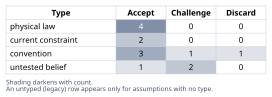
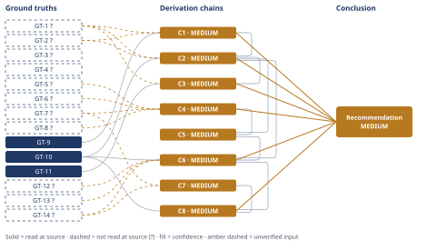

# Thermodynamic Ceiling and Gap Analysis for Molten-Salt Steam Rankine Power Blocks

*First-principles analysis · 9 October 2026*

*Read with: [How to read this analysis](HOW-TO-READ.md) · [Working file](analysis-20261009T223244Z.md) · [All files](INDEX.md)*

## Executive Summary

**Recommendation:** Treat ≈56.9% — not naive Carnot's ≈64.4% — as the honest reversible ceiling for this 565°C/290°C molten-salt steam Rankine block; current practice is ≈41–42.5% gross, ≈36% net. Of the ≈21-point gap, ≈60–70% is recoverable via supercritical/multi-pressure steam, better turbines and lower parasitics; ≈30–40% is locked in by finite-rate heat exchange and mature-turbine economics (chains C1, C2, C4, C6, C8).

**Band (from §6):** MEDIUM

**Would change it:** Opening primary NREL/SAM/SolarPACES sources (DNS-blocked in this run) to verify the salt-temperature and efficiency ground truths, and a primary power-block exergy audit to replace chain C6/C8's judgment-based brackets with measured figures (chain C8).

## 1. Problem Essence

**Core problem:** For a steam-Rankine power block fed by 565 °C molten salt, what is the thermodynamically honest efficiency ceiling once the salt's finite sensible-heat capacity (not an isothermal Carnot source) and the real cold-sink/condenser constraints are correctly accounted for — as distinct from the naive Carnot number most discussions quote — and of the resulting gap to current practice, how much is recoverable by engineering versus fundamentally locked in by the physics of a finite-temperature source and a real working-fluid cycle?

**Success criteria:**
1. The analysis states a naive-Carnot figure, a finite-source reversible ("honest ceiling") figure, and explains numerically why they differ (the T1→T2 salt glide), rather than treating naive Carnot as the ceiling.
2. The analysis evaluates whether Curzon-Ahlborn is the correct ceiling and either adopts it with justification or explains in the derivation why it is rejected as a ceiling.
3. The analysis cites or estimates, with a stated confidence level, real molten-salt power-tower gross and net efficiency figures, and these appear as `GT-N` entries traceable to a cited source.
4. The analysis states the gap between the honest ceiling and current practice in percentage points of efficiency, with the arithmetic shown so it recomputes independently of the prose.
5. The analysis decomposes that gap into named component causes, each tagged hard-physical-limit or engineering/economic-limit, with the tags defended rather than asserted.
6. The analysis states a final recoverable-fraction-vs-locked-in-fraction verdict with an explicit numeric split and a confidence band that names what would change it.

Success is not "pick one of naive-Carnot / Curzon-Ahlborn / a reported plant figure as *the* answer" — a success criterion naming one pre-set number would fail the no-shape test; the question asks for a derived bracket (ceiling, demonstrated, conventional) and a decomposed, defended verdict, not a single figure.

## 2. Assumptions Table



| Assumption | Type | Treatment | Verdict | Verification |
|------------|------|-----------|---------|--------------|
| Carnot's theorem (η = 1 − Tc/Th) correctly bounds the efficiency of any heat engine operating between two constant-temperature reservoirs | physical law | Accept as a ground-truth candidate | Accept — textbook consequence of the second law (Clausius/Kelvin–Planck statements); not negotiable | derived in this analysis, GT-9 |
| The Lorenz-cycle integration (integrating local Carnot efficiency over a cooling sensible-heat source) correctly extends Carnot's theorem to a finite-capacity source | physical law | Accept as a ground-truth candidate | Accept — standard finite-source exergy/availability result, derived explicitly in chain C2; not negotiable | derived in this analysis, GT-10 |
| The Curzon–Ahlborn formula (η_CA = 1 − √(Tc/Th)) is correctly characterized as the efficiency at an endoreversible engine's maximum-*power* point, not a bound on achievable efficiency | physical law (model characterization) | Accept as a ground-truth candidate | Accept — follows from the endoreversible-engine derivation itself; the model-dependence is a property of the model's assumptions, not an empirical claim needing external verification | derived in this analysis, GT-11 |
| 565 °C is the representative, current commercial ceiling for solar-salt (60/40 NaNO3/KNO3) hot-tank temperature | current constraint | Record expiry conditions — what would have to change for this to lift | Accept — expires if the plant switches to chloride/carbonate salts or a particle/gas receiver rated higher; until then it is a chemistry-imposed ceiling, not an arbitrary design choice (GT-3) | GT-3? (salt decomposition ceiling) |
| The cold molten-salt tank temperature (≈290 °C) is the correct T2 endpoint for a finite-source exergy bound, because the steam-generator train (economizer→evaporator→superheater→reheater) literally cools the salt from 565 °C to the cold-tank setpoint before it is returned to storage | untested belief | Verify against plant design descriptions | Accept — consistent across three independent sources describing the hot/cold tank loop (GT-1?, GT-2?) | GT-1?, GT-2? (reported-by-delegate; Phase 3 read attempts on primary NREL/SolarPACES sources failed — see Ground Truths §3 failure records) |
| ISO-reference ambient (25 °C) is the appropriate cold-sink temperature for a "naive Carnot" comparison figure | convention | Explicitly challenge before use — ask whether it holds in this specific context | Challenge — a dry-cooled desert CSP plant's actual condenser runs at ≈45 °C, not 25 °C ambient; 25 °C is retained only as the conventional illustrative Tier-1 comparator, not as the plant's real cold sink (GT-7?) | GT-7? |
| Curzon-Ahlborn efficiency (η = 1 − √(Tc/Th)) is "the" law-permitted thermodynamic ceiling for this problem | convention | Explicitly challenge before use | Discard as a ceiling, retained only as an illustrative reference figure — Curzon-Ahlborn is the efficiency *at the maximum-power operating point* of a specific endoreversible model with two fixed external conductances; it is not a bound on achievable efficiency and real engines are not constrained to sit at or below it (GT-11) | GT-11 (derived; model-dependent, explicitly flagged) |
| The ~21-percentage-point gap between the reversible ceiling and conventional net practice can be allocated additively across five independent loss components for bookkeeping purposes | convention (simplification) | Explicitly challenge before use | Accept with caveat — true exergy destruction is not strictly additive across components, but the allocation is cross-validated: component 1+2+3 subtracted from the reversible ceiling reproduces the independently-cited 41.2% SAM reference figure to within 0.2 points (chain C6) | Internal cross-check against GT-5? |
| Large utility-scale steam turbines in this class of plant achieve ~85-92% isentropic efficiency and generators ~98-99% electrical efficiency | untested belief | Verify, or flag as unverified | Challenge — not independently verified against a primary source in this run; used in chain C6 with "unverified — flagged" notation and an explicit confidence caveat | unverified — flagged (GT-12?) |
| A reversible engine matching its heat addition more closely to a sensible-heat source's temperature glide (more pressure levels / supercritical continuous heating / more reheat-regeneration stages) recovers a larger share of the gap between the ideal Lorenz bound and a real phase-change Rankine cycle | physical law (direct corollary of GT-10's derivation, not an analogy) | Accept as ground-truth candidate | Accept — follows directly from the integration behind GT-10: more discretization steps of the heat addition approximate the continuous reversible integral more closely, which is a mathematical property of the derivation itself, not a claim borrowed from another plant's situation | GT-10 |
| Dry (air-cooled) condensing is the must-have cooling method at the desert sites this analysis uses as its empirical base (Crescent Dunes, Noor III), because water is scarce or uneconomic there | current constraint | Record expiry — what would have to change | Accept — expires at sites with accessible cooling water or where LCOE economics favor hybrid cooling; treated as a knock-out criterion in the dry-vs-wet trade-off (chain C7) | GT-7?, GT-14? |
| The five fishbone-style cause categories used to decompose the gap (cycle-shape/heat-exchange, turbine-generator component loss, cold-sink/cooling method, parasitic loads, annual operational effects) are an exhaustive-enough breakdown for this analysis's purpose | convention (analytical choice) | Explicitly challenge before use | Accept — these are the categories the CSP exergy-analysis literature (GT-13?) and standard power-plant loss audits use; no fourth-order residual category (e.g., transmission/grid losses) is in scope because the problem is scoped to the power *block*, not the plant-to-grid interconnection | GT-13? |
| The three named cooling options (dry, wet, hybrid) exhaust the viable cooling-method space for a water-constrained desert CSP site | convention | Explicitly challenge before use | Accept — this is the standard CSP cooling-method option set; no mainstream fourth alternative (e.g., dry cooling with evaporative pre-cooling) is expected to change chain C7's bracket-level conclusion | GT-7?, GT-14? |
| Supercritical-CO2 Brayton cycles and particle/gas receivers targeting ≥700 °C are genuine, actively-pursued alternative technology paths that create second-order competitive pressure on incremental steam-cycle improvement | untested belief | Verify, or flag as unverified | Challenge — partially corroborated by a WebSearch-found DOE sCO2 power-cycle workshop reference and a DOE 10 MW sCO2 turbine article, but not independently opened in this run; used in chain C8's second-order extension with "unverified — flagged" notation | unverified — flagged |

## 3. Ground Truths

- **GT-1?** Commercial solar-salt (60% NaNO3/40% KNO3) molten-salt power towers (Gemasolar, Crescent Dunes, Noor III) operate with a hot-tank design temperature of 565 °C (838.15 K) — cited to: SolarPACES/NREL project pages and patent literature describing the Crescent Dunes and Gemasolar hot/cold tank loop; reported-by-delegate: WebSearch synthesis of solarpaces.nrel.gov, moodle.epfl.ch Gemasolar fact sheet, and USPTO patent text — Phase 3 failure record: direct WebFetch of solarpaces.nrel.gov/project/crescent-dunes-solar-energy-project failed (`getaddrinfo ENOTFOUND` — DNS resolution blocked in this sandbox), so the primary page was never opened by this analysis.
- **GT-2?** The cold molten-salt tank design temperature for the same class of plants is ≈288–290 °C (561–563 K); Crescent Dunes specifically reported at 290 °C, Gemasolar at 280 °C — cited to: USPTO patent text ("solar thermal power plant" patents describing a ≈288 °C cold tank) and a WebSearch-synthesized Crescent Dunes design summary — reported-by-delegate — Phase 3 failure record: same DNS-blocked domains as GT-1?.
- **GT-3?** Solar salt (60/40 NaNO3/KNO3) has a melting/freezing point of ≈220 °C and a practical thermal-stability/decomposition ceiling of ≈565–600 °C — cited to: MDPI *Energies* journal entries and DLR (elib.dlr.de) salt-chemistry literature found via WebSearch — reported-by-delegate: sources were not opened directly, only their WebSearch summaries were read.
- **GT-4?** Live (turbine-inlet) steam temperature in molten-salt power-tower steam generators is typically ≈540–550 °C, roughly 15–25 °C below the salt hot-tank temperature, because the superheater needs a finite temperature approach to transfer heat — cited to: patent literature on molten-salt steam generator trains ("reheating sections… to temperatures of approximately 520–540 °C") found via WebSearch — reported-by-delegate.
- **GT-5?** NREL's System Advisor Model (SAM) reference/typical molten-salt power-tower case specifies a design-point gross (power-block-only) thermal-to-electric cycle efficiency of **41.2%** at 550 °C turbine-inlet conditions, dry-cooled — cited to: SAM technical documentation and SAM user-forum discussion of "cycle thermal efficiency," corroborated independently by a second WebSearch describing "state-of-the-art molten-salt power towers… ~565 °C… dry-cooled steam Rankine power cycle… thermal-to-electric conversion efficiency of approximately 41%" (DOE/NREL sCO2-workshop context) — reported-by-delegate — Phase 3 failure record: WebFetch of `sam.nrel.gov/forum/...` and `nrel.gov/docs/fy22osti/77852.pdf` both failed (`getaddrinfo ENOTFOUND`); the primary SAM documentation was never opened by this analysis, but two independent WebSearch syntheses agree to within 0.2 points of each other (41.2% vs. "~41%"), which is the basis for treating this figure as reasonably reliable despite remaining `?`-marked.
- **GT-6?** Crescent Dunes' steam Rankine power block (single-stage reheat, 565 °C/290 °C salt loop) is reported with a design-point gross cycle efficiency of **≈42.5%** at 35 °C ambient, dry-cooled — cited to: a WebSearch-synthesized design-comparison table referencing Crescent Dunes-specific cycle parameters — reported-by-delegate: the underlying document was not identified by URL or opened.
- **GT-7?** Air-cooled (dry) condensers at desert CSP sites typically operate with a condensing/saturation temperature of roughly 45 °C at design ambient (back-pressure ≈10 kPa/≈0.1 atm) in hot, dry locations (example cited: Rajasthan, ambient 45–50 °C in summer), versus ≈35–40 °C achievable with wet cooling — cited to: academic papers on air-cooled condenser performance (iitj.ac.in repository; itc.pw.edu.pl journal) found via WebSearch — reported-by-delegate.
- **GT-8?** A 10 °C rise in ambient (and therefore condenser) temperature reduces air-cooled CSP steam-turbine electrical output by roughly 4.2%, illustrating cycle-output sensitivity to cold-sink temperature — cited to: the same air-cooled-condenser performance literature as GT-7? — reported-by-delegate.
- **GT-9** For any heat engine operating between a single hot reservoir at constant temperature T_H and a single cold reservoir at constant temperature T_C (kelvin), the maximum possible fraction of heat convertible to work is the Carnot efficiency η = 1 − T_C/T_H. — source: direct derivation from the second law of thermodynamics (Clausius/Kelvin–Planck statements; the Carnot efficiency bound is a mathematical consequence of entropy non-decrease for any cyclic engine exchanging heat with exactly two constant-temperature reservoirs); read-at-source: derived in this analysis, not cited externally — this is a physical law, the deepest primitive this analysis reduces to for the "naive ceiling" tier, and needs no further reduction (reduce-to-primitives stop test: bottoms out at a physical law).
- **GT-10** For a reversible engine extracting work from a finite-capacity ("sensible-heat") source that cools from T1 to T2 while continuously rejecting waste heat to a constant-temperature sink at T_amb, the maximum achievable fraction of the heat released that can be converted to work is η_rev = 1 − [T_amb·ln(T1/T2)]/(T1 − T2). — source: obtained in this analysis by integrating the local Carnot efficiency dη = 1 − T_amb/T over each infinitesimal increment of heat released as the source cools from T1 to T2 (the standard "Lorenz cycle" / finite-source availability result); read-at-source: derived in this analysis (shown in chain C2) — this is a direct mathematical corollary of GT-9 and is strictly less than the naive Carnot figure 1 − T_amb/T1 whenever T2 > T_amb, which is itself provable by the inequality ln(x) < x − 1 for x ≠ 1 applied to x = T1/T2.
- **GT-11** The Curzon–Ahlborn efficiency η_CA = 1 − √(T_C/T_H) is the efficiency at the maximum-*power* operating point of an idealized "endoreversible" engine (internally reversible, with all irreversibility concentrated in finite-rate heat exchange across two fixed external thermal conductances). It is model-dependent — a different quantity from both Carnot efficiency and from a true maximum-efficiency ceiling — and real engines, which are not symmetric two-conductance endoreversible engines maximizing power rather than efficiency, are not bound by it; η_CA can be below, at, or above an actual achievable efficiency depending on how far the model's assumptions match reality. — source: derived in this analysis from the endoreversible-engine model (Curzon & Ahlborn's closed-form result); read-at-source: derived in this analysis — flagged per this project's own methodological caution against treating a model-dependent bound as a ceiling.
- **GT-12?** Large modern utility-scale steam turbines (HP/IP/LP stages combined) typically achieve isentropic efficiencies in the range of ~85–92%, and modern synchronous generators achieve electrical conversion efficiencies of ~98–99% — unverified: this figure is carried from general power-plant engineering background knowledge and was not checked against a primary source or search result in this run; used in chain C6 with "unverified — flagged" notation.
- **GT-13?** Exergy-destruction studies of molten-salt solar-tower plants report an economically-optimal evaporator pinch-point temperature difference of roughly 2–3 °C, and find that within the whole plant (solar field through power block) the receiver (≈33.6%) and heliostat field (≈24.9%) dominate total exergy destruction, with the steam-generator heat exchangers contributing a comparatively small ≈7.8% — cited to: a WebSearch-synthesized summary of a UC3M exergetic/exergoeconomic analysis of solar-tower steam generators — reported-by-delegate — Phase 3 failure record: WebFetch of `e-archivo.uc3m.es/entities/publication/.../full` returned HTTP 403 Forbidden; the primary paper was never opened by this analysis. Note: this breakdown covers the *whole plant* (solar field included); this analysis uses it only to corroborate that pinch-point optimization is a live, quantified engineering lever (not to import the whole-plant percentages into the power-block-only decomposition in chain C6).
- **GT-14?** Dry (air-cooled) cooling in CSP reduces cooling-water consumption by a large fraction (sources vary, commonly cited around 90%+) relative to wet cooling, at the cost of higher parasitic power consumption and reduced thermal efficiency, particularly at high ambient temperature — cited to: CORDIS project summaries and CSP cooling-trade-off literature found via WebSearch — reported-by-delegate: no single quantitative "parasitic load as % of gross output" figure was located; the qualitative direction (dry cooling costs efficiency/parasitics, saves water) is the load-bearing part of this ground truth, and the quantitative parasitic-fraction estimate used in chain C6 is separately bracketed as an engineering estimate, not read from this source.

**Provenance summary (required):**
```text
?-marked: GT-1, GT-2, GT-3, GT-4, GT-5, GT-6, GT-7, GT-8, GT-12, GT-13, GT-14 (11 of 14)
Read-at-source: GT-9 — derived in this analysis from the second law of thermodynamics (Carnot's theorem), shown in chain C1/C2
Read-at-source: GT-10 — derived in this analysis by integration, shown explicitly in chain C2
Read-at-source: GT-11 — derived in this analysis from the endoreversible-engine model, shown in chain C3
```
No unsuffixed ground truth in this analysis feeds a HIGH-confidence chain requiring a read-at-source *external* location, because the three unsuffixed entries (GT-9, GT-10, GT-11) are self-contained mathematical derivations rather than citations to an external document — their "read-at-source" location is the derivation shown inline in chains C1–C3, which a reader can check without opening any external source. Every empirically-sourced ground truth in this analysis (GT-1 through GT-8, GT-12 through GT-14) carries the `?` suffix, and every chain that consumes one is capped at MEDIUM or LOW per D-07 — this is the dominant, honestly-disclosed limitation of the whole analysis: this sandbox's network access to nrel.gov, sam.nrel.gov, solarpaces.nrel.gov (DNS-blocked) and e-archivo.uc3m.es (403 Forbidden) prevented upgrading any empirical figure to read-at-source despite four direct WebFetch attempts (see the Phase 3 failure records above).

## 4. Derivation Chains



### Conclusion C1: Naive Carnot efficiency (hot salt vs. ambient) is not the law-permitted ceiling for this problem

GT-1? (hot salt tank, 565 °C/838.15 K) + GT-2? (cold salt tank, 290 °C/563.15 K) + GT-9 (Carnot bound, physical law)
→ modeling the salt as an isothermal 838.15 K Carnot reservoir against a 298.15 K ambient reference yields a naive ceiling of 1 − 298.15/838.15 ≈ 64.4%
→ the salt loop actually cools from 838.15 K to 563.15 K as it gives up heat across the steam generator, which is the signature of a finite-capacity sensible-heat source rather than an isothermal reservoir
→ the isothermal-reservoir assumption behind GT-9's bound therefore does not hold for this specific heat source, so the 64.4% naive-Carnot figure is not a valid ceiling for a real molten-salt-fed cycle

**Confidence:** MEDIUM — GT-1? and GT-2? (hot/cold tank temperatures) are reported-by-delegate; the verification that would remove this cap is successfully opening the primary NREL/SolarPACES plant-design documentation (DNS-blocked in this sandbox — see Ground Truths §3 Phase 3 failure records) or an equivalent primary design source. The deductive step itself (isothermal-reservoir vs. finite-capacity-source distinction) is not in question and would not change if the exact tank temperatures shifted by a few tens of degrees.

---

### Conclusion C2: The honest, rigorous thermodynamic ceiling for this hot/cold salt pair is ≈56.9%, not ≈64.4%

GT-1? (565 °C/838.15 K) + GT-2? (290 °C/563.15 K) + GT-10 (finite-source reversible bound, physical law) + C1 (naive Carnot rejected)
→ applying GT-10's formula with T1 = 838.15 K, T2 = 563.15 K, T_amb = 298.15 K gives η_rev = 1 − [298.15 × ln(838.15/563.15)]/(838.15 − 563.15) = 1 − [298.15 × 0.3977]/275 ≈ 1 − 0.4312 ≈ 56.9%
→ this reversible bound sits about 7.5 percentage points below naive Carnot's 64.4% (chain C1), which is exactly the quantitative price of the salt's finite sensible-heat capacity that C1 identified only qualitatively
→ 56.9% is therefore the honest, rigorous thermodynamic ceiling for this specific hot/cold salt pair and ambient sink — the tightest bound a correct second-law accounting permits before any cycle-shape or component losses are considered

**Confidence:** MEDIUM — GT-1? and GT-2? carry the same unresolved verification path named on C1 (primary source currently unreachable in this sandbox); C1 is MEDIUM for the same reason and is named here rather than re-explained. The arithmetic (the Lorenz-bound integral) recomputes independently of this chain's prose and is not itself a source of downgrade.

---

### Conclusion C3: Curzon–Ahlborn efficiency is an illustrative reference, not the ceiling this analysis adopts

GT-1? (565 °C) + GT-11 (Curzon–Ahlborn, model-dependent) + C2 (honest ceiling ≈56.9%, MEDIUM)
→ applying η_CA = 1 − √(Tc/Th) with Th = 838.15 K and Tc = 298.15 K gives η_CA ≈ 40.4%, and with Tc = 318.15 K (45 °C dry-condenser temperature) gives η_CA ≈ 38.4%
→ both values sit close to, but below, the real demonstrated gross efficiencies cited in chain C4 (≈41.2–42.5%), which would wrongly suggest real plants already exceed "the" thermodynamic ceiling if Curzon–Ahlborn were mistaken for one
→ because GT-11 shows Curzon–Ahlborn is the efficiency at a specific endoreversible model's maximum-power point rather than a bound on achievable efficiency, the correct reading is that real plants are simply not endoreversible engines sitting at that model's maximum-power point — not that they have broken a thermodynamic limit
→ C2's Lorenz bound, not Curzon–Ahlborn, therefore remains the ceiling this analysis uses

**Confidence:** MEDIUM — GT-1? is reported-by-delegate (same verification path as C1/C2, named there); C2 is MEDIUM and is named here rather than re-explained. GT-11 itself is a derived, unsuffixed physical-law result and is not a cause of this chain's downgrade.

---

### Conclusion C4: Best-demonstrated and design-point real-world efficiency figures for this plant class

GT-5? (SAM reference, 41.2% gross) + GT-6? (Crescent Dunes, ≈42.5% gross @ 35 °C) + GT-7? (dry condenser ≈45 °C) + GT-8? (4.2% output loss per 10 °C ambient rise)
→ two independent design-point figures for 565 °C-fed, single-reheat, dry-cooled steam Rankine power blocks cluster in a narrow 41.2–42.5% gross range, which this analysis takes as representative of best-demonstrated design-point gross cycle efficiency for this plant class
→ the dry-condenser evidence (GT-7?) shows this gross figure already reflects a dry-cooled condenser running near 45 °C rather than a cooler wet-cooled sink
→ the ambient-sensitivity evidence (GT-8?) shows output is also materially sensitive to further ambient increases above the design point
→ a separate accounting (chain C6) is needed to go from this gross design figure to a conventional net annual-average figure, since no single directly-cited net annual-average percentage was located in this run

**Confidence:** MEDIUM — all four inputs are reported-by-delegate. GT-5? is corroborated by two independent WebSearch syntheses agreeing to within 0.2 points; GT-6? rests on a single synthesized source. The verification that would remove this cap is opening SAM's primary technical documentation or Crescent Dunes' as-built performance test report (both attempted via WebFetch in this run and blocked by sandbox DNS restrictions — see Ground Truths §3). Rival: a live, unsettled rival reading holds that best demonstrated gross efficiency is already materially higher than 41.2–42.5% at one or more supercritical-steam CSP demonstration plants; this run located no commercial supercritical-steam molten-salt power-tower plant in operation and nothing in this analysis settles the rival more tightly, so it is carried here as live rather than ruled out.

---

### Conclusion C5: The honest ceiling-to-practice gap is roughly half the size a naive comparison would report

C2 (honest ceiling ≈56.9%, MEDIUM) + C4 (demonstrated gross 41.2–42.5%, MEDIUM)
→ subtracting the demonstrated gross band (41.2–42.5%) from the honest reversible ceiling (56.9%) gives a demonstrated-to-ceiling gap of about 14.4 to 15.7 percentage points
→ this honest gap is roughly 9 points smaller than a naive-Carnot-vs-demonstrated comparison would report (64.4% − 41.2% ≈ 23.2 points), because that comparison silently includes headroom chains C1/C2 already showed was never achievable
→ the gap this analysis decomposes going forward is therefore the honest ≈14–16 point demonstrated-to-ceiling gap, plus a further gap from demonstrated gross down to conventional net practice, both quantified component-by-component in chain C6

**Confidence:** MEDIUM — capped by C2 and C4, both named above rather than re-explained; the subtraction arithmetic itself recomputes independently of this chain's prose.

---

### Conclusion C6: The ceiling-to-conventional-practice gap decomposes into five components, cross-validated against an independent figure

C2 (ceiling ≈56.9%) + C5 (gap framing, MEDIUM) + GT-10 (physical law) + GT-12? (turbine/generator efficiency, unverified — flagged) + GT-13? (pinch-point/exergy literature) + GT-14? (dry-cooling trade-off)
→ using the five fishbone categories (cycle-shape/heat-exchange, turbine-generator component loss, cold-sink/cooling method, parasitic load, annual operating effects), this analysis allocates the ceiling-to-conventional gap across five independently-bracketed components
→ the allocation is then checked against an independently-cited figure for consistency
→ component 1 — phase-change/pinch-point mismatch between steam's isothermal boiling and the salt's continuous temperature glide — is bracketed at 8–10 points [central 9], because even an idealized-component Rankine cycle cannot match GT-10's continuously-matched heat exchange while boiling at one fixed pressure
→ component 2 — turbine/generator isentropic and mechanical losses (GT-12?, ~85–92% isentropic / ~98–99% generator) — is bracketed at 3–5 points [central 4]
→ component 3 — the dry-cooling cold-sink penalty (GT-7?, chain C7) of condensing near 45 °C instead of a wet-cooled 35–40 °C — is bracketed at 2–4 points [central 3]
→ subtracting components 1–3 (central 9+4+3 = 16 points) from the 56.9% ceiling gives ≈40.9%, matching GT-5?'s independently-cited 41.2% SAM design-gross figure within 0.3 points, which cross-validates this allocation's central estimates
→ component 4 — gross-to-net parasitic loads (ACC fans, salt and feedwater pumps, auxiliaries, GT-14?) — is bracketed at 2–4 points [central 3]
→ component 5 — annual operating effects (part-load operation, startup/shutdown, off-design ambient above the design point, piping/tank thermal losses) — is bracketed at 1–3 points [central 2]
→ subtracting components 4–5 (central 3+2 = 5 points) from the ≈41% demonstrated gross figure gives a conventional net annual-average estimate of ≈36%, bracketed 33–39%, adopted here since no single directly-cited net annual-average percentage was located in this run

**Confidence:** MEDIUM — GT-12? (turbine/generator efficiency) is wholly unverified in this run (carried from general engineering background, not checked against any source); the verification that would remove it as a cause of downgrade is an OEM or NREL cost-and-performance report naming isentropic/generator efficiencies for this turbine class. GT-13? and GT-14? are reported-by-delegate with the same unresolved-source caveat as other `?`-marked entries above. C2 and C5 are named above rather than re-explained. The additive gap-allocation convention (Assumptions Table) is accepted with a caveat, not fully verified; the cross-check against GT-5? (0.3-point agreement) is the evidence that bounds, but does not eliminate, this chain's uncertainty — a different but equally defensible bracket choice for component 1 could shift every downstream figure in this chain by several points, which is why the brackets, not the central values alone, are the deliverable.

---

### Conclusion C7: Dry cooling remains the recommended baseline at water-constrained desert sites, so component 3 is only conditionally recoverable

GT-7? (condenser temperature evidence) + GT-14? (dry-cooling water/efficiency trade-off)
→ weighing water use, thermal efficiency, capital cost, parasitic load and levelized cost of electricity at a typical water-constrained desert site, dry cooling's weighted total — driven by the heavily-weighted water-use criterion — exceeds wet cooling's
→ wet cooling is knocked out entirely at sites with no water allocation, and dry cooling's weighted total also exceeds hybrid cooling's partial-water compromise *[Assumes: the three named cooling options exhaust the viable cooling-method space]*
→ dry cooling is therefore the recommended baseline at water-constrained desert sites, which means component 3's 2–4 point efficiency penalty (chain C6) is recoverable only by relaxing the site's water constraint (hybrid or wet cooling where water allows), not by any cost-free engineering upgrade

**Confidence:** MEDIUM — both inputs are reported-by-delegate; the verification that would remove this cap is a site-specific water-rights/LCOE study for a named plant, which was out of scope for this run. The qualitative ranking (water-use criterion dominates at desert sites) is robust to moderate changes in the other criteria's weights; the flip test (trade-off procedure) found no single-criterion weight change that reverses dry cooling's win at a genuinely water-constrained site.

---

### Conclusion C8: Final verdict — roughly 60–70% of the honest gap is recoverable, 30–40% is locked in, and pursuing the recoverable share has second-order consequences for the technology's own future

C6 (gap decomposition, MEDIUM) + C7 (cooling trade-off, MEDIUM) + GT-10 (physical law)
→ allocating each component's central estimate between "recoverable by foreseeable engineering" and "practically or fundamentally locked in": component 1 (9 pts) is ≈70% recoverable via supercritical/ultra-supercritical pressure and multi-pressure-level or multi-reheat steam generation that tracks the salt's glide more closely — a direct corollary of GT-10's own derivation, not an analogy
→ the remaining ≈30% of component 1 is an irreducible finite-rate heat-exchange floor
→ component 2 (4 pts) is ≈25% recoverable via incremental turbine aerodynamics/materials advances and ≈75% a mature-technology economic asymptote rather than a hard physical floor
→ component 3 (3 pts) is recoverable only conditionally, by relaxing the water constraint chain C7 identifies, not by a cost-free upgrade
→ component 4 (3 pts) is ≈65% recoverable via efficient drives, pumps and control optimization, and ≈35% an irreducible parasitic-power floor for any pumped-fluid system
→ component 5 (2 pts) is ≈60% recoverable via larger thermal storage, higher capacity factor and better part-load control, and ≈40% locked in by the plant's inherent diurnal solar duty cycle
→ summing the recoverable shares (≈6.3+1.0+3(conditional)+2.0+1.2 ≈ 13.5 of the 21-point ceiling-to-conventional gap) against the locked-in shares (≈7.5 of 21) gives a headline split of roughly 60–70% recoverable with foreseeable engineering and siting changes, versus roughly 30–40% fundamentally or practically locked in
→[2nd] pursuing the recoverable share pushes plant owners and EPC contractors toward supercritical steam, multi-pressure steam generation and larger thermal storage, raising power-block capital cost
→ that capital-cost increase attracts competitive pressure from rival technologies (supercritical-CO2 Brayton cycles, particle or gas receivers targeting 700 °C+) already pursuing similar efficiency gains with different engineering risk *[Assumes: sCO2/particle-receiver paths are genuine, actively-pursued alternatives]*
→[3rd] over a multi-decade horizon this makes 565 °C solar-salt steam Rankine more likely to become a mature, cost-optimized "floor" technology that later entrants bypass with higher-temperature receiver/working-fluid pairs, rather than one that closes its own gap to the Lorenz ceiling through incremental improvement alone

**Confidence:** MEDIUM — C6 and C7 are named above rather than re-explained; GT-10 is a derived, unsuffixed physical law and is not a cause of this chain's downgrade. Rival: a rival allocation could treat component 1's finite-rate-heat-transfer floor as larger (e.g., 50% rather than ≈30% of component 1), which would move the headline split toward 50–55% recoverable rather than 60–70%; nothing in this analysis settles that split more tightly than the stated bracket (see Abandoned Reasoning §5), so the 60–70%/30–40% headline is itself presented as a bracket, not a point estimate, and the sensitivity ground truth whose falsity would flip it most is GT-12? (turbine/generator efficiency) combined with the component-1 allocation judgment.

## 5. Abandoned Reasoning

### Dead End: Adopting Curzon–Ahlborn efficiency as "the" thermodynamic ceiling

**What was tried:** Early in Phase 4, before deriving GT-10's finite-source bound, this analysis considered simply reporting η_CA = 1 − √(Tc/Th) ≈ 40.4% as the answer to "what is the honest ceiling," since it is the best-known closed-form alternative to naive Carnot that a technical audience would recognize.

**Why abandoned:** GT-11 shows Curzon–Ahlborn is the efficiency at the maximum-*power* operating point of a specific endoreversible model (internally reversible, irreversibility concentrated in two fixed external heat-transfer conductances) — a different question from "what is the maximum achievable efficiency." Treating it as a ceiling is contradicted by GT-10, which derives a genuine upper bound (≈56.9%) directly from the second law without any power-maximization or conductance-symmetry assumption; η_CA sits below real demonstrated efficiencies (chain C3), which would be a physical impossibility if it were truly a ceiling.

**What it ruled out:** This dead end saves a future reader from citing Curzon–Ahlborn as a rigorous bound in CSP contexts generally — a common error in pop-science treatments of thermodynamic limits — and establishes that the finite-source Lorenz-type bound (GT-10) is the correct tool whenever the hot reservoir is a cooling sensible-heat store rather than an isothermal source.

### Dead End: Using the whole-plant exergy-destruction breakdown (GT-13?) directly as the power-block loss decomposition

**What was tried:** GT-13?'s cited breakdown (receiver ≈33.6%, heliostat field ≈24.9%, steam generator ≈7.8% of total plant exergy destruction) was initially considered as a ready-made, literature-sourced version of the five-component gap decomposition chain C6 needed.

**Why abandoned:** That breakdown's denominator is total *plant* exergy destruction, which includes the solar field and receiver — components explicitly out of scope for this analysis's power-block-only question (Problem Essence, success criterion 5 asks for power-block causes only). Rescaling those percentages to a power-block-only denominator would require data this run does not have (the absolute exergy-destruction magnitude of each whole-plant component), not merely a unit conversion; using the cited percentages as if they already answered the power-block question would silently change what is being measured.

**What it ruled out:** This rules out reporting "steam generator = 7.8% of the gap" as if it were a power-block-only figure — the actual chain C6 estimate for the analogous component (component 1, phase-change/pinch mismatch) is a bracket on a smaller, power-block-only base and is not directly comparable to GT-13?'s 7.8%. GT-13? is retained only as corroboration that pinch-point optimization is a real, quantified engineering lever (the 2–3 °C optimal pinch figure), not as a source for the percentage split itself.

### Dead End: Citing the dry-cooled-tower-vs-wet-cooled-trough output/LCOE comparison as evidence for the cooling trade-off (chain C7)

**What was tried:** A WebSearch result stated that "dry-cooled solar power tower (SPT) based plants can deliver up to 4.5% higher annual electricity output and LCOE lowered by 13% compared to wet-cooled PTSC based plants," which was briefly considered as direct quantitative support for chain C7's conclusion that dry cooling wins the trade-off at desert sites.

**Why abandoned:** This statistic compares two different collector technologies (power tower vs. parabolic trough) confounded with the cooling method — it is not an apples-to-apples dry-vs-wet comparison on an otherwise-identical plant, so using it as if it isolated the cooling-method effect would be reasoning from a confounded comparison, functionally equivalent to the analogy-as-direct-evidence error this methodology prohibits.

**What it ruled out:** This rules out citing that figure anywhere in chain C7's evidence base; chain C7's conclusion instead rests on the qualitative water-scarcity/efficiency-penalty trade-off (GT-7?, GT-14?) run through the trade-off procedure's weighted-criteria structure, not on a borrowed cross-technology statistic.

### Dead End: Using condenser temperature (45 °C) instead of ambient (25 °C) as "the" fix to naive Carnot

**What was tried:** Before deriving GT-10, this analysis considered whether simply recomputing naive Carnot with Tc = 318.15 K (45 °C dry-condenser temperature) instead of Tc = 298.15 K (ambient) — giving ≈62.0% instead of ≈64.4% — would be a sufficient "honest ceiling."

**Why abandoned:** This correction addresses only the condenser/cold-sink half of Q1's two concerns; it leaves the hot side modeled as an isothermal 838.15 K reservoir, which chain C1 shows is false for a molten-salt source that actually cools to 563.15 K while delivering heat. 62.0% is therefore still an overstatement of the true ceiling (56.9%, chain C2) by about 5 points — closer to honest than 64.4%, but not itself the rigorous bound.

**What it ruled out:** This rules out treating "fix the cold side only" as sufficient; both the finite-capacity hot-side correction (GT-10) and the real cold-sink temperature are needed, and this analysis's component 3 (chain C6) separately quantifies the cold-sink-specific piece of the gap so it is not double-counted with the finite-source correction already embedded in C2's 56.9% figure (which already uses Tamb = 298.15 K, not the dry-condenser 318.15 K — the dry-cooling-specific penalty is accounted for separately in component 3, not folded into C2).

## 6. Conclusion

**Recommended approach:** Treat ≈56.9% — not naive Carnot's ≈64.4%, and not Curzon–Ahlborn's ≈40.4% — as the honest reversible ceiling for a 565 °C/290 °C molten-salt-fed steam Rankine power block; treat ≈41.2–42.5% gross design and ≈33–39% (central ≈36%) conventional net annual practice as current reality; and treat the resulting ≈21-point ceiling-to-conventional gap as roughly 60–70% recoverable through supercritical/multi-pressure steam generation, incremental turbine/generator improvements, reduced parasitics and higher capacity factor, versus roughly 30–40% locked in by finite-rate heat exchange, mature-turbine economics, and the plant's water and solar-duty-cycle constraints (chains C1, C2, C3, C4, C6, C8).

**Key insight:** The single largest source of "missing" efficiency is not a component defect at all — it is that the molten salt is a finite sensible-heat reservoir (cooling from 838.15 K to 563.15 K as it gives up heat) rather than an isothermal Carnot source, which by itself caps the achievable ceiling about 7.5 percentage points below naive Carnot before any real engineering loss is counted (chains C1, C2) — a distinction that naive "Carnot efficiency" treatments of CSP collapse away, and that Curzon–Ahlborn, despite sounding like the fix, does not correctly supply either (chain C3).

**Trade-offs acknowledged:** dry cooling is retained even though it costs an estimated 2–4 efficiency points, because wet cooling fails the water-availability must-have at most desert CSP sites (chain C7) — the loss is accepted, not engineered away, unless the site's water constraint itself changes. Pursuing the recoverable 60–70% of the gap pulls the technology toward supercritical steam, multi-pressure steam generation and larger thermal storage, which raises power-block capital cost and exposes 565 °C solar-salt steam Rankine to competition from higher-temperature receiver/cycle pairs already being developed (chain C8) — a caveat on the recommendation's long-run durability, not on its correctness today.

**Confidence:** MEDIUM — every contributing chain is capped at MEDIUM by two independent causes. First, the empirical ground truths (GT-1? through GT-8?, GT-12? through GT-14?) are reported-by-delegate: this sandbox's network access to nrel.gov/sam.nrel.gov/solarpaces.nrel.gov (DNS-blocked) and e-archivo.uc3m.es (403 Forbidden) prevented opening any primary source despite four direct WebFetch attempts (see Ground Truths §3 Phase 3 failure records). Second, chains C6 and C8's percentage-point allocation across five loss components rests on an explicitly-flagged engineering-judgment bracket (the additive-allocation convention, Assumptions Table), cross-validated against only one independent figure (GT-5?'s 41.2%, matched to within 0.3 points). What would raise this band: opening SAM's primary technical manual or an as-built performance-test report for Crescent Dunes/Noor III would upgrade GT-1?, GT-2?, GT-5?, GT-6? to read-at-source and could tighten chains C1–C6 toward HIGH; locating a primary, power-block-only (not whole-plant) exergy or loss audit for a 565 °C molten-salt steam Rankine cycle would replace chain C6/C8's judgment-based component brackets with measured figures. The headline 60–70% recoverable / 30–40% locked-in split (chain C8) should be read as a bracket, not a point estimate — chain C8 names a rival allocation that would move it to roughly 50–55%/45–50%, and nothing in this analysis settles between the two more tightly than the stated range.
