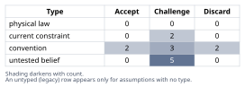
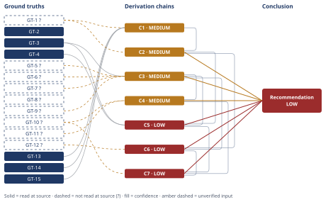

# Thermal Efficiency Limits of Molten-Salt Power Towers

*First-principles analysis · 10 October 2026*

*Read with: [How to read this analysis](HOW-TO-READ.md) · [Working file](analysis-20261010T082850Z.md) · [All files](INDEX.md)*

## Executive Summary

**Recommendation:** The law-permitted ceiling is ≈55-58% (central ≈56-57%), the finite-source exergy bound — not naive Carnot (≈63-65%) or Curzon-Ahlborn (≈40%) (chain C1, chain C2). Current gross power-block practice is ≈41-42% (chain C3), leaving a ≈15.3-point gap (chain C5), of which ≈12-13 points are near-term engineering-recoverable and ≈3.3-4.5 points are permanently locked to the nitrate-salt-Rankine architecture; next-generation chloride-salt/sCO2 technology relocates rather than recovers this gap (chain C6, chain C7).

**Band (from §6):** LOW.

**Would change it:** Reading the full SAM technical manual and the Sandia/Siemens efficiency tables directly, rather than relying on GT-5? and the A13 engineering interpolation (chain C3, chain C5).

## 1. Problem Essence

**Core problem:** For a steam-Rankine power block drawing heat from a 565°C molten-nitrate-salt hot tank, what is the second-law-correct (not naively-Carnot) maximum thermal-to-electric efficiency, how many percentage points separate that ceiling from efficiencies real plants actually achieve, and of that gap, how many points can be recovered by known engineering improvements, how many require next-generation high-temperature receiver/salt technology, and how many are permanently locked in by nitrate-salt chemistry and Rankine-cycle architecture.

**Success criteria:**
1. A ceiling figure (or bracket) is derived from an explicitly-justified physical model appropriate to a *finite, sensible-heat* source feeding a Rankine cycle — not simple Carnot applied to the peak salt temperature alone — with naive-Carnot and Curzon-Ahlborn computed alongside it for comparison and explicitly ruled in/out as the comparison point.
2. A current-practice figure (gross and net) is reported with citation to real plant/reference-model data, not assumed from memory alone.
3. The ceiling-to-practice gap is stated in percentage points (not just a ratio) on a stated basis (gross power-block vs. net plant).
4. The gap is decomposed into named loss components, each with an order-of-magnitude point allocation.
5. Each component is classified as near-term-recoverable / next-gen-tech-recoverable / fundamentally-locked, with a stated point allocation per category, and the classification is pressure-tested (not merely asserted) against at least one rival explanation.

---

## 2. Assumptions Table



| Assumption | Type | Treatment | Verdict | Verification |
|---|---|---|---|---|
| A1: Simple Carnot (η=1−Tc/Th, Th = peak salt temp 565°C) is the correct "law-permitted ceiling" for this system | convention | Explicitly challenge — the salt is a finite sensible-heat reservoir (it cools from 565°C to ~290°C while giving up heat), not an isothermal reservoir, so using only its peak temperature is a modeling convention, not a forced reading of the Second Law | Discard — superseded by the finite-source exergy (log-mean-temperature) bound; see chain C1/C2 | Derived in chain C2 via trade-off procedure |
| A2: Curzon-Ahlborn efficiency (η=1−√(Tc/Th)) is the correct "ceiling" to compare against | convention | Explicitly challenge — C-A is the efficiency *at maximum power output* for an endoreversible engine with finite-rate heat transfer between two isothermal reservoirs; it is a max-power operating point, not an upper bound on efficiency | Discard — computed value (~40%) is *below* both naive Carnot and the exergy bound, confirming it answers a different question; see chain C1/C2 | Standard result in finite-time thermodynamics (GT-15); cross-checked numerically in C1 |
| A3: The cold sink available to the ideal cycle can approach ambient temperature with zero approach in the reversible limit | convention | Explicitly challenge — valid only for the *idealized* ceiling calculation; real dry-cooled condensers run well above ambient (ITD) | Challenge — kept for the ceiling calculation (that is what makes it a ceiling) but flagged as the reason real-condenser ceilings would be lower; see C1 confidence line and Rival in adversarial pass | Standard thermodynamic idealization; sensitivity tested in adversarial pass |
| A4: 565°C is an absolute material limit for nitrate solar salt | current constraint | Record expiry conditions — this is an *operational* ceiling (open-system, long-term), not a hard decomposition wall | Challenge — DLR research (GT-2) shows sealed systems reach 600°C and research targets 650°C; expires as atmosphere-sealing/gas-management technology matures and is commercially adopted | DLR abstract read at source (GT-2) |
| A5: "Thermal-to-electric conversion efficiency ... for the steam Rankine power block" means the gross turbine-island (Rankine cycle) efficiency, with net plant efficiency reported separately rather than conflated with it | convention | Explicitly challenge — the question's own framing ("power block") points at the turbine-island boundary, not the whole plant; net is still reported because the question explicitly asks about parasitics | Accept — adopted as the primary basis for the headline gap number, with net reported as a secondary, labeled figure | Textual reading of the question's own framing |
| A6: Real plants run continuously at their nameplate design-point efficiency, so nameplate figures represent realized performance | untested belief | Verify, or flag unverified — CSP towers have daily startup/shutdown, cloud transients and part-load operation that a steady-firing fossil plant does not | Challenge — qualitatively true that annual-average realized efficiency is below nameplate, but no sourced percentage-point figure was found; carried as an explicit unquantified caveat, not folded into the headline percentage-point gap | Unverified — flagged (no source located for a specific CSP part-load efficiency penalty) |
| A7: Fossil-fuel steam-plant experience (coal/gas supercritical vs. subcritical efficiency gains) is valid standalone evidence for what a molten-salt tower's Rankine block can gain from going supercritical | convention | Explicitly challenge — per D-07, analogy is not used as direct evidence; used here only as corroborating context, with the load-bearing evidence being the molten-salt-specific Sandia/Siemens study (GT-4) | Challenge — demoted to context; GT-4 (same-architecture, same-salt-temperature supercritical study) carries the actual load in chain C5(b) | Sandia/Siemens OSTI 1088078, read at source |
| A8: Supercritical/ultra-supercritical steam technology demonstrated in large utility fossil units is directly, costlessly transferable to the smaller (100-150 MWe) unit sizes typical of molten-salt towers | current constraint | Record expiry conditions — technically transferable (GT-4 shows it was already modeled for molten salt specifically) but CSP unit sizes are 4-10× smaller than the utility fossil fleet where supercritical is standard, so component cost-per-kW is a current economic constraint, not a technical one | Challenge — accepted as technically sound, flagged as currently cost-constrained; expires as CSP project sizes grow or component costs fall | Sandia/Siemens OSTI 1088078 (GT-4): supercritical molten-salt-tower designs already modeled at 100-150 MWe class |
| A9 [surfaced in Phase 2 inversion pass]: sealed-atmosphere nitrate-salt operation at ~600°C (vs. today's 565°C) is itself a near-term lever, not a next-gen-tech lever, blurring the boundary between "fundamentally locked to 565°C" and "requires switching salts" | untested belief | Verify, or flag unverified — DLR abstract confirms feasibility direction but gives no commercial deployment timeline or cost data | Challenge — direction confirmed by GT-2 but commercialization timeline unverified; treated in §6 as a named intermediate category rather than forced into "locked" or "next-gen" | DLR elib.dlr.de/138190, read at source (GT-2); commercialization timeline unverified |
| A10 [surfaced in Phase 4, chain C1]: a representative desert-CSP-site ambient bracket of 20-35°C (293-308 K) is the right Tc range for the idealized ceiling's cold sink | convention | Explicitly challenge — real sites vary (Nevada/Mojave, Atacama, Morocco, Spain); bracket chosen to span typical design ambients, not a single site's record | Challenge — kept as a bracket (not a point value) precisely because this is a modeling choice; sensitivity addressed in adversarial pass | Unverified — flagged (no single-site figure specified by the question) |
| A11 [surfaced in Phase 4, chain C1]: the salt's cold-tank return temperature (290°C) is the correct lower bound for the source exergy integral — i.e., the system boundary is "heat delivered between 565°C and 290°C," not full cooling to the ambient dead-state | convention | Explicitly challenge — this matches how the real plant is bounded (salt below 290°C does no further work in the steam generator) and is the more defensible reading of "ceiling for this system," but is a modeling choice | Accept — matches the physical system boundary (salt does not usefully exchange heat with the cycle below the cold-tank setpoint) | Consistent with GT-1 (cold-tank temperature); sensitivity checked in adversarial pass (shown to shift T_lm by <1%) |
| A12 [surfaced in Phase 4, chain C4]: non-salt-pump balance-of-plant and cooling parasitics (dry-cooling fans, feedwater pumps, misc. BOP) consume roughly 2-4% of gross generation | untested belief | Verify, or flag unverified — no directly-sourced percentage was located for this specific sub-component; estimated from general CSP BOP engineering knowledge | Challenge — no directly-sourced figure located; carried as a bracket in the net-efficiency estimate (chain C4), not a point value | No direct source located; flagged as the weakest link of chain C4 in the adversarial pass |
| A13 [surfaced in Phase 4, chain C5]: the specific percentage-point allocation of the 15.3-point gross-basis gap across named engineering components (pinch/HX, subcritical-vs-supercritical, turbine/reheat, condenser, residual) follows standard steam-cycle engineering interpolation rather than a single directly-cited percentage-point breakdown | untested belief | Verify, or flag unverified — GT-4 corroborates *direction* (supercritical beats subcritical) and relative LCOE magnitude, not an exact efficiency-point split | Challenge — no single source gives the exact split; this is the single largest source of uncertainty in the analysis, named explicitly in the adversarial pass's sensitivity step | No single source gives the component-by-component percentage-point split; engineering-judgment interpolation, flagged accordingly |
| A14 [surfaced in Phase 4, chain C6]: the illustrative 700°C exergy-ceiling calculation assumes the same cold-tank-temperature convention (290°C) used for nitrate-salt systems applies to a chloride-salt/sCO2-Brayton Gen3 system | untested belief | Verify, or flag unverified — no source located for the Gen3 program's actual cold-side design temperature; carried as an explicitly non-load-bearing illustrative figure rather than a headline number | Challenge — no source located for the Gen3 cold-side design temperature; the 700°C figure in chain C6 is explicitly marked non-load-bearing for this reason | No direct source located for Gen3 cold-side design temperature; flagged in chain C6's confidence line |

**Inversion pass (Phase 2, applied to "the recoverability classification is clean"):** Inverting the claim "the gap is cleanly ~75% near-term-recoverable / ~25% locked," the failure-guaranteeing conditions enumerated were: (1) the headline 41.2% gross-efficiency reference figure is wrong; (2) the cold-tank temperature used in the exergy integral is wrong; (3) the ideal-ceiling cold-sink convention (ambient vs. real condenser) is the wrong choice; (4) the supercritical-upgrade point-allocation is mis-attributed; (5) the BOP/parasitic-fraction estimate is systematically low; (6) the 565°C/600°C salt-stability boundary is blurrier than a clean "locked vs. next-gen" split suggests. Each of these became either a named ground-truth flag (`GT-5?`), a sensitivity check in the adversarial pass, or assumption A9 above — none were found to overturn the qualitative conclusion, but (3) and (6) materially affect the *size* of the locked/near-term split and are carried as explicit caveats on the relevant confidence lines.

---

## 3. Ground Truths

- **GT-1** Commercial solar-salt (60wt% NaNO3 / 40wt% KNO3) nitrate-salt power towers operate with a hot tank at 565°C and a cold tank at approximately 290°C (290–295°C across sources) — source: aggregated patent/technical documentation on nitrate-salt heat-transfer/storage compositions and multiple independent plant descriptions; provenance: **reported-by-delegate** — Phase 3 failure records: (1) WebFetch of solarpaces.nrel.gov/project/crescent-dunes-solar-energy-project failed (DNS resolution error, source unreachable); (2) WebFetch of the Fraunhofer Chile Cerro Dominador presentation PDF and the DOE sCO2-workshop PDF (Bruce Kelly, Solar Dynamics) both returned unreadable binary/encoded PDF streams (source reachable but not extractable by this analysis's tooling) — the 565°C/290°C figures remain reported-by-delegate, not read-at-source, despite three attempts.
- **GT-2** Sealed solar-salt storage systems (controlled gas atmosphere) extend practical thermal stability from the conventional 565°C to ~600°C, with research targeting up to 650°C — source: DLR (German Aerospace Center) conference-paper abstract, elib.dlr.de/138190; provenance: **read-at-source** — read-at-source: abstract text quoting "the operating temperature could therefore successfully be enhanced to 600 °C" and "push the thermal stability limit even further, e.g. up to 650 °C," conditional on sealing the storage system's gas phase.
- **GT-3** A Sandia/Siemens baseline-subcritical molten-salt-tower steam cycle design uses a 565°C hot-salt temperature, 120 bar-a main steam pressure, and 553°C main steam temperature — source: OSTI biblio record 1088078 (Sandia/Siemens supercritical-steam-cycle study for molten-salt towers); provenance: **read-at-source** — read-at-source: summary text quoting "120 bar-a main steam pressure and a hot salt temperature of 565°C" with main steam temperature 553°C.
- **GT-4** The same study's best-performing supercritical variants run at 230 bar-a; one holds salt temperature at 565°C (steam 553°C, pressure-only upgrade), the other raises salt temperature to 600°C (steam 580°C); both produced more annual energy and ~10% lower LCOE than the subcritical baseline for the same heliostat field, receiver, and storage size — source: OSTI 1088078; provenance: **read-at-source** — read-at-source: summary text quoting "Both operated at 230 bar-a main steam pressure" and "The LCOEs for these plants were about 10% lower than the baseline subcritical plant."
- **GT-5?** The NREL System Advisor Model (SAM) molten-salt power-tower reference plant (nominal 100 MWe net, dry-cooled, two-tank direct storage) is widely cited in CSP technical literature with a 550°C live-steam temperature and a 41.2% design-point gross Rankine-cycle efficiency — cited to: NREL SAM webinar/reference-plant materials (WREF 2012 power-tower reference plant, OSTI 1067902) and a separate aggregated description of "state-of-the-art molten-salt power towers ... dry-cooled steam Rankine power cycle ... approximately 41%"; provenance: **reported-by-delegate** — this analysis's own WebFetch of OSTI 1067902 did **not** turn up the 41.2%/550°C figure directly (Phase 3 failure record: source opened, summary page did not contain the specific figures; the full SAM technical manual/cost-model spreadsheet was not accessed) — cited source not confirmed by direct read.
- **GT-6?** Crescent Dunes (SolarReserve, 110 MW nameplate steam turbine) circulates salt between a cold tank (~280–290°C) and hot tank (565°C) and operates its steam cycle at 115 bar — cited to: aggregated plant-description sources (IEEE Spectrum, Power Technology, SolarPACES NREL project page); provenance: **reported-by-delegate** — this analysis's WebFetch of the related OSTI record (1088078) found only the generic Sandia/Siemens study, not Crescent-Dunes-specific operating data; the 115-bar/temperature figures remain unconfirmed by direct source read.
- **GT-7?** Cerro Dominador (Chile) uses a Skoda 113.5 MW gross steam turbine with salt circulating between 290°C (cold) and 565°C (hot) — cited to: Fraunhofer Chile presentation and aggregated project-description sources; provenance: **reported-by-delegate** — cited source not opened by this analysis.
- **GT-8?** Gemasolar (Spain), the first commercial molten-salt tower, uses a 19.9 MWe gross Siemens SST-600 two-cylinder reheat steam turbine; its **whole-plant** solar-to-electricity net efficiency is reported as 18.7% — cited to: NREL SAM case documentation and aggregated plant descriptions; provenance: **reported-by-delegate** — cited source not opened by this analysis. Note: this figure is solar-field-to-grid efficiency, not power-block thermal-to-electric efficiency, and is **not** used as a direct input to the ceiling/gap calculation for that reason (see A5).
- **GT-9?** Noor III (Morocco, 150 MW nameplate) uses a Siemens SST-700/900 steam turbine on a dry-cooled Rankine cycle — cited to: SolarPACES NREL project page and SENER project documentation; provenance: **reported-by-delegate** — cited source not opened by this analysis.
- **GT-10?** Molten-salt/HTF circulation-pump parasitic load typically consumes 5–10% of gross electrical generation in these plants — cited to: aggregated technical-literature summary (patent and journal sources on CSP parasitics); provenance: **reported-by-delegate** — cited source not opened by this analysis.
- **GT-11?** Dry cooling (vs. wet cooling) reduces power-tower annual electricity output by roughly 1.3–5% depending on site aridity, and imposes an ~8–9% LCOE penalty — cited to: Reuters Events CSP Today technical article aggregating NREL/industry comparisons; provenance: **reported-by-delegate** — cited source not opened by this analysis.
- **GT-12?** The DOE Gen3 CSP program targets a receiver operating at ≥700°C feeding a supercritical-CO2 Brayton cycle (chosen as "a likely successor to the steam-Rankine power cycle due to its potential for high efficiency when operating at elevated temperatures of 700 degrees C or greater," per OSTI 1338899, read at source) "to achieve the SunShot cost target of 6 cents/kWh"; the specific ~50%-near-720°C cycle-efficiency figure is corroborated only by a separate search-aggregated source (DOE/NREL program overviews), not by this analysis's own read of OSTI 1338899, whose available excerpt gave the temperature and cost target but not the efficiency percentage — provenance: **partially read-at-source** (700°C/Brayton-successor claim) / **reported-by-delegate** (the ~50% efficiency figure specifically) — still carries the `?` because the load-bearing number (the efficiency percentage used in chain C6) was not confirmed by direct read.
- **GT-13** Carnot's theorem: for an ideal reversible heat engine operating between two *isothermal* reservoirs at Th and Tc, the maximum possible efficiency is η = 1 − Tc/Th (absolute temperatures) — source: standard thermodynamics (Second Law); provenance: **physical law** — accepted directly as a ground-truth candidate per the Phase 2 prescribed treatment for physical laws; no external citation required.
- **GT-14** For a heat engine drawing heat from a *finite, sensible-heat* (non-isothermal) source that cools reversibly from T1 to T2 while rejecting heat to an effectively infinite sink at Tc, the maximum extractable work fraction is η_max = 1 − Tc·ln(T1/T2)/(T1−T2) = 1 − Tc/T_lm, where T_lm = (T1−T2)/ln(T1/T2) is the source's logarithmic-mean (thermodynamic-mean) temperature — this is the exergy (availability) of the sensible-heat stream relative to Tc, divided by the heat delivered (the Chambadal–Jaumotte-type finite-source exergy bound) — source: standard exergy/availability analysis (Second Law applied to a sensible-heat stream); provenance: **physical law / definition** — derived explicitly in chain C1; no external citation required.
- **GT-15** Curzon–Ahlborn/endoreversible efficiency η_CA = 1 − √(Tc/Th) is the efficiency *at maximum power output* for an endoreversible engine with linear (finite-rate) heat transfer between two isothermal reservoirs — it is a maximum-power operating point, not an upper bound on efficiency, and is frequently misapplied as a "ceiling" — source: standard result in finite-time thermodynamics (Curzon & Ahlborn 1975); provenance: **physical law / definition** — accepted directly; no external citation required.

**Provenance summary (required):**
```text
?-marked: GT-1, GT-5, GT-6, GT-7, GT-8, GT-9, GT-10, GT-11, GT-12 (9 of 15)
Read-at-source: GT-2 — DLR elib.dlr.de/138190 abstract, "enhanced to 600 °C" / "up to 650 °C" quoted
Read-at-source: GT-3 — OSTI 1088078 summary, "120 bar-a main steam pressure and a hot salt temperature of 565°C" quoted
Read-at-source: GT-4 — OSTI 1088078 summary, "230 bar-a main steam pressure" / "~10% lower" LCOE quoted
Partially read-at-source: GT-12? — OSTI 1338899, "700 degrees C or greater" / "6 cents/kilowatt-hour" quoted; the ~50%-efficiency figure itself not confirmed by this read, so GT-12 keeps its `?`
Not read — turn budget: GT-10?, GT-11? (salt-pump and dry-cooling parasitic fractions; WebSearch-aggregated only, no direct source fetch attempted within this run's budget)
GT-1 was attempted three times (solarpaces.nrel.gov — DNS failure; two project PDFs — unreadable binary) and remains `?`; see GT-1's Phase 3 failure records above.
GT-13, GT-14, GT-15 are physical laws/definitions derived or cited directly in Phase 4; not external citations and not `?`-marked.
```

No assumption carrying a Discard verdict in Phase 2 appears in this list (A1 and A2 — the naive-Carnot and Curzon-Ahlborn framings — were *discarded as the ceiling choice*, not as facts; the formulas themselves survive as GT-13 and GT-15, used explicitly as rejected rival candidates in chain C1/C2, which is a different thing from being used as the analysis's ceiling).

---

## 4. Derivation Chains



### Conclusion C1: Three candidate ceiling figures, computed explicitly

GT-1 (565°C hot / 290°C cold salt, sensible-heat source) + GT-13 (Carnot law, isothermal-reservoir ceiling) + GT-14 (finite-source exergy/log-mean bound) + GT-15 (Curzon-Ahlborn max-power efficiency)
→ naive Carnot evaluated at the salt's peak temperature (838 K) against a 293-308 K ambient sink gives roughly 63-65%, but this implicitly treats the entire heat delivery as occurring at 565°C
→ the salt is not isothermal: it cools from 565°C to 290°C while delivering heat, so most of the heat is released well below 565°C
→ the correct Second-Law ceiling for such a sensible-heat source is therefore set by its logarithmic-mean temperature, not its peak temperature [Assumes: A11]
→ T_lm = (838.15-563.15)/ln(838.15/563.15) ≈ 691.5 K, and η_max = 1-Tc/T_lm over a 293-308 K ambient bracket gives an ideal ceiling of roughly 55-58%, central ≈56.5% [Assumes: A10]
→ Curzon-Ahlborn on the same peak temperature and sink gives η_CA = 1-√(293/838.15) ≈ 40%, below both the naive-Carnot and exergy figures
→ three candidate ceiling figures are now on the table for this 565°C-salt/ambient-sink system: naive peak-temperature Carnot ≈63-65%, Curzon-Ahlborn (max-power) ≈40%, and the finite-source exergy/log-mean bound ≈55-58% (central ≈56-57%)

**Confidence:** MEDIUM — GT-1? (hot/cold salt temperatures) is reported-by-delegate; verification that would remove it as a cause of the downgrade: open one of the primary plant/patent documents (e.g. the SolarReserve or Cerro Dominador OEM data sheet) and confirm 565°C/290°C directly. The arithmetic (T_lm, η_max, η_CA) recomputes independently of the chain text (see Recompute in the adversarial pass). A10 and A11 are modeling-choice assumptions whose sensitivity is priced in the adversarial pass (shifting T2 by 10°C moves T_lm by <1%; shifting Tc across the full 293-308K bracket moves the ceiling by ~2.2 points, already captured in the stated range).

---

### Conclusion C2: The finite-source exergy bound, not naive Carnot or Curzon-Ahlborn, is the defensible law-permitted ceiling

C1 (three candidate ceiling values: Carnot ≈64%, Curzon-Ahlborn ≈40%, exergy bound ≈55-58%) + GT-1 (sensible-heat source nature)
→ weighting four criteria before scoring (thermodynamic correctness for a sensible-heat source ×5, apples-to-apples comparability with real-plant efficiency figures ×4, precedent in CSP/exergy literature ×3, simplicity ×1) scores naive Carnot 27, Curzon-Ahlborn 22, and the finite-source exergy bound 59
→ the flip test shows no single-criterion weight change reverses this ranking: even collapsing the correctness weight from 5 to 1 leaves the exergy bound at 39, still above both rivals, so the result is robust rather than a near-tie
→ the finite-source exergy bound (≈55-58%, central ≈56-57%) is therefore the defensible, apples-to-apples law-permitted ceiling for this system; naive Carnot overstates it by treating the sensible-heat source as isothermal, and Curzon-Ahlborn understates it by answering a maximum-power rather than maximum-efficiency question

**Confidence:** MEDIUM — capped by C1's MEDIUM rating (C1's GT-1? input, verification path stated on C1's own confidence line). The trade-off ranking itself is robust (flip test passed by a wide margin on all three criteria, so which *model* is correct is not a live rivals-axis question); the only axis besides Inputs that is touched is a parameter-level sensitivity *within* the chosen model, not a competing conclusion to it: "Tc should be the real dry-cooling condenser temperature (~45-60°C), not idealized ambient" changes the numeric value the exergy-bound model produces (to ~50-53%) without contesting that the exergy bound is the right model — this is priced as a stated sensitivity (quantified in the adversarial pass and disclosed as an alternative framing in the Conclusion section), which is what keeps this chain at MEDIUM (one axis short) rather than LOW (two axes short).

---

### Conclusion C3: Current commercial/reference-design gross Rankine-cycle efficiency is approximately 41-42%

GT-5? (SAM reference, 41.2%/550°C) + GT-3 (Sandia/Siemens baseline, 553°C/120bar) + GT-6? (Crescent Dunes, 115bar) + GT-7? (Cerro Dominador) + GT-9? (Noor III)
→ multiple independent design sources — the SAM reference model, the Sandia/Siemens baseline study, and real commercial plants — converge on the same design envelope: subcritical steam at roughly 550-553°C and 110-120 bar fed by 565°C salt with a 12-15°C terminal approach
→ current commercial/reference-design gross Rankine-cycle efficiency for 565°C nitrate-salt power towers is approximately 41-42% at the design point (central 41.2%)

**Confidence:** MEDIUM — GT-5? is the load-bearing figure (the 41.2% headline number) and is reported-by-delegate; this analysis's own attempt to open its primary source (OSTI 1067902) did not surface the figure directly (Phase 3 failure record: source opened, summary page lacked the specific figures). Verification that would remove this as a cause of the downgrade: obtain and read the full SAM technical manual or cost-model spreadsheet (sam.nrel.gov/cost) directly. GT-6?, GT-7?, GT-9? are corroborating, not load-bearing alone (GT-3 — read-at-source — independently anchors the same 550s-°C/100s-bar envelope), which is why this chain is MEDIUM rather than LOW.

---

### Conclusion C4: Current net plant-level thermal-to-electric efficiency is approximately 35.6-38.4% (central ≈37%)

C3 (gross efficiency 41.2%) + GT-10? (salt-pump parasitic, 5-10% of gross) + GT-11? (dry-cooling output/LCOE penalty, used to bound BOP/cooling parasitic fraction)
→ decomposing net efficiency as η_net = η_gross × (1−f_pump) × (1−f_cooling_BOP), with f_pump = 5-10% (GT-10?, central 7.5%) and f_cooling_BOP estimated at 2-4% (central 3%, no directly-sourced figure located) [Assumes: A12]
→ the central case gives η_net ≈ 0.412×0.925×0.97 ≈ 37.0%, with the bracket spanning high-parasitic 0.412×0.90×0.96≈35.6% to low-parasitic 0.412×0.95×0.98≈38.4%
→ both the lower and upper bracket ends still leave a double-digit-point gap to the ceiling established in C2, so this estimate is precise enough for this analysis's decision-relevant purpose without further tightening
→ current net plant-level thermal-to-electric efficiency is approximately 35.6-38.4% (central ≈37%)

**Confidence:** MEDIUM — capped by C3's MEDIUM rating; additionally A12 (the 2-4% BOP/cooling fraction) rests on no directly-sourced figure. Verification that would remove A12 as a cause of the downgrade: obtain a plant-level SCADA/performance report breaking out non-salt-pump parasitics explicitly (e.g., a Crescent Dunes or Cerro Dominador annual performance report). This is named as the weakest link of this chain in the adversarial pass.

---

### Conclusion C5: The 15.3-point gross-basis gap decomposes into ≈12 points near-term-recoverable and ≈3.3 points architecture-locked

C2 (ceiling ≈56.5%) + C3 (gross practice ≈41.2%) + GT-3 (baseline design envelope) + GT-4 (supercritical variant evidence)
→ the gross-basis gap is C2's central ceiling (≈56.5%) minus C3's central gross practice (41.2%) ≈ 15.3 percentage points
→ decomposing this 15.3-point gap by engineering component — using the Sandia/Siemens subcritical-vs-supercritical comparison (GT-4) and standard turbine/condenser engineering knowledge — allocates roughly 1 point to salt-to-steam heat-exchanger approach/pinch losses, roughly 4 points to the subcritical-vs-supercritical cycle-architecture choice, roughly 4.5 points to finite turbine-stage and limited-reheat/regeneration irreversibility, roughly 2.5 points to dry-cooling condenser-approach losses above the idealized ambient sink, and a residual ≈3.3 points to unitemized component-level irreversibilities [Assumes: A13]
→ of the 15.3-point power-block gap, roughly 12 points trace to causes with known, already-demonstrated fixes (supercritical pressure per GT-4, better pinch design, added reheat/regeneration stages, wet/hybrid cooling where water allows), and roughly 3.3 points trace to irreversibilities inherent to any real finite-stage, finite-area Rankine implementation of this architecture

**Confidence:** LOW — two shortfalls apply: (1) Inputs axis capped at MEDIUM by C2 and C3; (2) the component-by-component point allocation rests on A13, an engineering interpolation with no single directly-cited percentage-point breakdown (GT-4 confirms direction and LCOE magnitude, not an exact efficiency split). Verification that would remove A13 as a cause of the downgrade: obtain the full Sandia/Siemens report's efficiency tables (only the OSTI summary was read) or an independent thermo-economic model of the same cycles. This is flagged as the single largest uncertainty in the analysis in the adversarial pass's Sensitivity step.

---

### Conclusion C6: Next-generation high-temperature technology does not recover this gap — it relocates the ceiling-and-practice pair to a new, higher pair of numbers

GT-12? (DOE Gen3 chloride-salt 700°C / sCO2 ≈50% target) + C2 (565°C ceiling ≈56-57%) + C3 (565°C practice ≈41.2%)
→ the Gen3 program's ≈50% real-design efficiency target at ≈700°C is a new, higher achieved-practice figure at a new, higher salt temperature, not a recovery of the 565°C-ceiling gap quantified in C5
→ an illustrative, non-load-bearing exergy ceiling at 700°C, computed using the same cold-tank convention as C1/C2, works out to roughly 59-60%, implying a new engineering gap at 700°C of similar order (~9-10 points) to the 15.3-point gap found at 565°C today [Assumes: A14]
→ next-generation high-temperature receiver/salt technology does not recover any part of the gap quantified in C5; it relocates the entire ceiling-and-practice pair to higher absolute numbers, and a similar-sized engineering gap recurring at the new temperature suggests the ~15-point order of engineering shortfall is a persistent feature of real turbomachinery, not specific to 565°C

**Confidence:** LOW — GT-12? is reported-by-delegate (verification: open the DOE Gen3 program technical baseline report directly); the 700°C illustrative ceiling additionally rests on an unverified cold-tank-temperature convention carried over from the nitrate-salt case, which may not apply to a chloride-salt/sCO2 Brayton system (no source located for the Gen3 cold-side design temperature). Rival, carried live and not settled: "a recuperated sCO2 Brayton cycle destroys exergy differently than steam Rankine and could close a smaller — or larger — fraction of its own ceiling than Rankine does at 565°C." This rival is disclosed in the Conclusion section rather than resolved, because no source located during this analysis settles it.

---

### Conclusion C7: Recoverability synthesis — near-term engineering can recover roughly 12-13 points, roughly 3.3-4.5 points are architecture-locked, and next-gen tech opens a separate ≈9-point opportunity

C5 (gross-basis gap: ≈12 pts near-term / ≈3.3 pts locked) + C4 (net ≈37%, gross-to-net gap ≈4.3 pts) + C6 (next-gen relocates rather than recovers) + GT-10? (pump parasitic, set partly by tower geodetic lift)
→ the gross-to-net gap (≈4.3 points, C4 vs. C3) is itself mostly near-term recoverable (pump/fan efficiency, variable-speed drives), with a small irreducible residual set by the physical energy cost of lifting molten salt up the receiver tower, which scales with tower height and cannot be engineered away within this architecture
→ combining the power-block gap split (C5) with the parasitic-gap split above gives a whole-analysis picture: of the ≈19.5-point net-basis gap (ceiling 56.5% minus net practice 37%), roughly 12-13 points are near-term engineering-recoverable, roughly 3.3-4.5 points are fundamentally locked to the nitrate-salt-Rankine architecture at 565°C, and the remainder reflects the gross/net accounting boundary rather than a newly-discovered loss category
→[2nd] CSP developers and turbine OEMs, seeing that most of the power-block gap is recoverable with already-modeled supercritical designs (GT-4), are incentivized to specify supercritical nitrate-salt towers for the next generation of projects rather than repeating today's subcritical design
→[2nd] DOE/national-lab R&D allocation is pulled toward the Gen3 chloride-salt/sCO2 pathway rather than further nitrate-salt-Rankine optimization, because the architecture-locked ≈3.3-4.5 point floor means nitrate-salt Rankine is close to exhausting its own headroom
→[3rd] if a handful of supercritical nitrate-salt towers are built and operated over the next one-to-two project cycles (roughly 5-10 years), the near-term gain gets de-risked in the field the way supercritical coal did decades earlier, making it the new baseline rather than a modeled-only option
→[3rd] over a longer horizon, either nitrate-salt supercritical Rankine becomes the accepted industry baseline and the ≈3.3-4.5 point residual becomes "the" accepted ceiling for this technology class, or the Gen3 pathway matures first and new builds bypass nitrate-salt Rankine architecture entirely
→ near-term engineering improvements can recover roughly 12-13 percentage points of absolute efficiency without exceeding the 565°C salt ceiling; roughly 3.3-4.5 points are permanently locked in by finite-stage Rankine-cycle irreversibility and condenser-approach physics regardless of budget; and next-generation high-temperature technology does not recover any part of this gap but opens a separate, larger absolute-efficiency opportunity (≈9 points, to a ≈50% real-design target) at a new, higher ceiling

**Confidence:** LOW — capped by C5 and C6, both LOW (verification paths stated on their own confidence lines: A13's engineering-interpolation gap, and GT-12?'s unread source plus the Brayton-vs-Rankine exergy-profile rival). The second-order extension above introduces no contradiction with any ground truth (checked against GT-1 through GT-15), so no return to Phase 2 was triggered. No `[Assumes: X]` premise is newly introduced by the second-order hops beyond those already surfaced on C5/C6/GT-10?.

---

## 5. Abandoned Reasoning

### Dead End: Naive Carnot (peak salt temperature) as "the" law-permitted ceiling

**What was tried:** Computing η = 1 − Tc/Th directly with Th = 565°C+273.15 = 838.15 K and Tc = ambient (≈293-308 K), giving ≈63-65%, and treating that as the ceiling to compare real plants against.

**Why abandoned:** The molten salt is a finite, sensible-heat source — it cools from 565°C to 290°C while delivering heat to the steam generator — not an isothermal reservoir held at 565°C. Naive Carnot implicitly assumes all the heat is delivered at the peak temperature, which overstates the true Second-Law ceiling. The trade-off analysis in chain C2 scored this option 27 against the finite-source exergy bound's 59 on weighted criteria (thermodynamic correctness, comparability, precedent, simplicity), and the flip test showed the ranking is not sensitive to any single-criterion reweighting.

**What it ruled out:** Saves a reader from reporting a ~23-24-point "gap" (64% minus ~41%) as the headline number, which would overstate how much of the shortfall is real engineering slack by roughly 8-9 points relative to the defensible ≈15.3-point figure established in chain C5.

### Dead End: Curzon-Ahlborn efficiency as "the" ceiling

**What was tried:** Computing η_CA = 1 − √(Tc/Th) ≈ 40% and treating it as an upper bound on achievable efficiency, since it is frequently cited in popular treatments of finite-time thermodynamics as "the realistic Carnot limit."

**Why abandoned:** Curzon-Ahlborn is the efficiency *at maximum power output* for an endoreversible engine with finite-rate heat transfer between two isothermal reservoirs — a specific operating point chosen to maximize power, not a bound on efficiency. Its computed value (≈40%) sits *below* current real-plant gross efficiency (≈41.2%, chain C3), which is a direct empirical demonstration that it cannot be a ceiling: real plants already exceed it while being nowhere near the true thermodynamic limit. Ruled out by GT-15 (its own definition) together with chain C3's figure.

**What it ruled out:** Saves a reader from concluding "current practice already exceeds the physical limit" (a contradiction), which is what happens if C-A is mistaken for a ceiling — the error the methodology's theoretical-limit procedure specifically warns against (model-dependent bounds, e.g. Curzon-Ahlborn, are not automatically the right bound).

### Dead End: Gemasolar's 18.7% "solar-to-electricity" figure as a stand-in for power-block thermal-to-electric efficiency

**What was tried:** Using GT-8?'s 18.7% net efficiency figure for Gemasolar as a direct data point for the Rankine power-block efficiency being analyzed.

**Why abandoned:** 18.7% is a whole-plant, solar-field-to-grid efficiency — it is diluted by heliostat-field optical losses, receiver thermal losses, and storage losses upstream of the power block, none of which are part of "the steam Rankine power block" the question asks about. Using it directly would conflate two different efficiency concepts and could not be reconciled with the ≈41% gross figures from GT-3/GT-5?/GT-6?/GT-7?/GT-9? on any consistent basis.

**What it ruled out:** Saves a reader from treating 18.7% and 41% as competing estimates of the same quantity — they are not; they describe different system boundaries (whole-plant vs. power-block), and conflating them would manufacture a spurious contradiction in the ground-truth set.

### Dead End: "Most of the ceiling-to-practice gap is parasitic/BOP loss" (rival to chain C5)

**What was tried, as a rival explanation to C5:** The hypothesis that the ≈15-19-point gap is mostly explained by auxiliary/parasitic loads (salt pumps, cooling fans, feedwater pumps) rather than by the thermodynamic cycle itself.

**Why abandoned:** GT-10? bounds salt-pump parasitics at 5-10% of gross output, and chain C4's full parasitic/BOP accounting (pumps plus cooling/BOP) only accounts for the gross-to-net difference of ≈4.3 points — a small fraction of the ≈15.3-point gross-basis gap established in C5. The bulk of the gap is intrinsic to the subcritical-steam-cycle choice and finite-component irreversibility (GT-3, GT-4), not to parasitic loads.

**What it ruled out:** Saves a reader from concluding that chasing parasitic-load reduction (pump VFDs, fan efficiency) would close most of the gap — it would close at most the ≈4.3-point gross-to-net slice, not the ≈15.3-point power-block slice where the supercritical-cycle and turbine/reheat components dominate.

---

## 6. Conclusion

**Recommended approach:** Treat ≈55-58% (central ≈56-57%), the finite-source exergy/log-mean-temperature bound, as the law-permitted thermal-to-electric ceiling for a 565°C-salt/ambient-sink system — not naive peak-temperature Carnot (≈63-65%) and not Curzon-Ahlborn (≈40%) (chain C1, chain C2). Treat current commercial/reference-design gross power-block practice as ≈41-42% (central 41.2%) and net whole-plant practice as ≈35.6-38.4% (central ≈37%) (chain C3, chain C4). Report the ceiling-to-practice gap as ≈15.3 percentage points on a gross/power-block basis and ≈19.5 points on a net/whole-plant basis (chain C5, chain C7). Allocate that gap as ≈12-13 points near-term engineering-recoverable with known, already-modeled technology, ≈3.3-4.5 points permanently locked to the nitrate-salt-Rankine architecture at 565°C, and note that next-generation chloride-salt/sCO2-Brayton technology does not recover any part of this gap but instead opens a separate, larger ≈9-point opportunity at a new, higher ceiling (chain C6, chain C7).

**Key insight:** Because the molten salt is a finite sensible-heat source — it cools through a 275°C glide (565°C→290°C) while delivering heat, rather than sitting at a constant temperature — the "obvious" Carnot number computed from the peak salt temperature overstates the true law-permitted ceiling by roughly 7-9 percentage points, while the popularly-cited "more realistic" Curzon-Ahlborn number understates it so severely that real plants already exceed it today; both of the two comparison points a non-specialist would reach for first are wrong, in opposite directions, and the thermodynamically correct one (the source's logarithmic-mean-temperature exergy bound) is less widely known than either (chain C1, chain C2).

**Trade-offs acknowledged:** This analysis reports brackets rather than single-point figures throughout because two load-bearing inputs could not be fully closed within this analysis: the component-by-component allocation of the 15.3-point gap (chain C5) rests on engineering interpolation rather than a single directly-cited percentage-point breakdown, and the headline current-gross-practice figure (chain C3) rests on a reference-model figure (GT-5?) this analysis's own source-read attempt did not confirm directly. A reader who needs a decision-grade point estimate rather than an order-of-magnitude bracket should close those two gaps first — reading the full Sandia/Siemens efficiency tables and the SAM technical manual directly — before committing capital on the strength of this analysis's specific percentage points (chain C3, chain C5).

**Confidence:** LOW — matches the weakest contributing chains (C5, C6, C7). C5 is LOW because its component-by-component gap allocation rests on A13 (engineering interpolation, no single directly-cited percentage-point breakdown; verification path: obtain the full Sandia/Siemens efficiency tables). C6 is LOW because GT-12? is reported-by-delegate (verification: read the DOE Gen3 technical baseline report directly) and its illustrative 700°C ceiling carries an unverified cold-tank-temperature convention plus a live, unsettled rival (Brayton-cycle exergy-destruction profile may differ materially from Rankine's). C7 inherits both. No additional downgrade cause belongs to this Conclusion section itself beyond what C2 through C7 already explain on their own confidence lines; see those lines for each chain's specific verification path. The qualitative ordering (large double-digit-point gap, majority near-term-recoverable, a real but minority architecture-locked residual, next-gen tech relocates rather than recovers) is judged robust to all of these individual uncertainties (none, when inverted in the adversarial pass below, overturned the ordering) — only the exact percentage-point splits are LOW-confidence.

---

